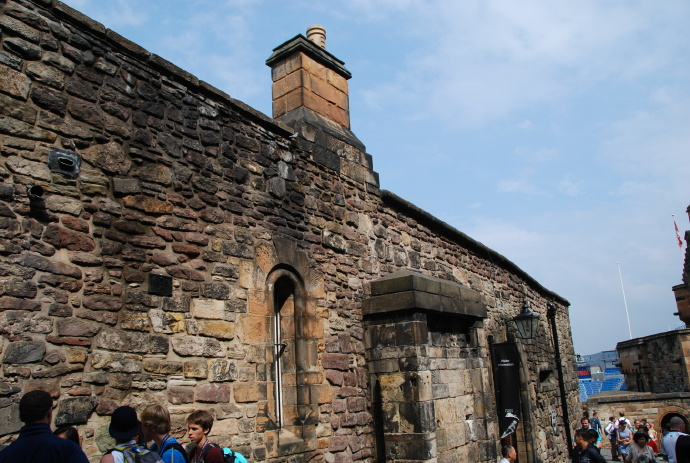
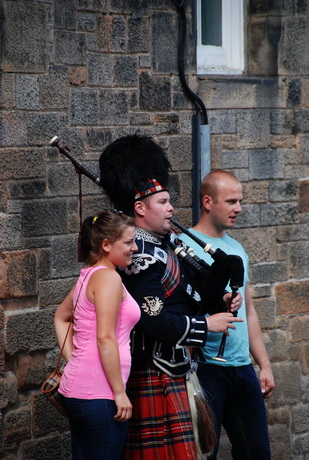
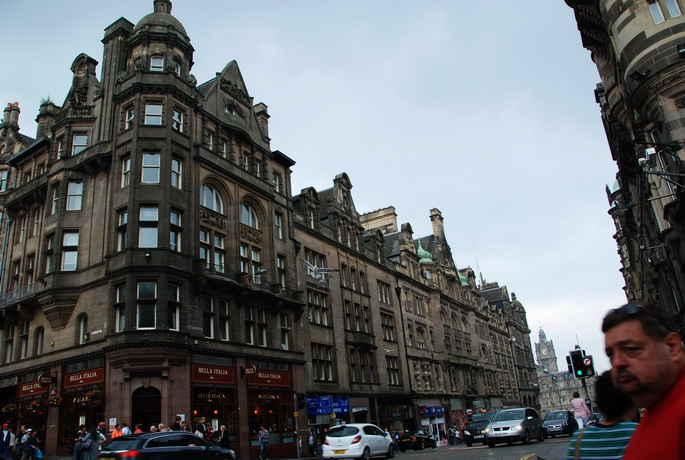
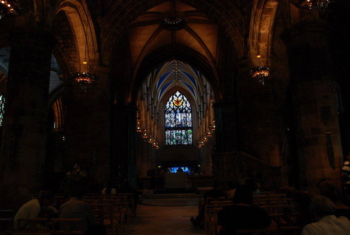
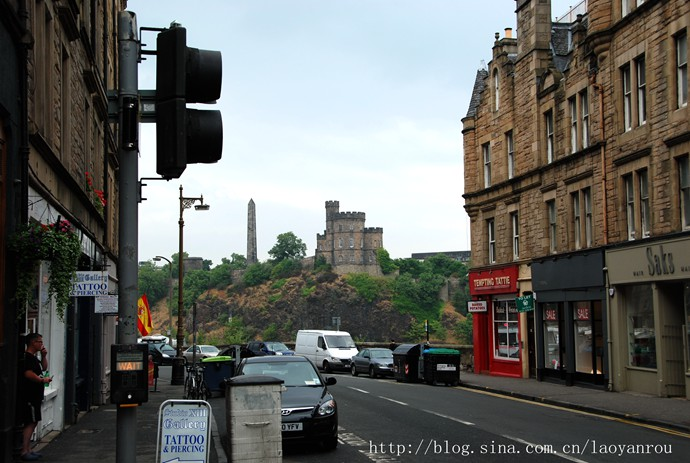

# 欧游札记之英国大学路(第一日 爱丁堡一瞥)

  
  
引子

老腌肉我本乃一静若处子之人，基本属于苟谈言笑的无趣大叔之流，但岁月荏苒、青春已逝后却依然感觉到心中总有那么一种悸动，不断在耳边呢喃怂恿着我出去外面看看。于是乎便在旅游攻略、穷游达人和老板开恩准假的帮助下踏上了追寻异域风情的漫漫长路，这趟旅程何时结束无从知晓，但它的起点确是从英国大学路之旅开始的。

第一日 爱丁堡一瞥

七月流火的某日，我们搭上了周一晚阿联酋航空的班机历经漫长的七个半钟抵迪拜，在四个小时中转候机后痛苦地发现仍需在飞往格拉斯哥的航班上继续煎熬七个半钟。于是航程期间整个人的生存状态被基本设定在吃饱了睡、睡饱了再吃的养猪循环模式。

终于，北京时间19：30，历经近二十小时航程的我们抵达苏格兰格拉斯哥。说实话格拉斯哥的机场无论从规模还是硬件设施上来说和国内大城市的机场均无可比性，出飞机后所穿过的机场到达通道也仿佛一临时走廊而已，似乎与其苏格兰第一大城市的身份不尽相符，但不得不承认其内部也还算精致洁净。

还没缓过神便被导游带出机场塞上旅游大巴直奔爱丁堡，其沿途均为典型苏格兰田园风光，多牧场鲜草及牛羊。抵爱丁堡后主要行程是从外部观赏爱丁堡皇家城堡，这里曾是苏格兰皇室居住地，由红砂岩堆砌而成，三面黑岩峭𤩹、一面入堡斜坡，内外城墙双层防御，易守难攻，不得不佩服苏格兰先人的择地眼光。由于时间有限仅有一个钟未能入堡详观，唯有在堡外驻足远观并照相若干，也只能留个遗憾待以后补偿吧（另：城堡八月份开音乐节，规模盛大，从城堡外观众席数目规模可见一斑）。

  
  

出爱丁堡沿皇家一里路直下，街面均为砂岩铺路，齐整大方，沿街大部分为红砂岩歌特式或罗马式建筑，尽管不完全都是文物，但现代文明的污染已将新建筑做旧和老建筑悄然混然溶为一体，整条街弥漫着中世纪的文化气息，在街头走着若不是来来往往的现代着装的人群和沿街卖现代苏格兰工艺品和苏格兰裙子的商铺，还真是恍若穿越回古代苏格兰了。

  
  
  
  
  
  
  

游毕爱丁堡便被大巴直接拉回格拉斯哥入住克莱德区皇冠假日假日酒店。酒店沿河，对面为格拉斯哥的科学中心和苏格兰BBC电视台大楼，是时天阴，无特别观感。一天舟车劳顿，我们九时便累极入睡，而此时窗外仍未天黑。
