# 欧游札记之英国大学路(第二日格拉斯哥大学&温德米尔湖)

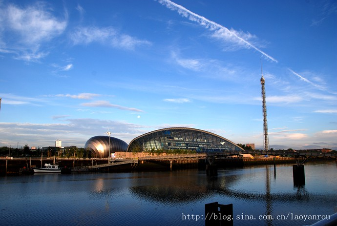

格拉斯哥科学中心

第二日 格拉斯哥大学&温德米尔湖

时差作怪，当地时间清晨四时半我们全已自然醒且毫无倦意，终究不幸被导游言中了。五时洗漱完毕见窗外己亮晨曦微现，便拎上相机下楼散步。阵阵凉风迎面袭来，外面风景己和昨晚所见大相径庭，只见晴朗微醺的天空中霞光初现，白云如丝絮般旋转缠绕，河两岸建筑沐浴在淡红的朝霞中与水中倒影惺惺相对，甚是静谧美好。朝阳升起后，BBC大楼和科学中心清晰可见，宛如披上一层薄薄的金纱，蔚蓝天空中的云朵悄然幻化，如团似锦，蔚为壮观！​

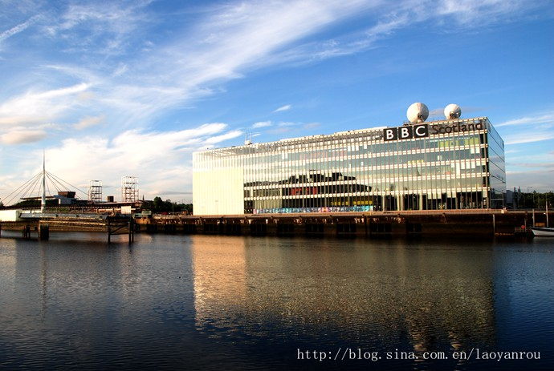

格拉斯哥BBC广播大楼

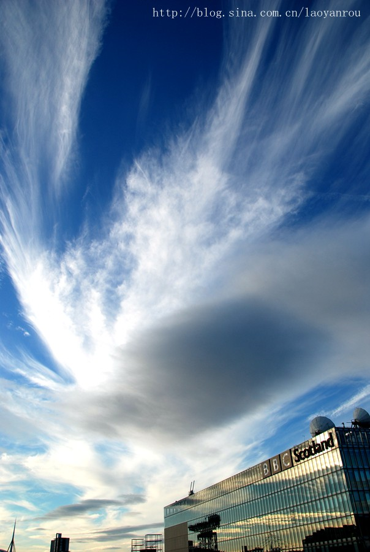

格拉斯哥BBC广播大楼

早餐后赴格拉斯哥大学，这座全英排名第四的古老大学，排其前面三位的仅为牛津、剑桥和圣安德鲁斯而已。第一眼看见该校颇为震撼，清一色高大雄伟的歌特式建筑，与其说它是学校不如说它是一座中世纪的欧洲古堡，不愧为全英第四古老大学，在全球排第五十名也理所当然。而从该校走出来的名人校友不仅包括《富国论》作者亚当史密斯、蒸汽机发明者瓦特，甚至还有曾叱咤香港政坛的女性叶刘淑仪等等。前两位还有其他知名的已过身校友的名字均被挂在校门上供人景仰，非常特别的纪念方式。

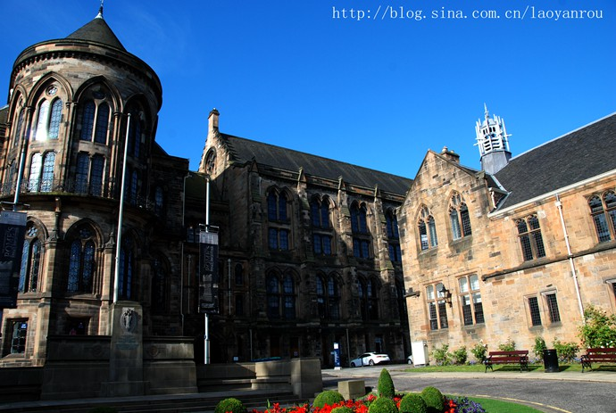

格拉斯哥大学

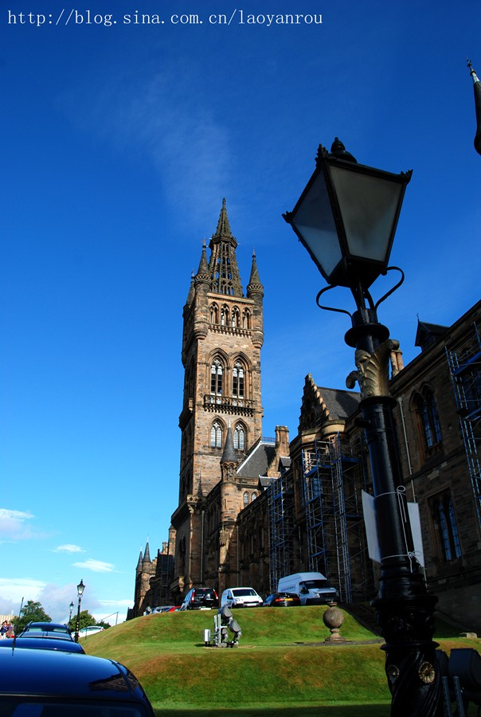

格拉斯哥大学

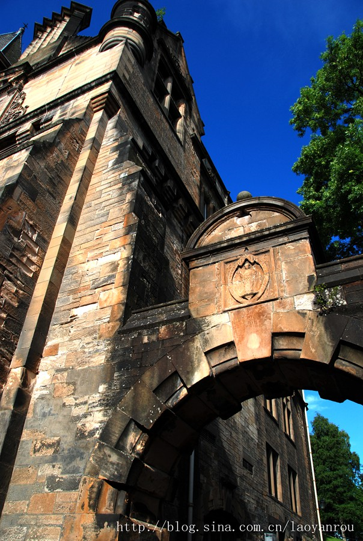

格拉斯哥大学

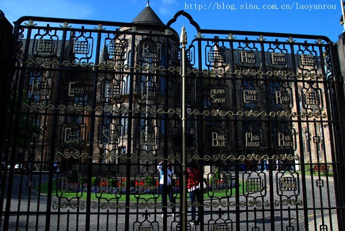

格拉斯哥大学校门（名人留名）

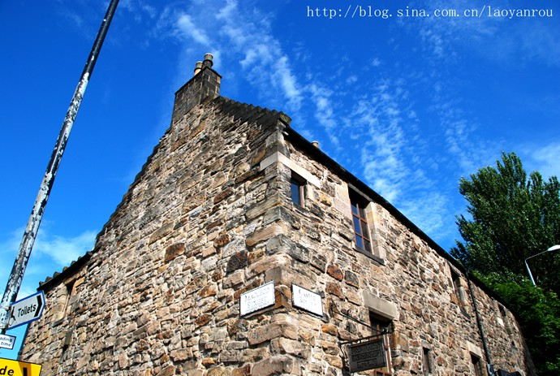

格拉斯哥无名老屋

下午离开苏格兰往英格兰的温德米尔湖，其沿途景观和苏格兰大有不同，属典型的欧洲山地风光，车窗外偶尔闪现的郁郁葱葱的山脚牧场和闲散游荡点缀之间的羊群倒是别有一番景致。我们穿过温德米尔镇到湖南端紧邻湖边的另一小镇准备上船游湖，之前在一家所谓“中餐馆”吃了一顿英式中餐，估计除了团队游客极少人过来用餐，那味道着实不敢恭维。温德米尔湖十分辽阔宁静，三三两两的白天鹅和野鸭不时嬉戏于湛蓝的湖水中，沿湖星罗棋布地建有一些老式英国别墅，伴着游船在平静湖水掠过而在绿树掩映中时隐时现，看来英国人也非常喜欢到水边度假休闲，只需抬头看看湖里那一艘艘穿梭如织的各式三角帆船便可得知。湖边小镇与湖区风格也颇为一致，若不是游客众多，想必也是一个完美体验英式悠闲乡村生活的好去处。（PS：我与LP在一幢白屋前准备照相的时候，一位英国阿姨主动上前帮我们照合影，其热情洋溢的好客之道颇令人动颜）

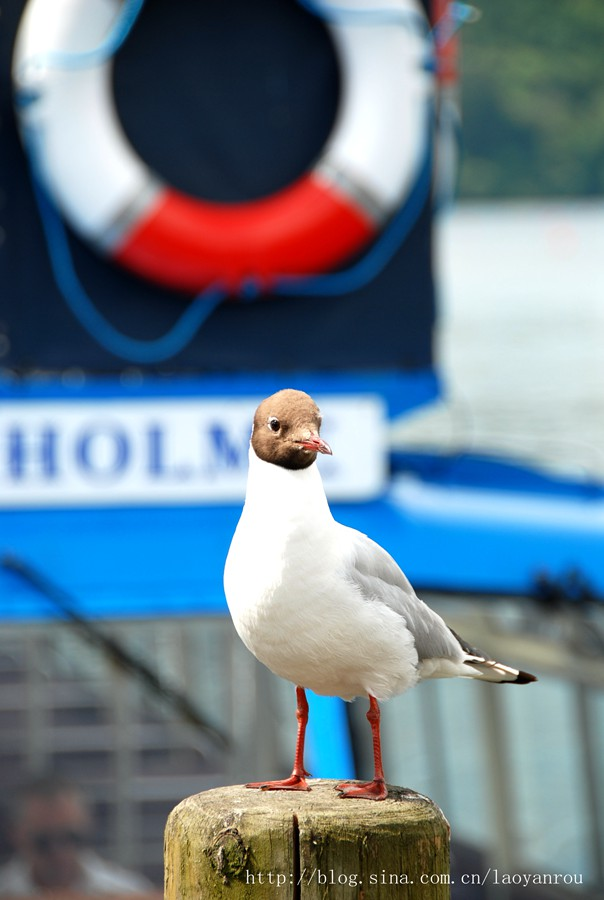

湖边白鸽

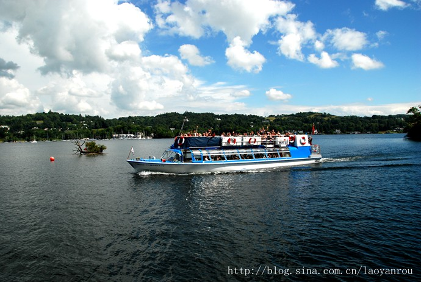

湖心游船

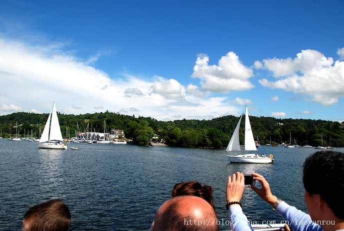

湖中帆船

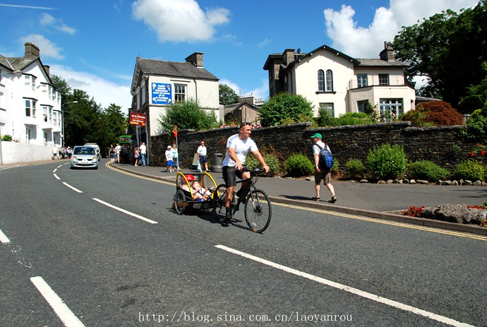

小镇奶爸

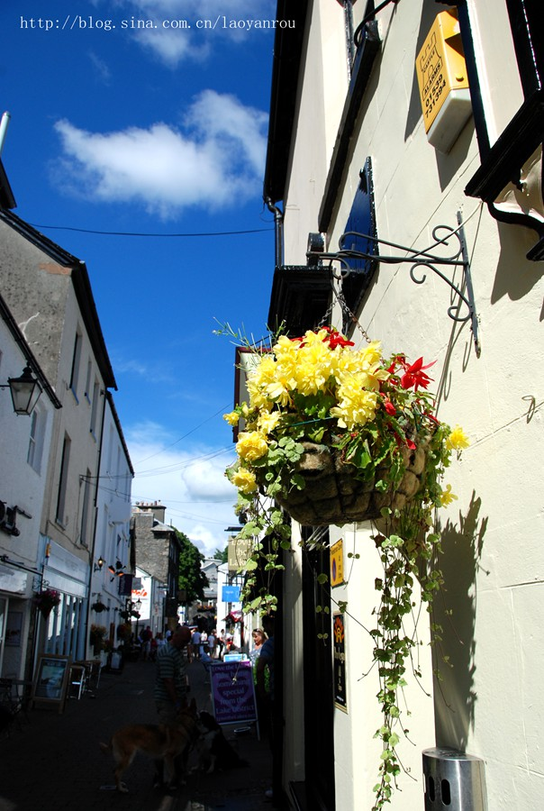

小镇黄花

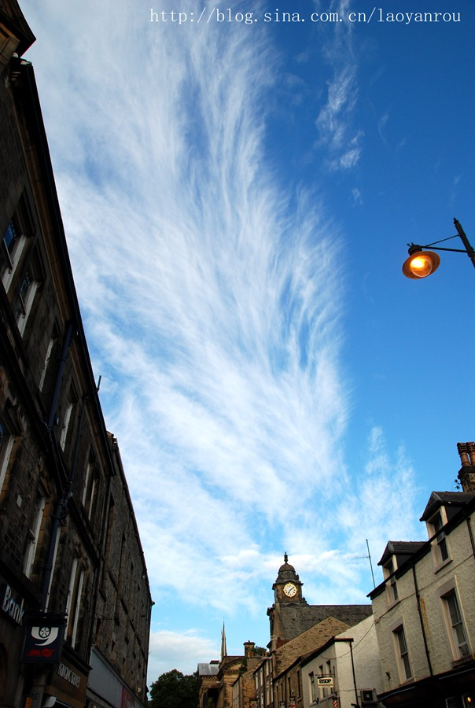

日暮小镇

傍晚参观完兰卡斯特城堡后，就入住了兰卡斯特附近的假日酒店，床很大也很干净，只是位置稍偏只适合出行方便的团队游客。
