# 欧游札记之英国大学路(第五日 剑桥大学&大英博物馆)

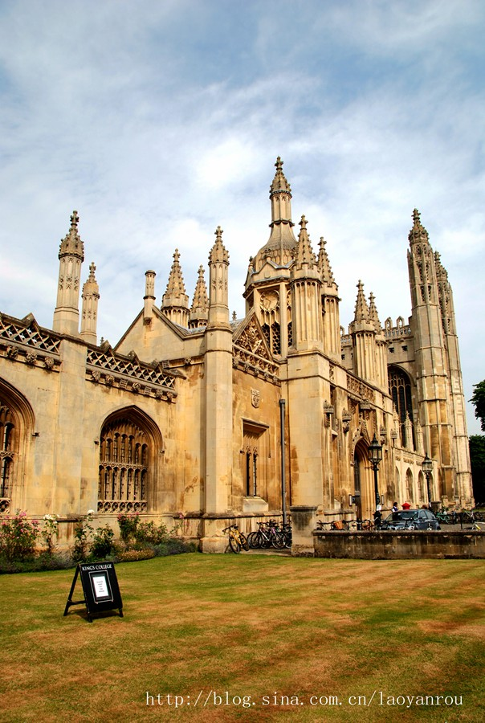  
  

第五日
剑桥大学&大英博物馆

牛津Buffer酒店晨起后四周闲逛，牧场周边的英国农民小屋即使略显陈旧简陋却也不乏个别装点得别出心裁者，令人眼前一亮。小屋后就是放养马匹牲畜的牧场和较为少见的裸露耕地。回到所住的酒店，晨光下的酒店建筑外墙清晰地留下了爬山虎曾经攀爬过的枝桠蔓延的印记，犹如一位画师在白墙上所绘的超现实主义作品，真乃大自然的鬼斧神工也！

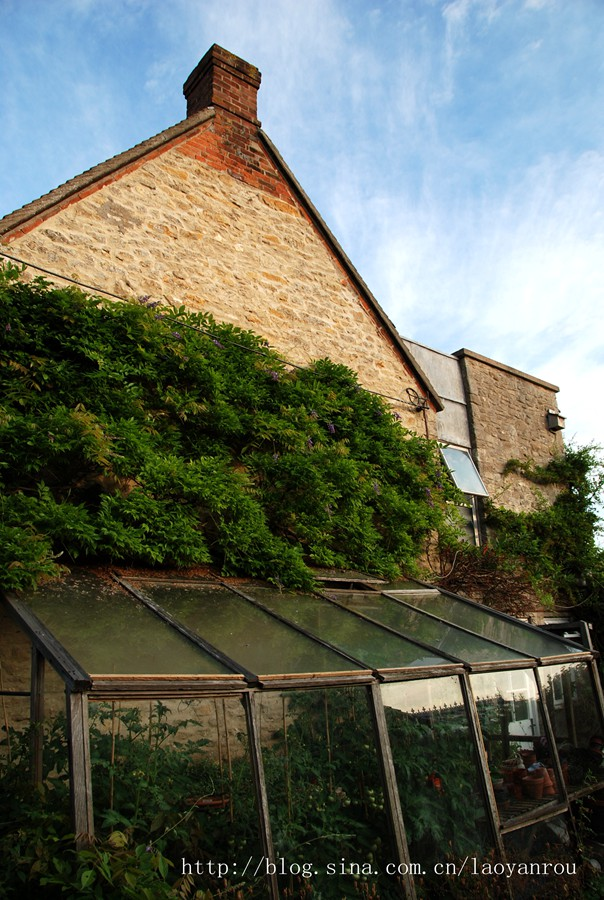  
  
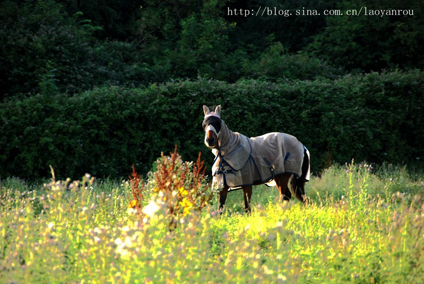  
  
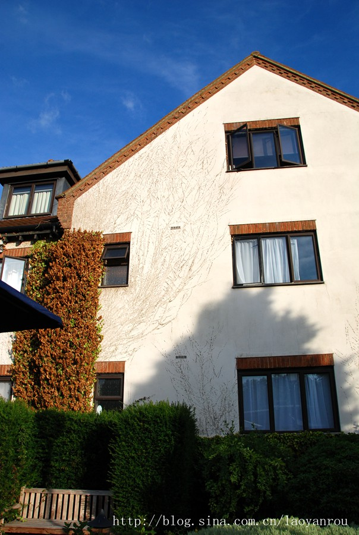  
  
上午参观因牛顿、徐志摩等一众大V校友而声名显赫的剑桥大学，学校总体比牛津大学要新、街道也较简单不易迷失。刚抵达时由于时间尚早，在游客学子不多的校园里还真有些徐志摩诗中描绘的“再别康桥”的感觉，只可惜好景不长，日上杆头后街上的游人如织立马让我们感觉倒退回了牛津大学。一路匆匆外观了皇后大学、国王大学、三一学院等名校，时间紧迫不得入内一睹为快颇为遗憾，唯有在书店挑选几本相关介绍、旅游图册聊以慰藉。据传言当年将牛顿一苹果砸开窍的苹果树的一株分支就被栽在三一学院外面供人参观，但从现场人迹寥寥的情况看似乎不太可信。剑桥学生颇具冒险搞怪的传统，不少学院的高大的院墙和塔楼顶端都被学生半夜成功登顶，挂上各种千奇百怪的物品。而此类恶作剧竟然也有好事者专门为此著书立传，莫非是受学术权威长期压迫而激发出的一种发泄手段？呵呵，不可而知。
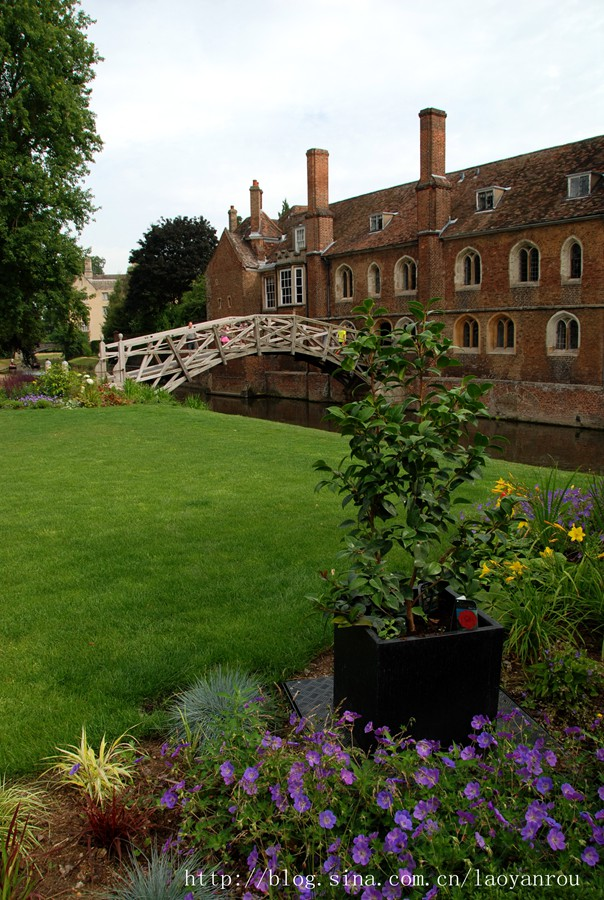  
  
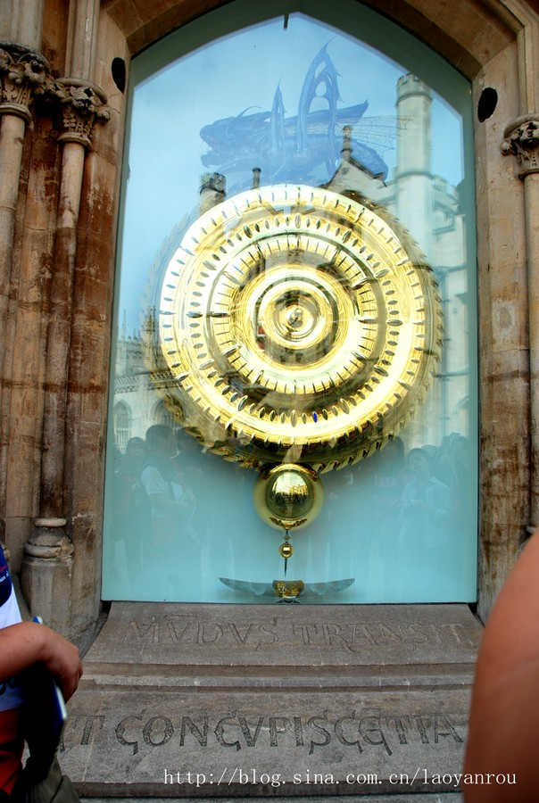  
  
  
  
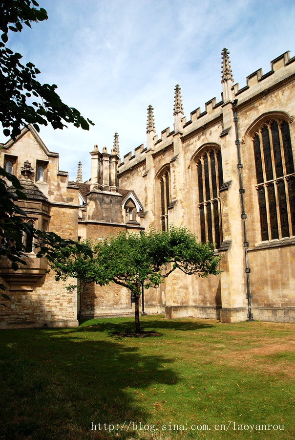  
  
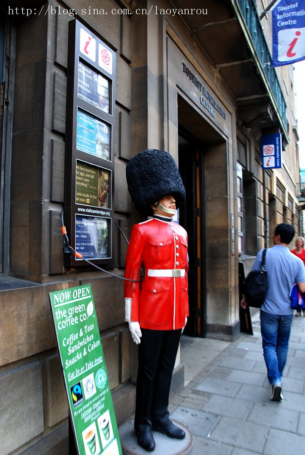  
  
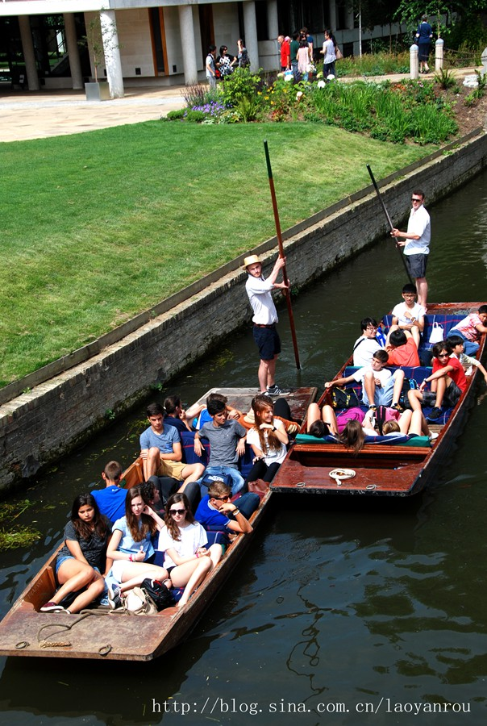  
  
因马拉松比赛封了不少路的伦敦终于姗姗走入我们的视野，司机于伦敦的滚滚车流中左右穿插将我们先送到圣保罗大教堂，偶遇一中东土豪黑哥们迎娶一金发白人妹子的婚礼，教堂钟声朗朗绕梁不绝、肤色着装各异的众亲友欢呼雷动、一长溜高挑靓丽的伴娘分外妖娆、婚车似乎最差也是某斯某斯。不由得惊讶于中东黑哥们的深厚背景和财力，一般人想在这间历史悠久的教堂办婚礼先不说费用、连排期都可能是极其漫长的过程，而反观被大伙所津津乐道的黄教主和AB的豪华婚礼似乎也相形见绌了。  
大英博物馆对我们中国人来说既充满了神秘感，同时也带有沉重的历史含义。参观完古希腊、古埃及文明的遗迹和文物后，在赞叹两大古文明的灿烂的历史之余，打心里对英国佬不遗余力、大费周章地将别人的小至戒指大至神庙的文物连扛带切地折腾回本国的能力表示由衷地“钦佩”。当看到以古代中国为主的包括尼泊尔、印度等亚洲国家的大批精美绝伦的流失文物之后，更深感一种莫名的耻辱，因为曾经落后挨打而遭掠夺欺凌的耻辱。我发现到中国馆参观的大部分都是中国人，估计大家来这的目的可能都差不多，瞻仰下几千年的老祖宗留下的珍贵文物并希冀有朝一日待国力强盛后能将其迎回故土。只为一个颠扑不破的真理：“弱肉必定强食、落后就要挨打！”
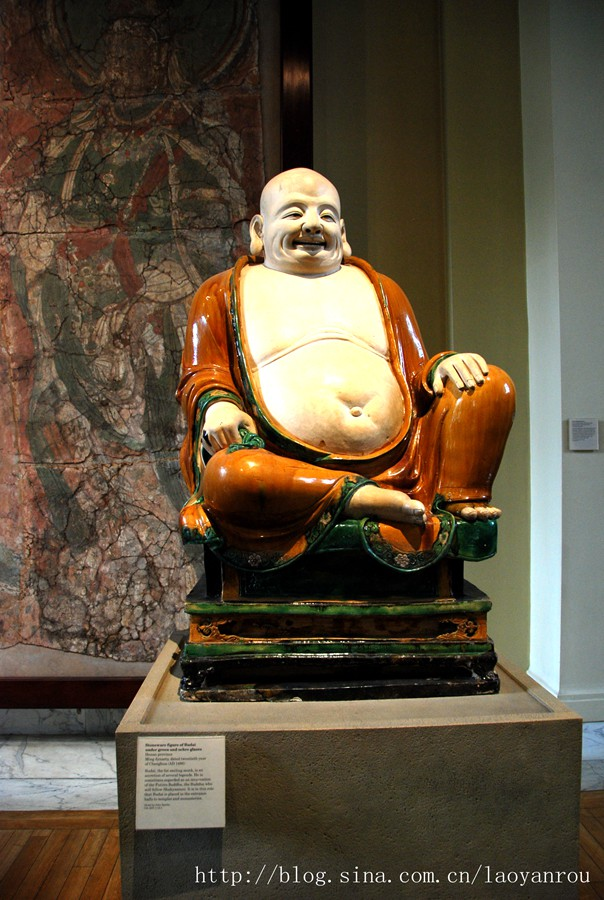  
  
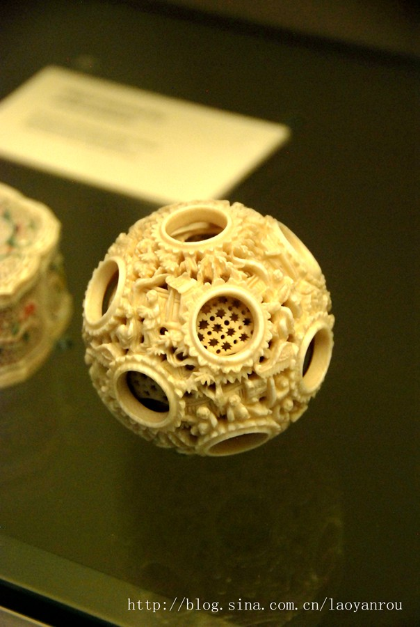  
  
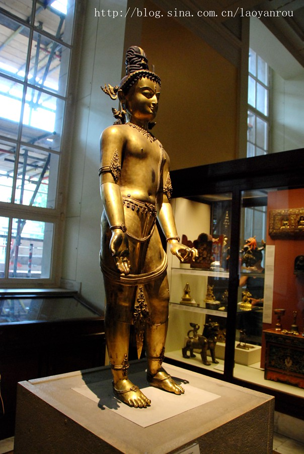  
  
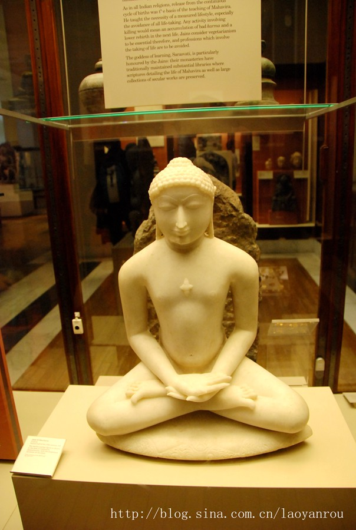  
  
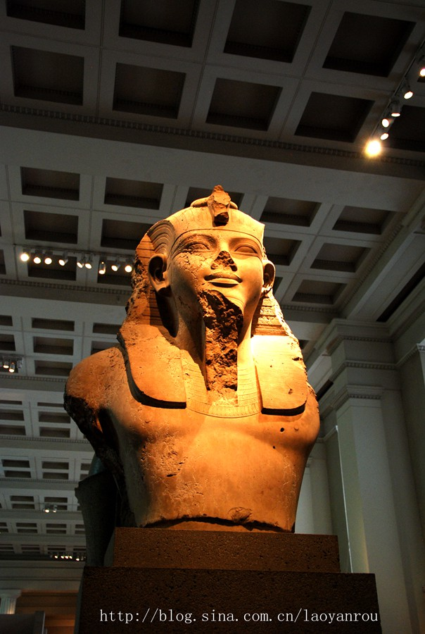  
  
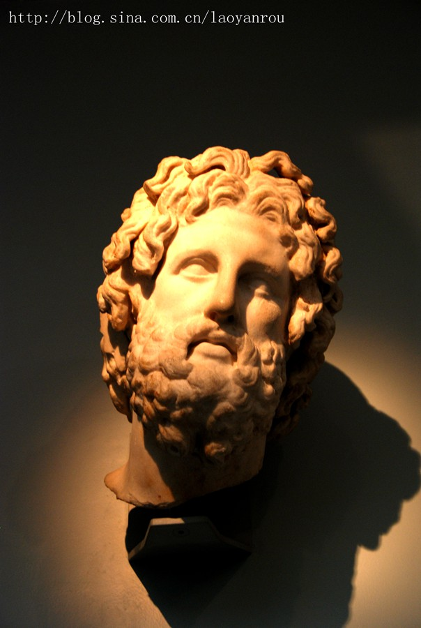  
  
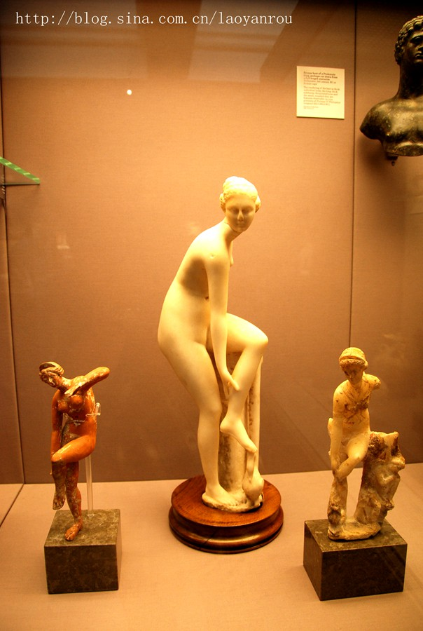  
  
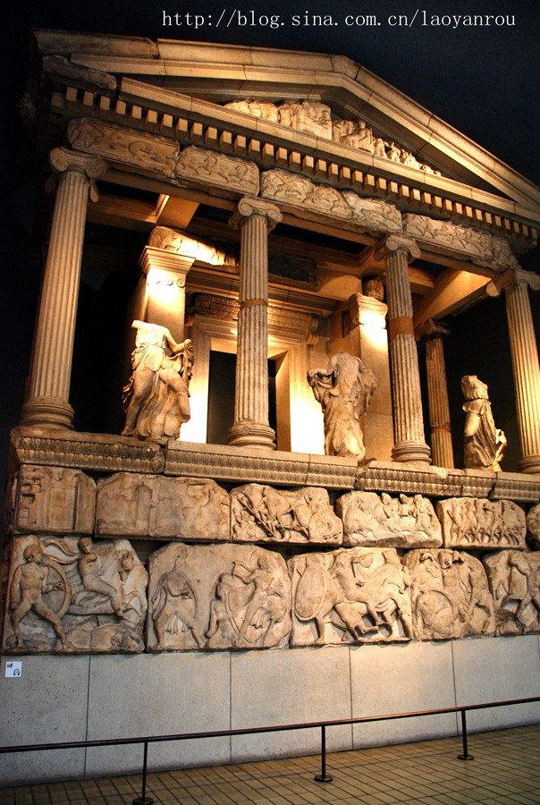  
  
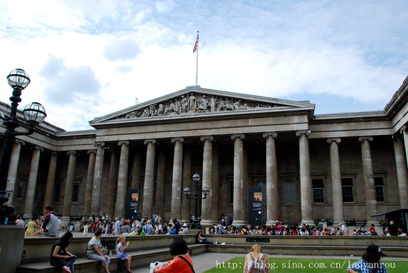  
  
晚上入住伦敦东南部希尔顿酒店，爬了几行格子便休息了。
