# 欧游札记之英国大学路(第七日 伦敦塔&温莎古堡)

  
  

第七日
伦敦塔&温莎古堡

在英国的最后一天，早上天气阴晴不定，时雨时晴，幸好等我们来到颇具神秘色彩的伦敦塔及伦敦塔桥的时候天空开始放晴，犹抱琵琶半遮面似的露出几片蓝天，使我们的照片背景不至于平淡无奇。穿过云层的几束阳光洒在伦敦塔和伦敦塔桥上，使得历史上曾在这里发生的一幕幕悲惨故事和诡异传说离我们显得是那么遥远。

  
  
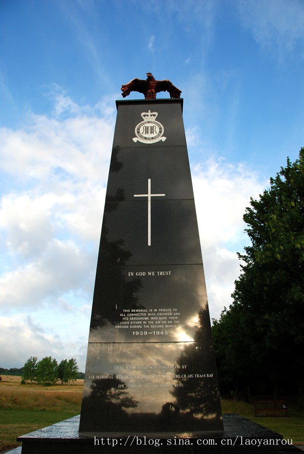  
  
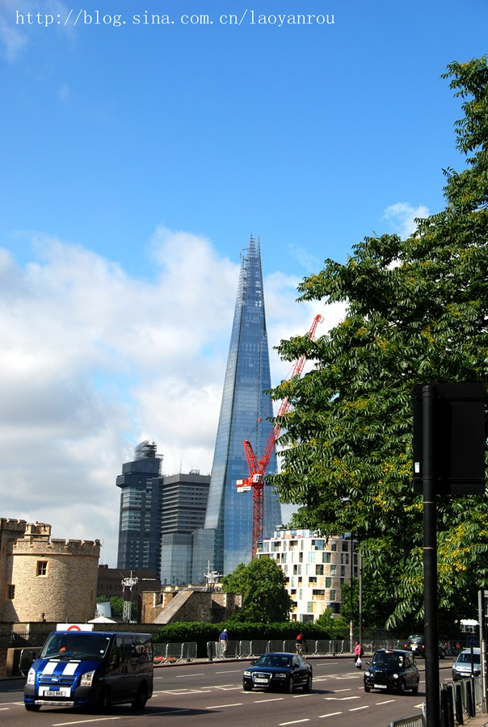  
  
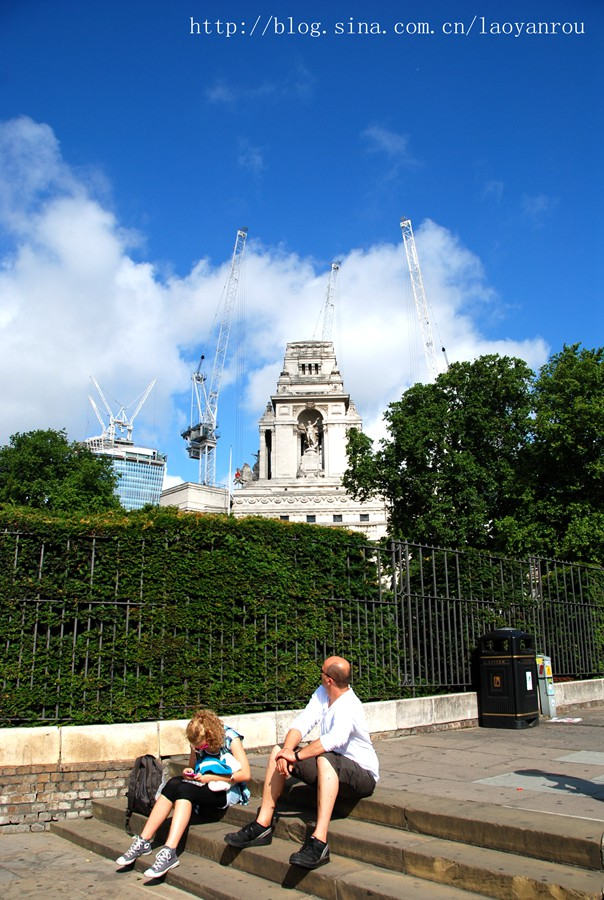  
  
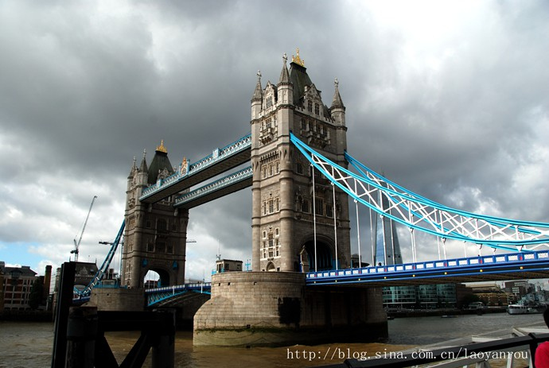  
  
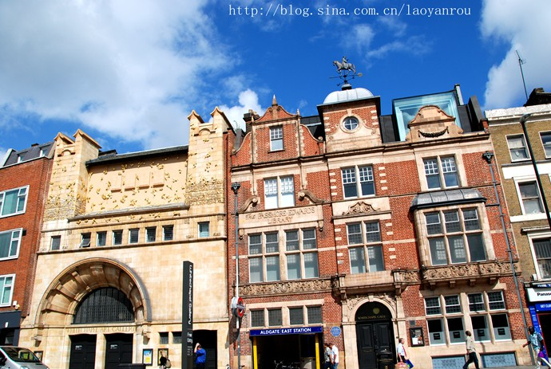  
  
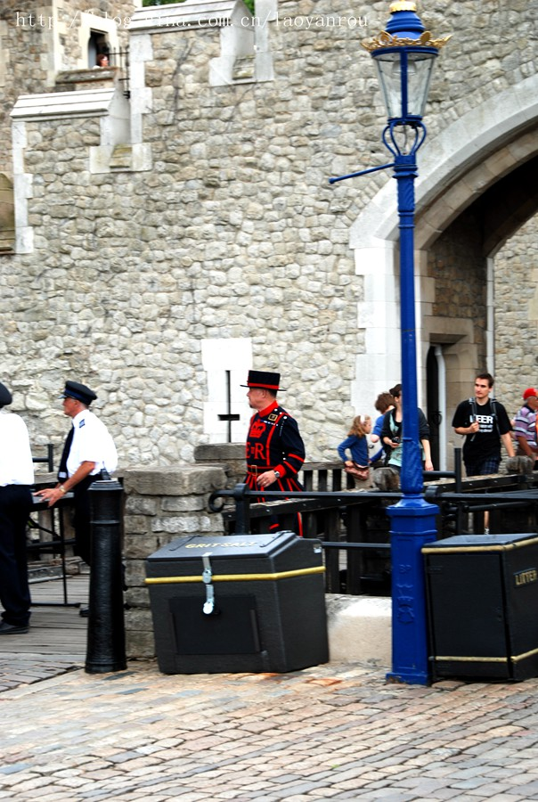  
  
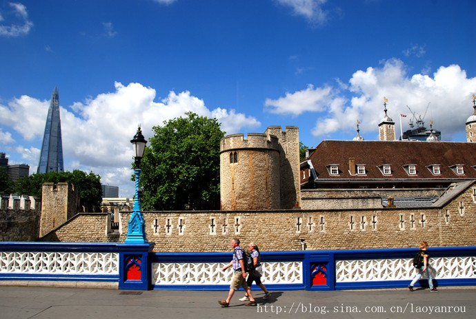  
  
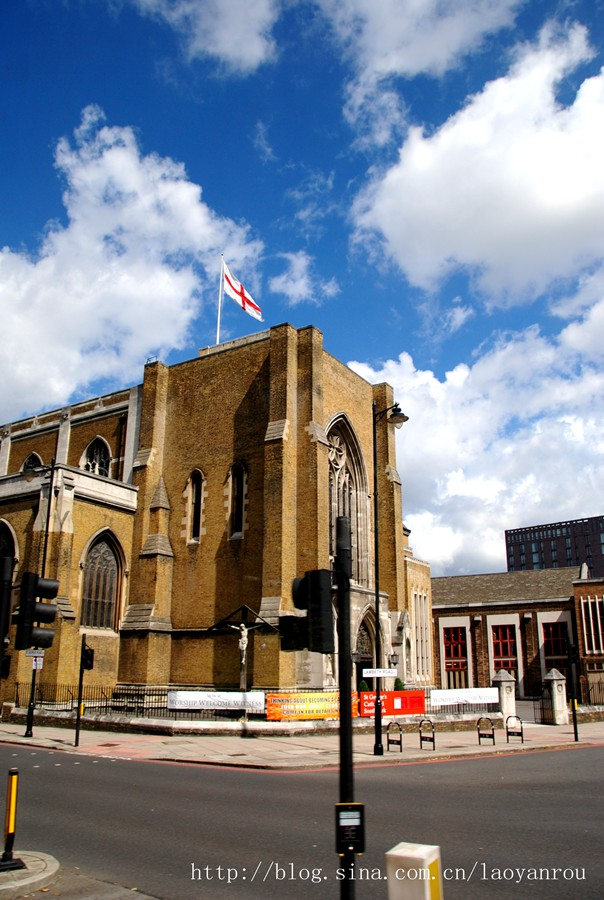  
  
下午在温莎小镇吃完一顿最为拥挤的“中餐”之后，开始慢慢品味我们英国之旅的最后一站，也是唯一可以深度参观的目前仍作为英国皇家行宫使用的温莎古堡。由于一直为皇室服务的缘故，该城堡保存得极其完好，一点也看不出92年一场几乎将其烧毁的大火所留下来的痕迹，在午后缀着几朵白云的湛蓝天空的衬托下显得尤为庄严巍峨。花了将近16英镑的门票钱后，我们领取了中文讲解机，在一雄厚男中音导游录音的指引下开始深入体验触摸一座英国古堡的真实感觉。进门没多久就看见了城堡的核心建筑，高耸在整个城堡中间一座圆形的小堡垒，小堡垒与城堡其他建筑以一护城河及斜坡相隔，其内建有极深水井，以保障皇族被围困时最后抵抗时的用水所需。关门前我们来到了圣乔治教堂，此地为爱德华三世建立加德骑士团所在地，教堂由历代皇帝数次加建而成，其内部哥特式的穹顶复杂精美，为数不少的巨型构件高高悬挂在穹顶之上令人不得不慨叹古人的智慧和巧夺天工。教堂内安息着许多英国皇亲国戚，均以白色大理石仿人雕像覆盖其棺，表情惟妙惟肖，仿佛只是沉睡一般，使瞻仰者对死亡的感悟多了几分温情少了几分冰冷。爱德华三世的巨幅全身像挂在教堂深处，画上的他高举着一把一两米多长的巨剑，剑上串着苏格兰和法国的王冠，代表着两国历史上错综复杂的皇权纠葛。
  
  
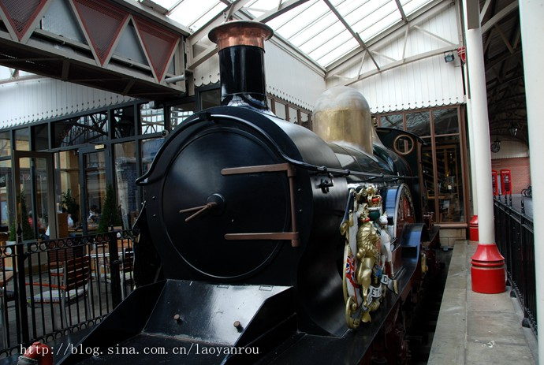  
  
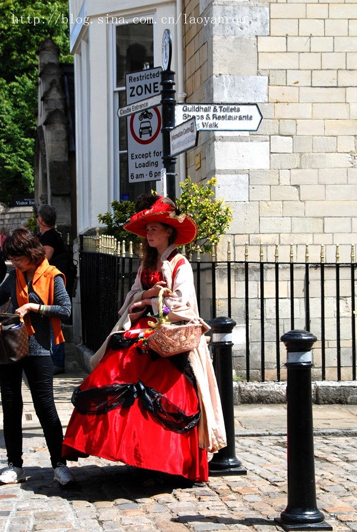  
  
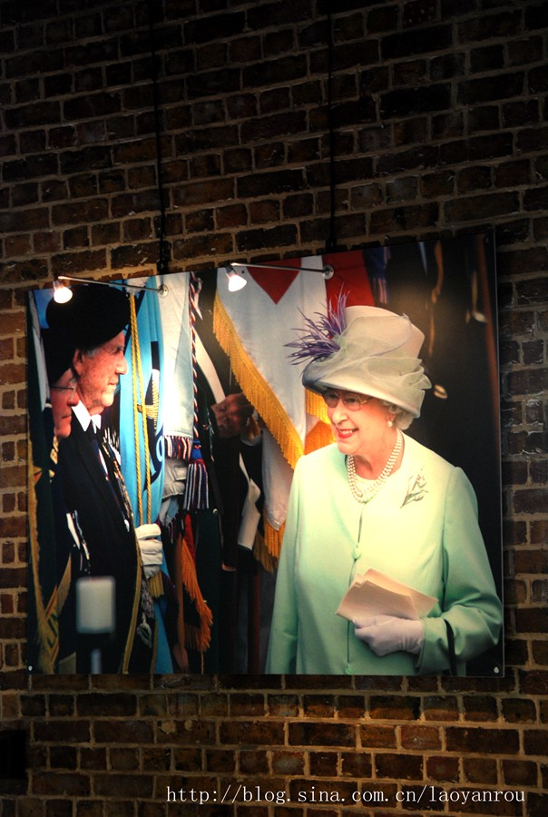  
  
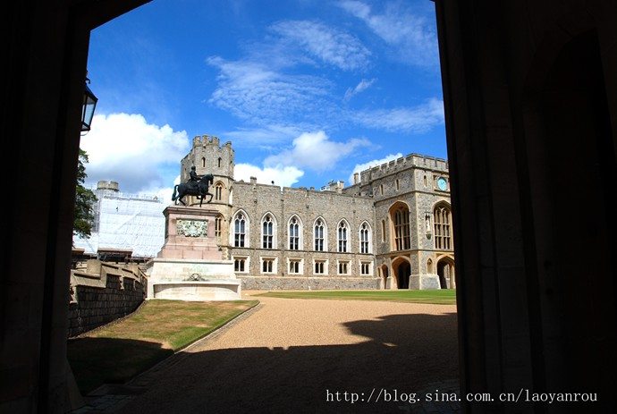  
  
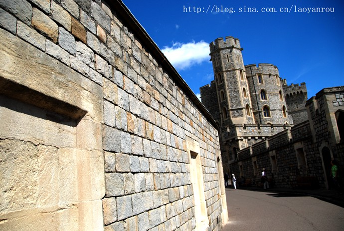  
  
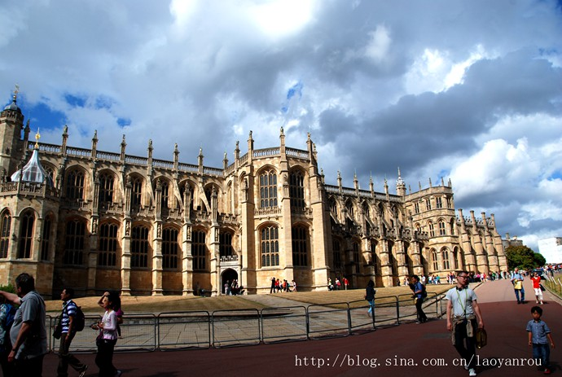  
  
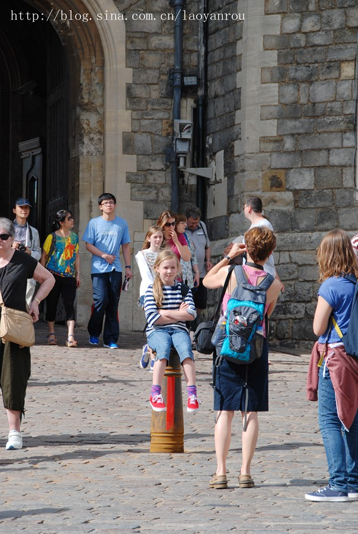  
  

看完圣乔治教堂本应该先去看下玛丽皇后的玩具室，无奈人头涌涌，排队遥遥无期，只好先去参观国厅，而进入国厅后才发现什么叫国之厅堂了，尽管其大小及规模不及古代中国故宫，但内部建筑装饰摆设的奢华程度丝毫不亚于其他著名的皇宫。我们一路走过的武器室，等待厅，接待厅，会议厅，餐厅，起居室等等房间无一不彰显出皇室的华丽气派，其建筑所采用的橡木、绘满巨幅油画的哥特式穹顶、墙上多幅神采奕奕的人物肖像油画、以及房间内摆设的精雕细刻的壁炉及各国工艺品包括中国的元青花等瓷器等等，将整个城堡内部装饰得富丽堂皇！令人称奇的是，一些曾经被92年的大火烧过的房间经过工匠们以古代工艺修复后焕然一新，其复原后的气势比旧房间有过之而无不及。其中有些修复手段令人不得不佩服其匠心独具，比如将新橡木砍伐后马上做成房梁，产生裂纹以模拟当年建筑用木材的实际情况。又如将被大火熏黑表面的木地板翻转过来就不仅可以掩盖了被烧的痕迹而且还能维持木地板的原貌。国厅的参观令我们对英国古堡有了一次从外到内的全新认识和体验。  
终于，我们意犹未尽地离开温莎，踏上归途飞机，重新经历了痛苦煎熬的近20小时飞行后回到广州，回顾在英国的一个礼拜时间的所见所闻，感触良多，谨以此文留作纪念。
