# 欧游札记之徜徉法兰西(DAY2.2圣母院-奥赛博物馆-罗丹美术馆)

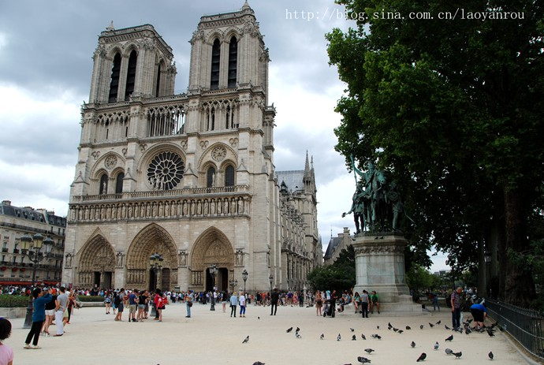

巴黎圣母院

DAY 2.2 圣母院-奥赛博物馆-罗丹美术馆

简单在卢浮宫地下中央大堂旁的美食广场买了几份略带几分亚洲风味的法式快餐填饱了肚子，就撒开了脚丫子沿着塞纳河右岸穿过了十三座桥之一久负盛名的爱情连心锁桥“艺术桥”，直奔西岱岛和巴黎圣母院而去。彼时天空有点不作美浓云密布，按LP的说法是“完美徒步天气”而对于抓相机的我来说却是个“平淡摄影时间”，无法表现出蓝天白云和法式哥特建筑完美的映衬对比来，唯一值得欣慰的是照出的人像光影分布倒也均匀，不像后来在南法热烈的正午阳光下照出的一堆阴阳脸（为此没少挨“水平倒退，照的还不如小孩”批评）。（TIPS：法国夏天日照猛烈且持续时间长，从早上七、八点一直艳阳高照到晚上八、九点！经验教训告诉我最佳的人物风景摄影时间应在上午十点之前，错过此时一旦遇到顶光、侧光或逆光的情况，人物和风景如同鱼和熊掌一样不可兼得！如果没有反光板或专业闪光灯补光，那么下场就惟有“呵呵”了！）

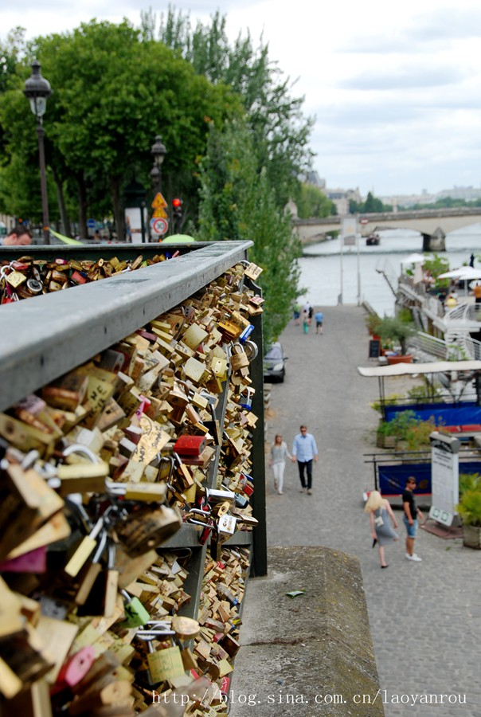

艺术桥的爱情连心锁

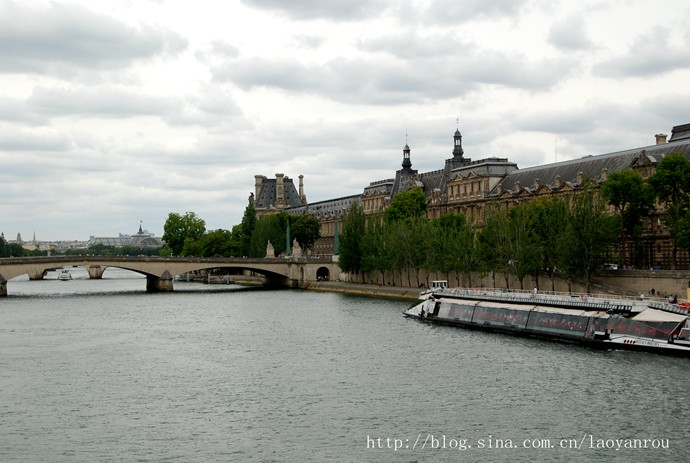

塞纳河

伫立于西岱岛东端的巴黎圣母院教堂尖塔直插云霄非常好认，与巴黎古监狱一起占据了西岱岛这一被塞纳河环绕与两岸仅以桥梁相连的前军事及政治要塞重地。自从卡佩王朝的路易七世把把王宫从奥尔良迁到卡洛林王朝查理曼大帝的儿子“虔诚者路易”在西岱岛住的旧宫后，巴黎才正式被卡佩家族定位为永久的法国首都。但这个巴黎昔日的政治统治中枢所在地在我们今天看来似乎总觉得面积小了点不够气势，从西岱岛最西端走到最东端的圣母院根本用不了十分钟，可是当我们来到圣母院广场前面的时候才发觉自己的肤浅！这个因法国浪漫主义、现实主义大文豪雨果同名小说《巴黎圣母院》而闻名天下的教堂吸引了全球无数游客的顶礼膜拜，广场上排队等候入内参观的队伍竟也蜿蜒曲折几百米！由于时间所限，我们在吃惊之余也只能在外面简单照了几张外景便赶往下一个目标“奥赛博物馆”，留下一点遗憾待日后重返巴黎的时候再弥补吧！

巴黎圣母院

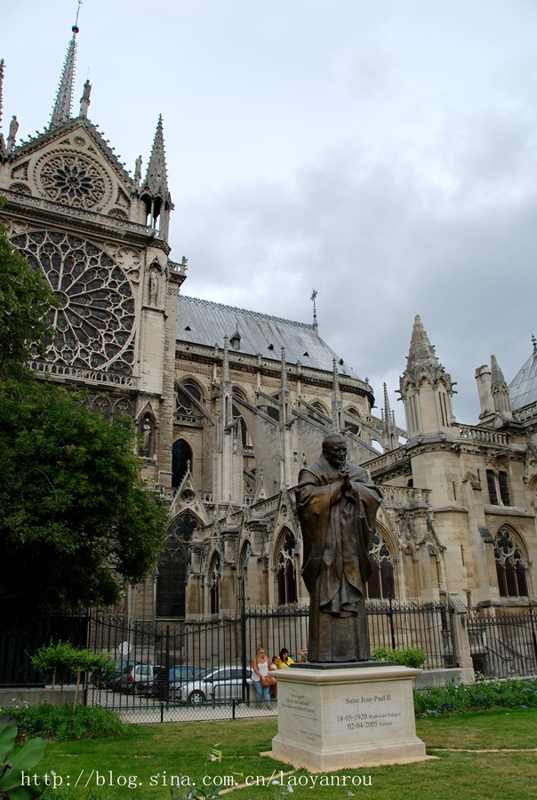

巴黎圣母院一角

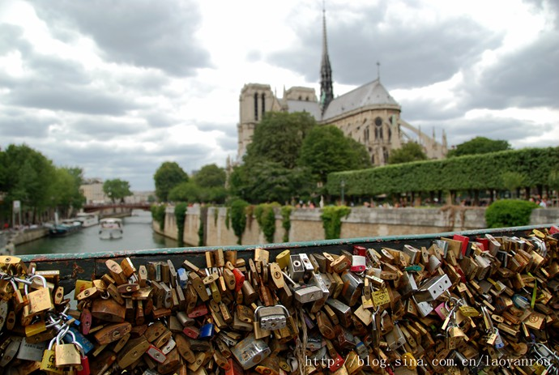

桥上远眺圣母院

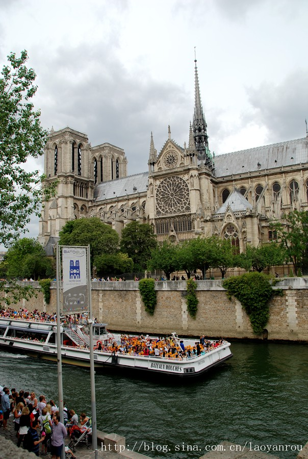

塞纳河游船

从巴黎圣母院到奥赛博物馆基本上是沿着塞纳河左岸进行了一次徒步远足，徜徉在昔日以巴黎文化艺术中心自居的“左岸”走了大概半个多小时，等到达奥赛博物馆的时候离闭馆仅剩两个多小时了，当看到等候排队进入奥赛博物馆的人潮竟然与圣母院广场人流不相伯仲的时候，我们心中那个着急啊。已经错过圣母院参观就不能再错过奥赛博物馆了，因为这里面有法国印象主义画派的几位大师的名作是必看不可的，其中包括印象主义画派师祖莫奈、德加，后印象主义画派大师凡高，还有古典浪漫主义画派马奈的一些名作。在世界名画的鼓舞诱惑下，我们咬牙坚持排了大半小时的队终于熬到踏入奥赛博物馆的大门了，心中不得不啧啧赞叹法国人（据我观察大多都是）对艺术品的疯狂热爱了（据说很多巴黎人每到周末就携家带口来参观博物馆！）由于奥赛博物馆是旧火车站改建而成的，只有高处的第五层和地面第一层用做展览。我们赶紧从印象主义画派作品最多的第五层开始看并一路看到一楼，沿途看了德加的《芭蕾舞者》，马奈的《草地上的午餐》、《奥林匹亚》和《吹笛的男孩》、米勒的《拾穗》，凡高著名的《自画像》、《奥维尔教堂》和《凡高在阿尔勒的卧室》等印象派作品，以及勒菲弗尔的《真理女神》、卡内巴尔《维纳斯的诞生》、安格尔的《泉》等一些描绘裸体女神或少女的写实主义油画或雕塑等。参观后总体感觉法国的印象主义和写实主义风格形成了鲜明对比，印象主义画派非常注重物体光影色彩而忽视其具体形态，与中国水墨画所追求的“写意”境界有那么一点类似，而写实主义风格的油画则通过对物体乃至人体的精确描绘反映出其惟妙惟肖的“写实”宗旨，这些油画通过对人体形态美尤其是女性裸体美的刻画到了登峰造极的境界，我们欣赏时除了惊叹其绘画技艺的出神入化以外却丝毫感觉不到一点色情的意味在里面，而这种充满张力的人体表现对于长期对其晦之若深的中国绘画来说却是一块模糊的的禁区，因此在绘画引入人体解剖学方面以及对人体艺术的开放度方面中国传统绘画还是有很多东西可以向西方油画学习借鉴的。

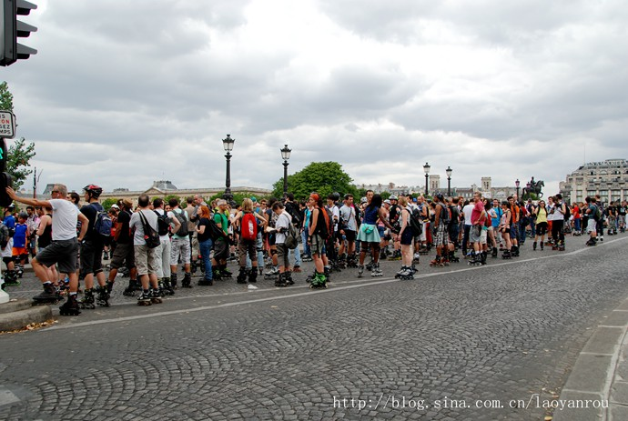

轮滑爱好者游行

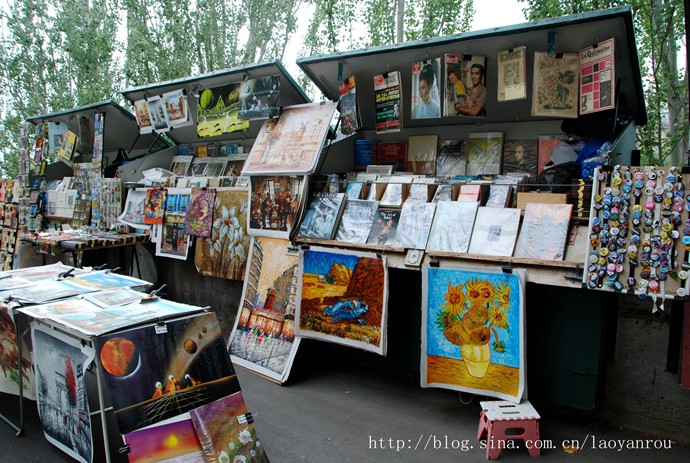

塞纳河边报摊

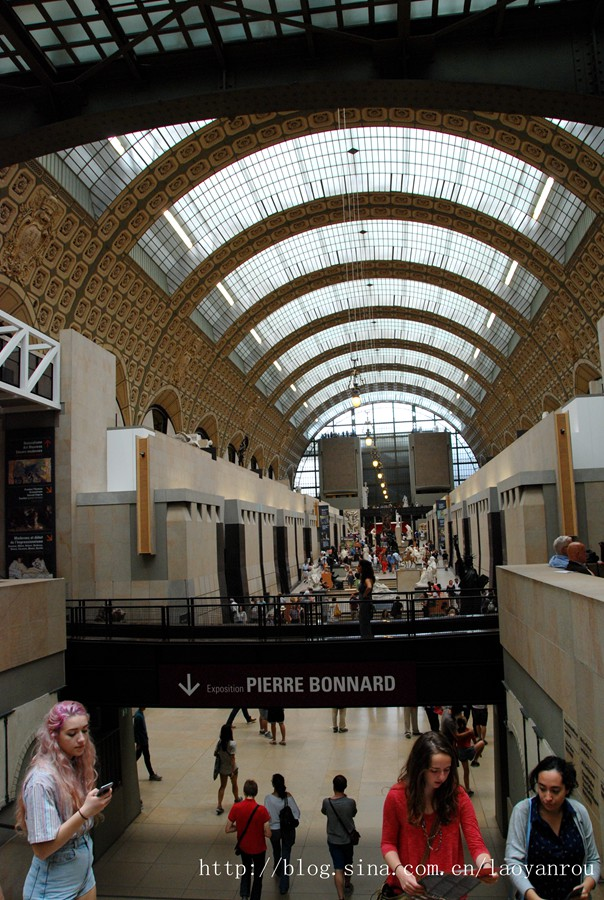

奥赛博物馆大厅

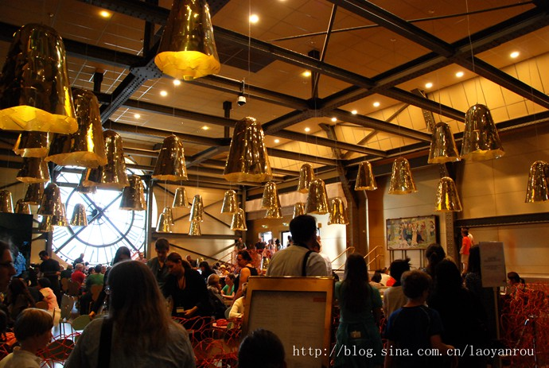

奥赛博物馆钟楼咖啡厅

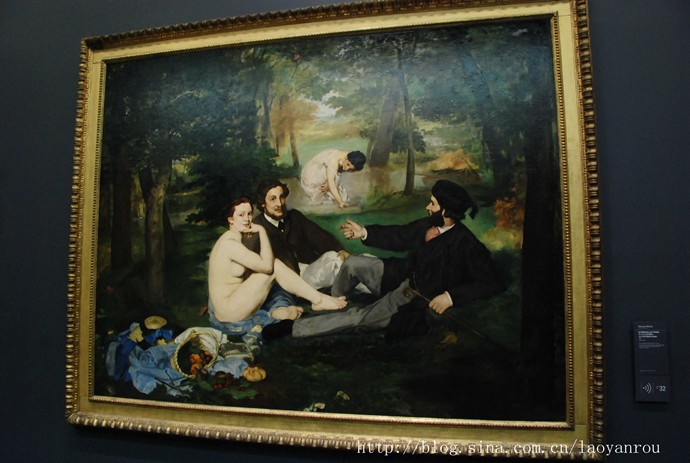

马奈《草地上的午餐》

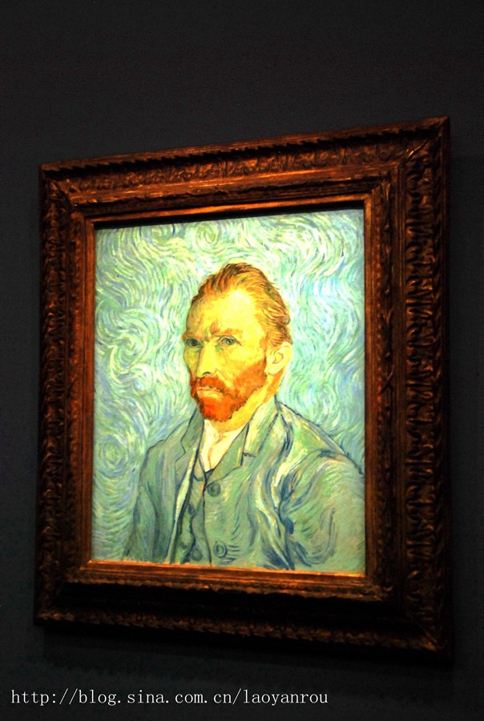

凡高《自画像》

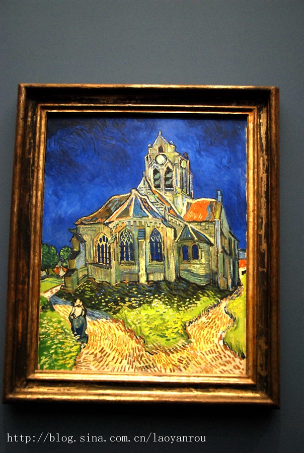

凡高《奥维尔教堂》

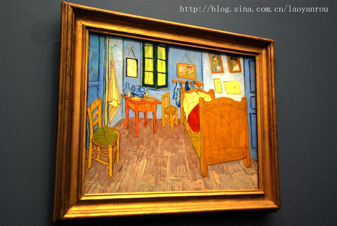

《凡高在阿尔勒的卧室》

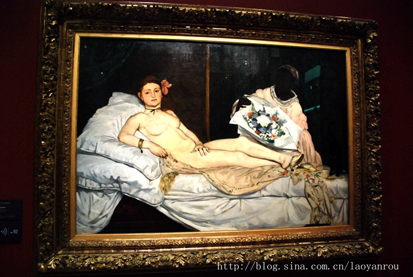

马奈《奥林匹亚》

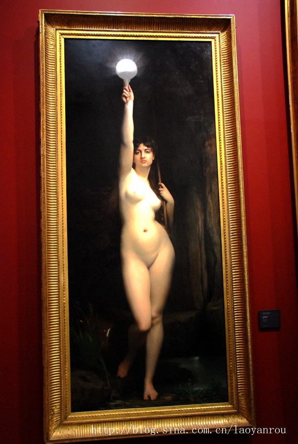

勒菲弗尔的《真理女神》

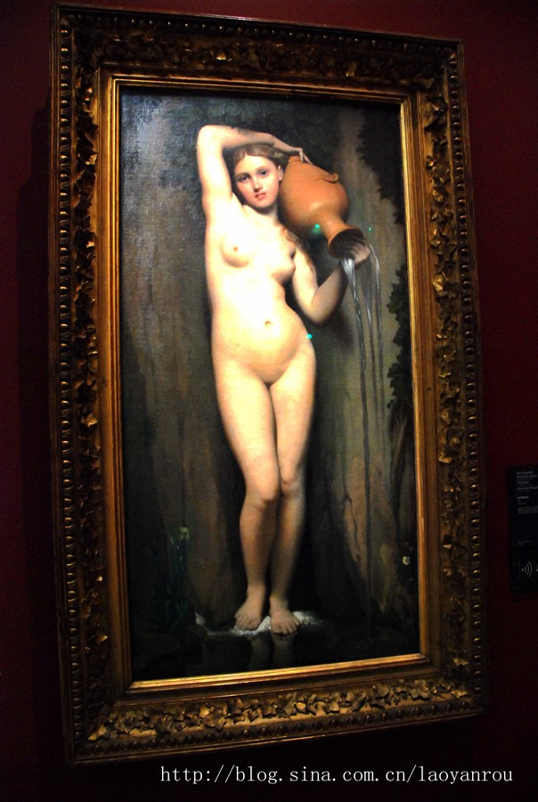

安格尔的《泉》

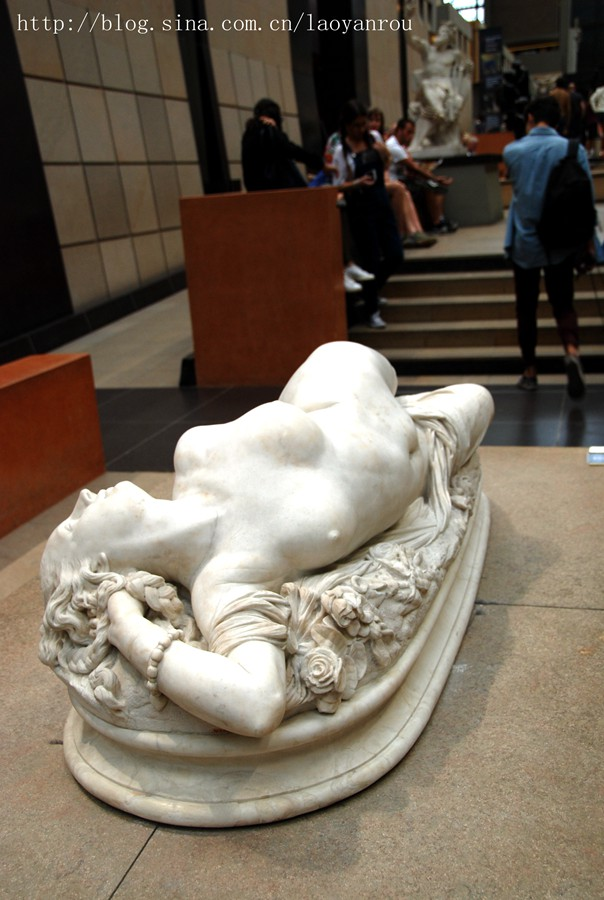

罗丹美术馆离奥赛博物馆离其实距离不远，往西南方向走上十来分钟就到了，其门口无人排队令我们大喜过望，在经历了凡尔赛宫、巴黎圣母院和奥赛博物馆的人潮洗礼后碰到一个不用排队的博物馆确实稀罕。但此时天空不作美下起了沥沥细雨，而我们的心情也随着馆藏作品数量减少而逐渐趋于平伏，法国19世纪至20世纪最伟大的现实主义雕塑艺术家奥古斯特·罗丹为数不多几件主要雕塑作品如《思想者》、《地狱之门》、《巴尔扎克》、《加莱义民》等均分散摆放在美术馆外露天的场地中，场馆内则陈列了《青铜时代》、《吻》等主要作品并展示了一些作品从半成品到完成的过程。由于对于雕塑的欣赏水平有限，我们对罗丹大师的作品感触尽管不太深，但想起了他说的一句名言倒可以作为参观罗丹美术馆的结束语“世界中从不缺少美，而是缺少发现美的眼睛。—罗丹”。

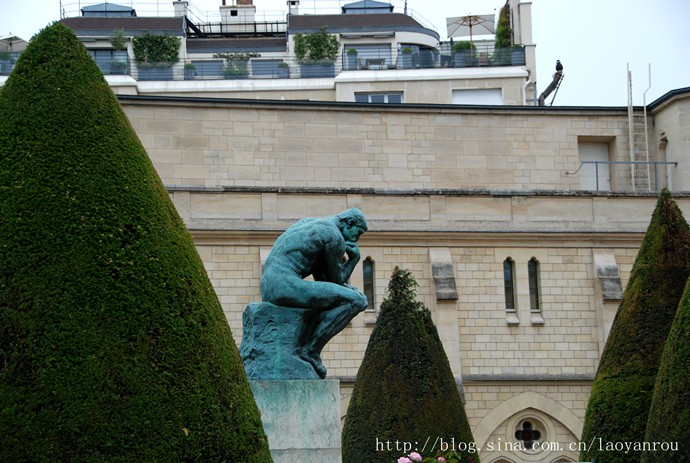

罗丹《思想者》

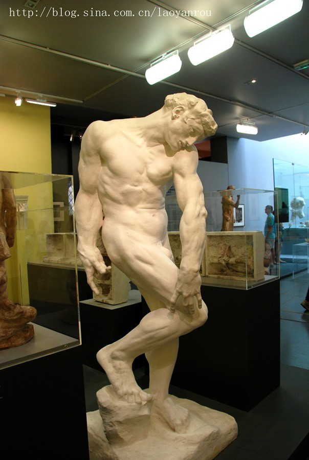

罗丹人像雕塑

离开罗丹美术馆搭M13号线转RER
C线回到了酒店，天色尚早我们又继续在十三区步行十五分钟找到了一家拉面馆解决了晚饭问题，尽管面做得不太正宗而且也要7、8欧一碗，但好歹也是中餐啊，估计到南法以后是基本无福享受的了。
