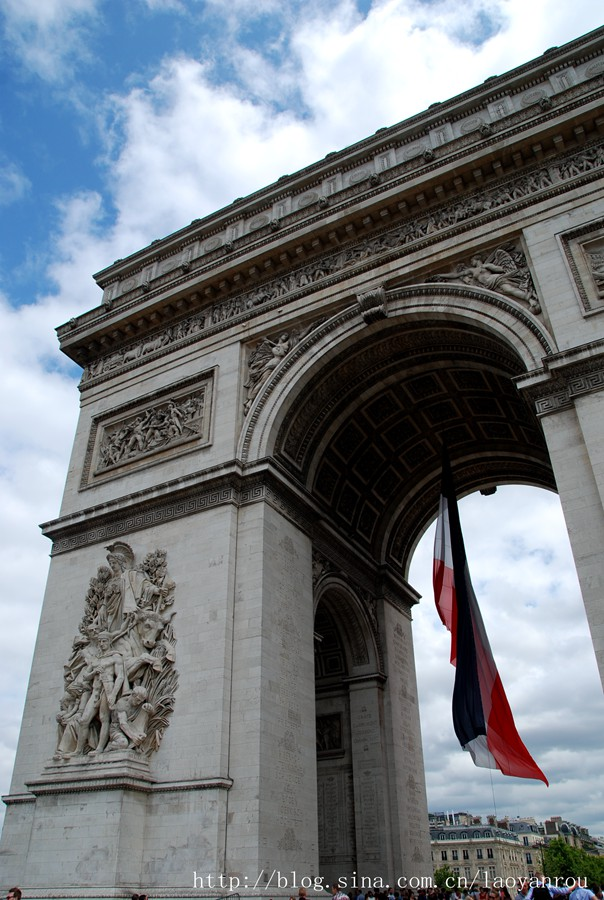
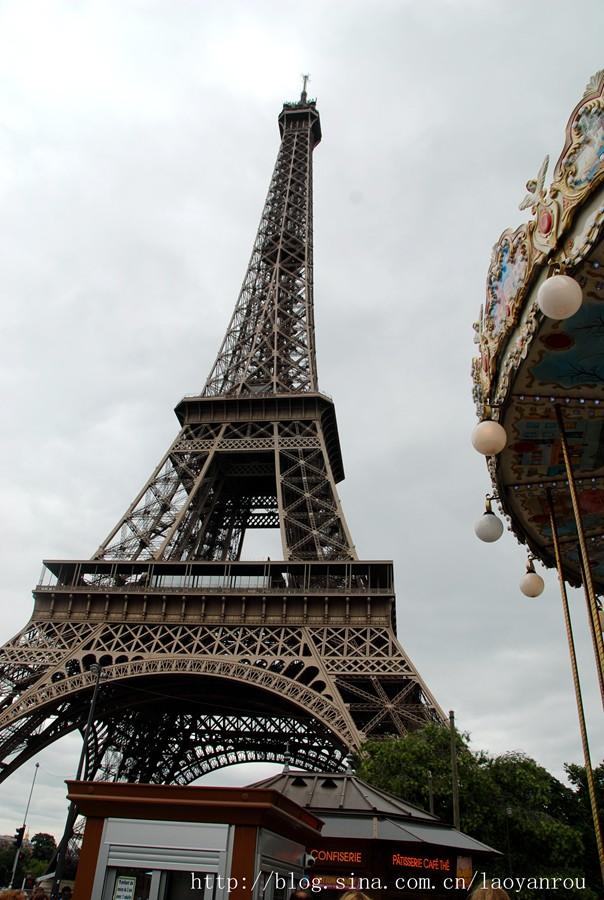
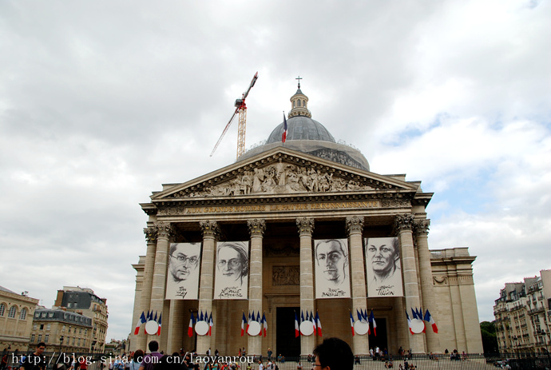
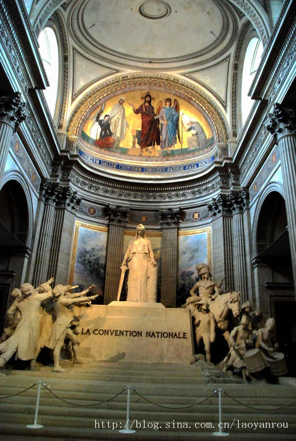
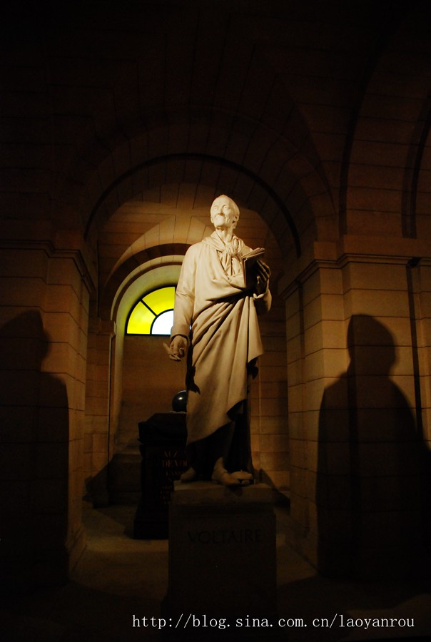
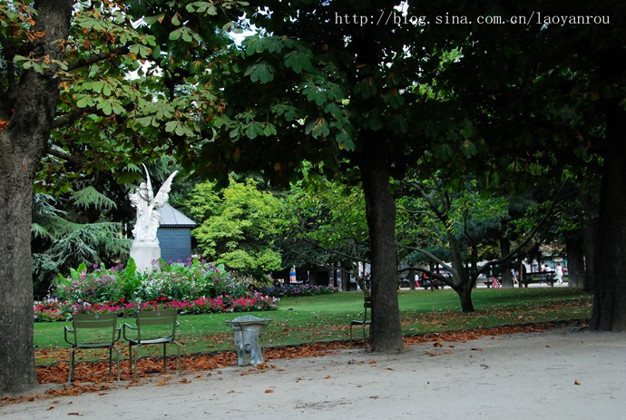

# 欧游札记之徜徉法兰西(DAY3.2凯旋门-埃菲尔铁塔-先贤祠-卢森堡公园)

  
  
DAY 3.2 凯旋门-埃菲尔铁塔-先贤祠-卢森堡公园

蓬皮杜艺术中心的其他楼层如四楼有一些当代艺术作品的展览，一楼是大厅和书店、二三楼是图书馆、六楼则为艺廊和餐厅，可以说这样一个综合性的大型文化艺术中心算是原了老蓬皮杜总统的心愿了吧。但除了五楼的博物馆我们也没逗留多久便在chatelet站搭M1线直奔下一站“凯旋门”了，从Etoile站地下通道一出来便可以见到这个屹立于巴黎星形广场的首屈一指的标志性建筑，和荣军院一样凯旋门与拿破仑关系密切，是这位军事天才为了纪念其一生40次胜仗中最光辉的奥斯特里茨战役（1805年击溃俄奥联军）而下令奠基修建的，但由于拿破仑在位时短，直到七月王朝路易•菲利普一世时期此门才最终修建完成并使拿破仑的遗体和军队获得通过的荣耀。近距离观看凯旋门的时候可以看到拱门上雕刻了拿破仑帝国出征胜利事迹和主要军队将领的名字，在拱门下的一副巨大飘扬的法国国旗的映衬下显得格外豪壮，为法国而浴血奋战的拿破仑及其将领们终以此方式名垂千古了。

  
  
相比于凯旋门，建于1889年的埃菲尔铁塔算是比较现代的巴黎标志性建筑了，这座320米高号称当时全球最高建筑的铁塔是由著名建筑师、结构工程师古斯塔夫•埃菲尔设计以迎接巴黎万国博览会所用的。从凯旋门坐M6线在Bir-Hakeim站下车沿河边走上几分钟便可抵达埃菲尔铁塔的脚下，远观埃菲尔铁塔的时候感觉不出来那种被其高高俯视的压迫感，只要到了铁塔脚下就会霎时感受到自己的微不足道。当然距离太近也有一定副作用，就是照相留影的时候总是不能把整座铁塔给全部框进画面里（已经使用广角），惟有往塞纳河对岸的夏佑宫多走几步而且采取仰视的角度才能在镜头一睹其全貌。所以埃菲尔铁塔最佳的观赏摄影点并不在其脚下，“距离产生美”这句话在这里非常有现实意义。从铁塔下战神广场密密麻麻的参观人群和排队登塔的长队来看，埃菲尔铁塔作为法国乃至全球最吸金的建筑地标名副其实，绝对可以秒杀全世界各国争相效仿而建筑的各种地标性建筑（这里面包括投资巨大、游客寥寥而回本无望的广州塔），它的火爆给我们一个重要的启迪“必须在正确的时间、正确的地点做正确的事！”，假如埃菲尔铁塔当初不是因为万国博览会的缘故被兴建，而被普通巴黎市民冠以“丑陋、突兀，破坏低矮建筑风格情调、影响市容”的称号而推迟一百年再建的话，想必无法拥有今日之盛名。说到我们和埃菲尔铁塔的相遇不得不提起另外一个小插曲：由于7月14日法国国庆（纪念1789年巴黎大革命攻占巴士底狱的日子），我们在阿维尼翁观看巴黎铁塔国庆音乐会电视现场直播的时候再次被埃菲尔铁塔魅力所征服，确实不得不佩服法国人制造浪漫的想象力啊，整台音乐会以夜晚的埃菲尔铁塔为背景，将庞大的战神广场当作观众席，在巴黎黄昏的霞光下上演了一幕幕的经典音乐歌剧及音乐作品（还邀请了国内著名钢琴家朗朗现场献艺！）。十点入夜后，埃菲尔铁塔上的璀璨灯光将夜幕下的“铁娘子”装扮得格外妖娆绚丽，在巴黎星星点点的城市灯光及无边夜色的衬托下仿佛从神话中走出来的女神一般艳光四射、魅力慑人。当音乐会进行到尾声，被环绕安置在铁塔上的无数烟花焰火伴随着庄严的古典乐次第绽放的时候，埃菲尔铁塔仿佛被一束束圣火盘旋萦绕，火树银花般地冉冉升起，此时我们已经被彻底震撼到彻底无语了。
  
  

当然这也是后话了，我们从埃菲尔铁塔离开时由于没有登塔参观还是略带遗憾而走的，不过这种心情并没有持续多久就很快被对先贤祠参观的期待给冲淡了，搭乘RER
C线转RER
B线在Luxembourg站下车转个弯就看见了其貌不扬的先贤祠，顺路还经过了旁边的卢森堡公园（后来进去坐了会，其实就一小公园而且出来还带一脚灰的，感觉一般吧）。和其他的历史古迹不同，先贤祠正面挂了几幅巨幅的人物肖像，里面一楼大厅还有一角专门摆放着一些近代名人的生平介绍和照片（可能是法国过世的名人吧，反正全是法文介绍，一个也不认识），除此以外还有一些雕塑壁画之类，当时以为也就这样没啥好看的了，后来看到很多人都从大厅后面的一个狭小的地下楼梯出来便也顺着楼梯下去一探究竟，终于发现地下其实另有乾坤——这里供奉着法国历代主要名人的灵柩，是整个先贤祠的核心所在。进入墓地第一眼看到就是法国两位著名的启蒙运动思想家伏尔泰和卢梭的全身雕像及灵柩，这两位大咖和孟德斯鸠一起掀起了在法国乃至人类历史上留下光辉一页的旨在解放思想的启蒙运动的高潮，不管是拥护开明君主制的早期思想家伏尔泰、孟德斯鸠还是坚持“人民主权论”的激进思想家卢梭，都不遗余力地以科学和理性为武器揭露了宗教愚昧的狂热主义并反对封建专制主义特权黑暗统治，为法国大革命进行了充分的思想舆论准备，扫清了建立资本主义新制度的多方面障碍，所留下的著作和确立的各种原则至今仍不失其生命力（如孟德斯鸠《论法的精神》提出三权分立说、伏尔泰的《哲学通信》、卢梭的《社会契约论》等）。可以说他们在思想文化领域给18世纪的欧洲带来了极大的冲击（使当时会讲法语成为了时尚的标签），为振兴法兰西民族文化雄风居功至伟，因此便当之无愧地享有了身后进入先贤祠受万人景仰的荣誉。在先贤祠长眠的其他名人里面国人可能更为熟悉的是著有《悲惨世界》一书的浪漫主义文学大师雨果和发现了人工放射性元素合成而共获诺贝尔化学奖的约里-居里夫妇。他们的安息之地位于地下墓地侧面的走廊上，尽管没有伏尔泰和卢梭那么显眼，但从墓前常年摆放着的鲜花来看，法国人民还是非常爱戴和缅怀这几位法国的文学和科学巨匠的。我们参观先贤祠的墓地的时候真切地感受到周围法国游客肃穆且浓重的瞻仰气氛，而且在墓地尽头看了一个介绍某名人灵柩在密特朗总统见证下由军队护送隆重进入祠内安葬的纪录片后，便更深彻地体会到先贤祠在法国人心目中的神圣而崇高的地位。

  
  
  
  
  
  
  
  

巴黎的第三天参观行程非常紧凑，熬到回酒店的时候已经感觉不到自己的双脚了以至于连第二次去吃越南米粉的力气都是硬挤出来的，原本计划每天都写个日记记录一下行程和感受，但现实骨感的疲劳让我们不得不乖乖向周公缴械，幸好我们将近两天半的疲惫充实的巴黎暴走之旅也终于告一段落，接下来可以赶在大多法国人休假之前哼着小曲踏上南法休假的路途了！（据说整个8月份法国人集体休假南法将人满为患）
