# 欧游札记之徜徉法兰西(DAY6.2阿维尼翁圣贝内泽桥-马赛圣母守望院)

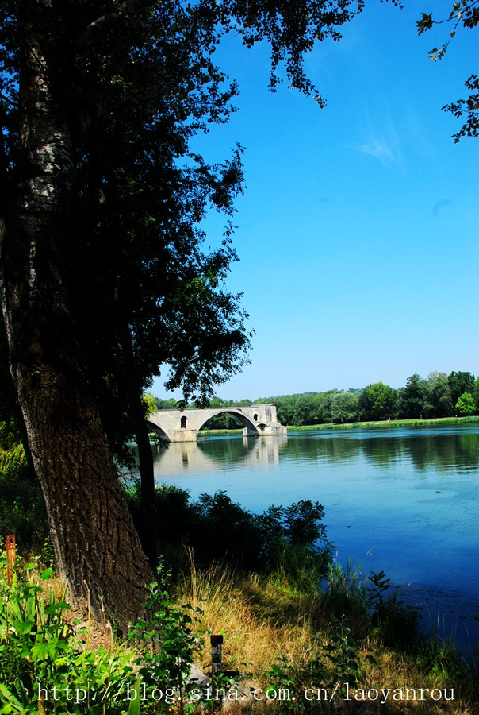

远眺阿维尼翁圣贝内泽桥

DAY 6.2 阿维尼翁圣贝内泽桥-马赛圣母守望院

教皇宫的参观尽管意犹未尽，然而已订好中午火车票去马赛的我们由于行程较紧只能悻然离开这座基督教领袖的殿堂前往圣贝内泽桥，传说这座桥是一位叫做贝内泽的年轻牧人听到圣音的指示，经由天使的带领，花费了8年的光阴建造的,此桥原有900米长，由22个拱型桥墩组合跨越罗纳河（Rhone）的两条支流，但由于17世纪中期罗纳河河水泛滥而导致大部分的桥墩被冲毁，仅剩余4根，因而又有“阿维尼翁断桥”之称。我们顺着阿维尼翁的古城墙外的罗纳河一路向着断桥走过去，静谧碧绿的河水从身边淙淙流淌而过，河岸两旁高大的柳树和水草郁郁葱葱，水静河飞的感觉霎时油然而生。从树丛间隙中远眺圣贝内泽桥，只见近千年的古老残旧的桥身在四根残留的桥墩支撑下顽强地伫立在罗纳河滔滔的河水中，颇显得有点孤寂又略带悲壮的意味，而当我们真正走上断桥桥近距离参观的时候才觉得此桥确实“只可远观不可近玩乎”，因为惟有从远处观看，圣贝内泽桥才能在罗纳河两岸风景的映衬下散发出其独特的残缺美的味道，法国人在对待历史建筑的态度也由此可见一斑，就如同他们对待美神维纳斯的断臂一样，从来都是修旧如旧，不愿轻易破坏其原有面貌，若他们象某些国人一样打着保护文物的旗号将文物古迹修复得焕然一新的话，恐怕无论是给维纳斯硬拼接上两条手臂还是将圣贝内泽桥重修连通，所造就的不伦不类的所谓“文物”也绝对难以被世人所接受吧！因为有些时候残缺也能产生慑人心魄的美，与其生拉硬凑倒还不如返璞归真，无论是死的文物还是活的人生大约也应遵循如此之理吧！

阿维尼翁圣贝内泽桥

桥下划皮划艇的人们

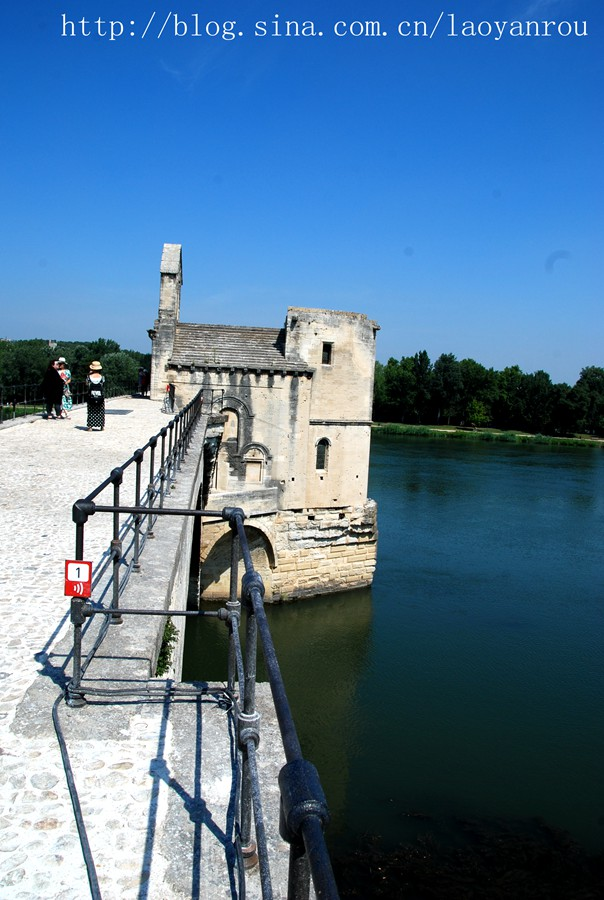

近处的阿维尼翁圣贝内泽桥

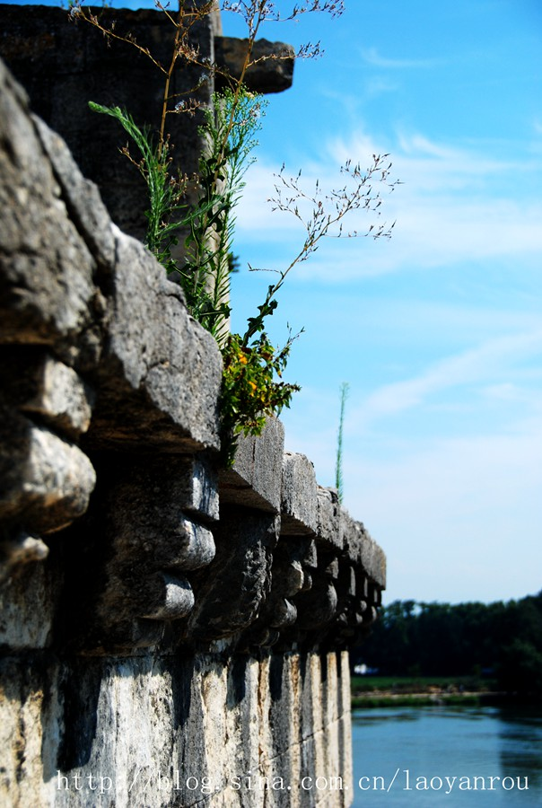

阿维尼翁圣贝内泽桥一角

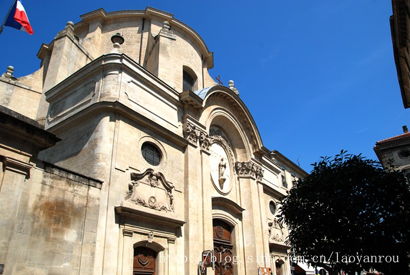

阿维尼翁街边某建筑

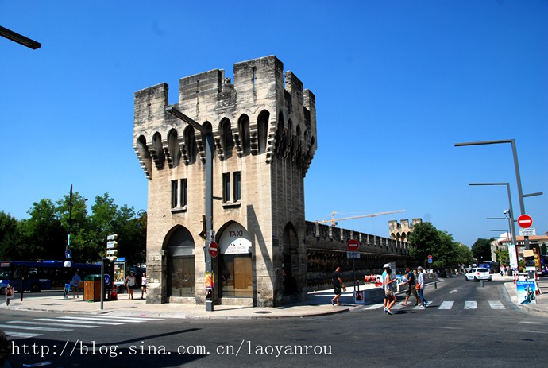

阿维尼翁老城门

从圣贝内泽桥赶往阿维尼翁老火车站的路上，我们顺着来路仿佛电影胶卷倒片似的又一次穿过了宽阔的教皇宫广场和狭窄古老的老城街道，而此时老城中熙熙攘攘的人流随着日上中天也渐渐多了起来，如潮水般将老城古朴闲逸的韵味一点点冲淡直至完全淹没。等我们赶到老火车站的时候，时间已经迫近马赛火车发车时间，而我们还要从老站坐穿梭列车赶回酒店拿行李再去TGV火车站坐车。俗语云点背的时候喝凉水都塞牙，我们瞅了列车时刻表的大屏N久都没看见哪趟穿梭火车或是TER火车是马上开往TGV车站的。此时已容不得任何犹豫和等待了，赶紧拖上LP和小孩跳上一辆停在老火车站外搭客的奔驰的士，也顾不上考虑要花多少钱搭一趟所谓“豪车”就直奔酒店而去，幸好在车上了解到在法国打的不分车辆档次只是按距离收费，所以下车付了20多欧车费的时候顿时觉得底气十足，心中暗呼“法国的士万岁！”。但是万万没有想到的是伴随我们的霉运竟远还没有结束，等扛上行李赶到TGV火车站的时候发现开往马赛的火车无论是普通的TER还是TGV列车均出现长短时间不一的晚点，我们当时心想“晚就晚一点吧，反正去马赛只需大约一个小时，我们还有大把时间可以在马赛逛个半天”。没曾想还真是哪壶不开提哪壶，由于我们所搭的TGV列车同时有头尾两个车次号，当我看到打头的陌生车次号后一时没反应过来以为是前一辆晚点的火车就没上车，结果就活生生地错过了车。无奈只好灰溜溜地找售票处工作人员给改了下一趟车，这一来回折腾使得我们赶到马赛的时候时间已经接近下午4点多钟了，幸好法国天黑得晚而且所定的IBIS酒店就在火车站旁边，可以较快安顿好，否则我们就别指望能出去逛下马赛这座历史可追溯至罗马帝国时期的老港口城市了。说归说，我们还是快马加鞭，急匆匆赶上了一班地铁在老港口附近下了车（实际上酒店离港口距离只有两三个地铁站而已），由于之前在酒店已经做好了规划，所以计划第一站先登高占领马赛的制高点——毗邻港口的一座山上的马赛圣母守望院，想必从高处俯瞰整个马赛的感觉会相当地“一览众山小”吧。为了节省时间和脚力我们在港口广场搭了一辆开往守望院的公交车，在马赛城狭窄而蜿蜒向上的老城街道中穿行了半个小时后来到了山顶的公交车终点站，下车后回眸一看便禁不住为我们登顶的英明决定所倾倒，山顶望下去的马赛老城和港口如同童话里微缩的城堡一般静静地沐浴在地中海的慵懒的夕阳下，港口内外进出的游艇和轮船缓缓地在蓝色的画布上划出一道道白色的水线，天空中不时传来的海鸥“欧欧”的鸣叫声给整幅绝美的画面又颇添了几分欢快感。而我们之前一直被前人攻略所反复灌输的马赛又脏又乱的概念于此时轰然倒塌，不由慨叹马赛不愧为地中海沿岸的一颗璀璨的明珠，即便是遭受了诸多如移民问题、治安问题的困扰，仍不失其作为公元前1世纪的古罗马帝国在高卢所青睐的第一个定居点的荣光。

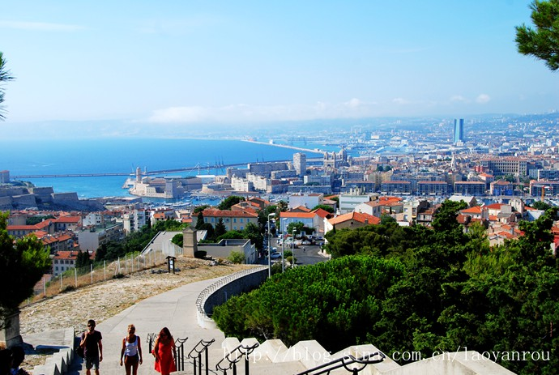

马赛圣母守望院俯瞰马赛港

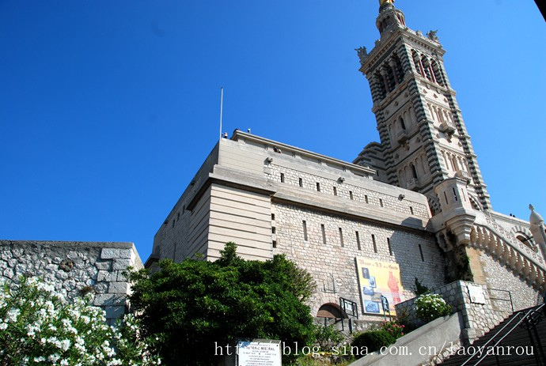

马赛圣母守望院

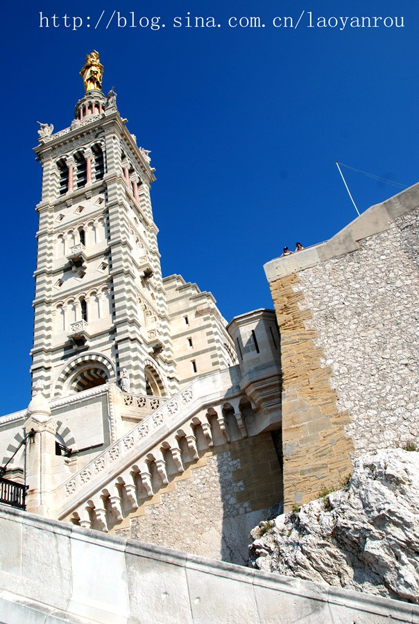

马赛圣母守望院

山顶的圣母守望院名副其实地站在高高的山岗上守望着马赛和它的子民，其钟楼高60米，顶部是圣母的巨大雕像，高约11.2米，据说，几乎在马赛的任何角度以及数里外的海上都可看到这尊闪闪发光的圣母像，由于教堂兴建于19世纪中叶迄今不久，因此整体上与我们在法国看到的其他因年代久远而颇显老旧的教堂（如巴黎圣母院）相比要显得崭新许多，而且修建教堂的石材大多是从意大利运过来的大理石和斑岩，因此无论从建筑风格还是装饰材料来说均不失为一件颇具地中海风格的优秀建筑艺术品。这种感觉在我们走进教堂内部后便愈发强烈了，其内部的立柱、拱廊和墙壁均由白色的大理石和红色的斑岩相间砌成，清新而不失庄严，其顶部的几个巨型穹顶也大量采用了金箔和略带阿拉伯风味的图案进行装饰，美轮美奂令人炫目。但同时也令我颇感疑惑的是马赛圣母守望院究竟应当定位于哪一种风格类型的建筑？若说是罗马式建筑吧，它的确还真有一些圆拱的建筑特征，符合罗马建筑“圆拱、粗柱、厚墙、石雕装饰”的特点，但它也同时具备了从法国发扬光大的哥特式建筑“高顶、尖拱、细柱、薄墙、玻璃装饰”中的高顶及玻璃装饰的特征，不仅采用了意大利的建筑材料，而且装饰中又使用了一些阿拉伯风格的元素。如此搭配出来的多元化风格的建筑确实令人不禁赞叹建筑师雅克•亨利•埃斯佩朗迪厄的伟大之处在于汲取了数种建筑风格的精华而实现了多种文化融合，或许这也正是马赛从古罗马帝国的高卢时代开始至今凭借其优越的地理位置成为各种文明、种族和文化融合交汇的国际都市的体现之一吧！当然无可否认的是，多种族的汇聚并不只是简单的融合，也不可避免地将产生文化的碰撞和冲击，比如网上经常传言的马赛比较乱、治安较差的现象估计也是由于其他种族如吉普赛人、非洲人、西亚人等大量涌入而引起的，作为一个极具自由民主、开放包容历史传统的国际化都市该如何应对连绵不绝的异族和文化对城市管理的冲击而能保持其良好的国际形象和声誉确实是摆在马赛政府甚至法国、德国、英国等欧洲老牌发达资本主义国家政府面前的一道千古难题。尤其是前不久由于叙利亚ISIS战乱而导致大批难民涌向欧洲避难后这一问题显得更为突出，其实归根到底不论哪个民族只要能体面地活着没有人愿意背井离乡去给别人家添乱，正是由于民不聊生，生灵涂炭才被迫踏上异乡的土地去争取一点有限的生存权利。我们应该同情并原谅这些独在异乡为异客的人们，尽管他们中有极小部分为了生存不惜干一些偷盗抢劫的勾当而伤害了他们所容身的城市和居民。对于他们我认为只能做两件事，要么择其善者留之、摒其恶者改之使他们真正融入当地的社会，要么就是从根子上解决，真正帮助难民所在国家恢复和平和稳定（决不能象某些国家打着维和的旗号惺惺作态无所作为任其混乱而不顾），重建一个安居乐业的环境使难民们能重归故里，如此尘归尘、土归土对大家均不失为一种更好的解脱。

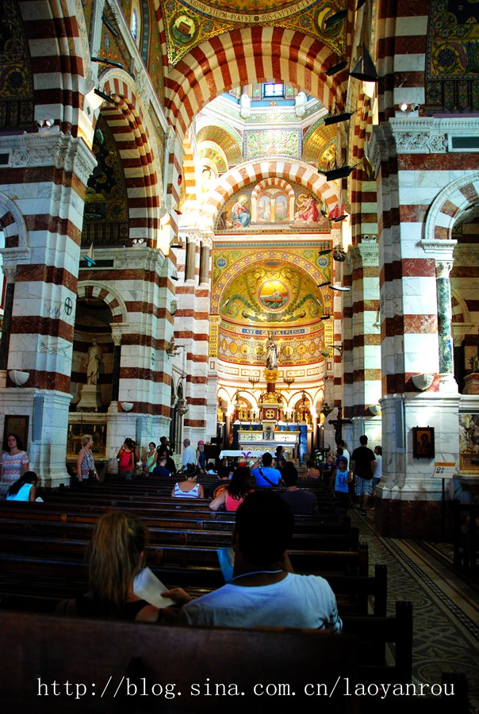

马赛圣母守望院内景

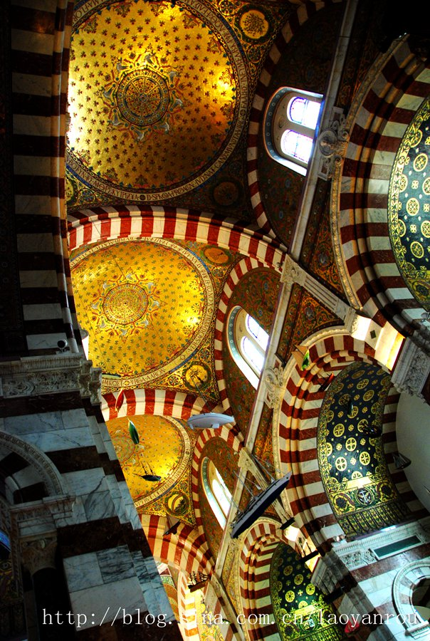

马赛圣母守望院穹顶

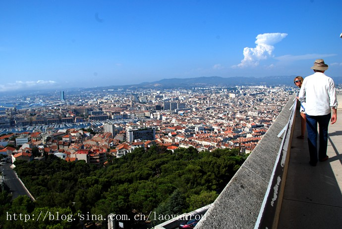

马赛圣母守望院俯视马赛城

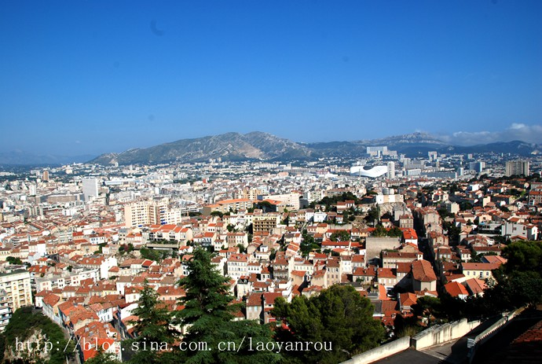

马赛圣母守望院俯视马赛城

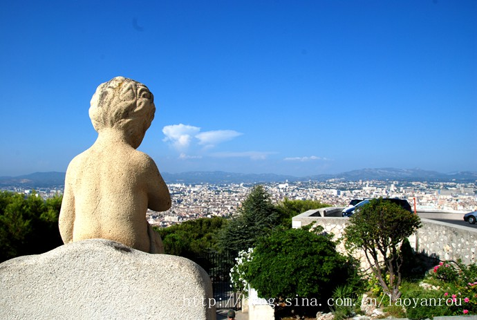

马赛守望者

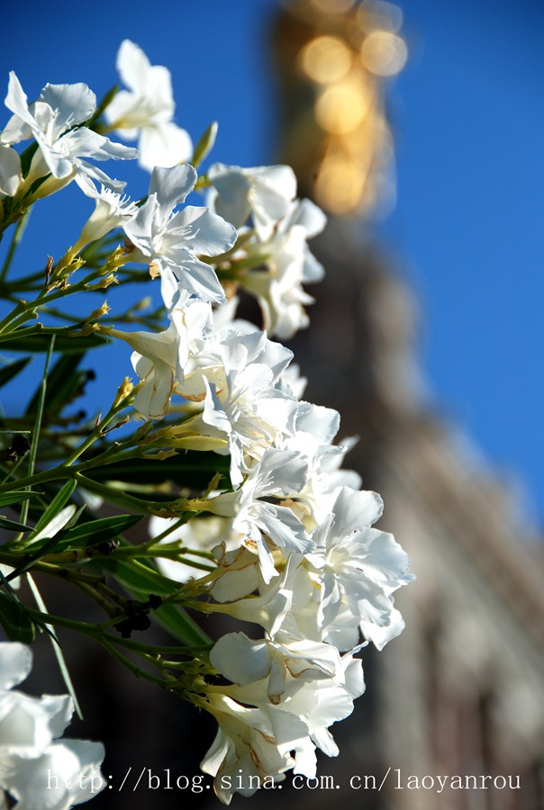

无名花

马赛圣母守望院
