# 欧游札记之徜徉法兰西(DAY6.3马赛圣维克多修道院-马赛鱼汤)

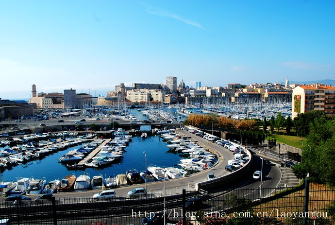

马赛老港

DAY 6.3 马赛圣维克多修道院-马赛鱼汤

下山的时候我们放弃了继续搭乘公交的想法，因为从山顶望下去港口就在山脚下，而且有条台阶直通山脚估计走路也花不了多少时间便可抵达马赛的第二个景点—圣维克多修道院，这座雄踞于旧港南岸的修道院是于公元五世纪在古代旧城遗址上建立起来的，据说修道院的城下教堂内，藏有公元五世纪的重要文物以及许多基督徒和异教徒的遗骸，而整个普罗旺斯地区基督化的进程也正是从这座修道院开始的。顺着台阶走下山摸索找到了修道院后，我们发觉当天的倒霉劲还没过，已经到点关门休息的修道院结结实实地让我们吃了一个闭门羹。想想今天所遭遇的种种不顺，我们只有用“凡事都要留一些缺憾”的自嘲精神来安慰自己了。但其实最终也不完全是一无所获，当我们在修道院前拍了几张相片留念后竟发现在如此神圣的修道院墙外的隐蔽拐角处竟然有好几摊插着
“1
EU”招牌的水果蔬菜走鬼档一字排开，一大群帮衬的顾客和档主卖力地讨价还价好不热闹，看来对宗教的敬畏终究也敌不过柴米油盐酱醋茶的压力啊！兴许法国人其实也不尽如我们想象的如此阳春白雪高雅浪漫，遇到精打细算的生计问题一样不能免于落入俗套，此即所谓的搞艺术和创作的往往是吃饱了没事干的人的缘故吧，试想若是连肚子都填不饱何来浪漫高雅可言呢？这也算是我们参观修道院未果而收获的一个小插曲吧！

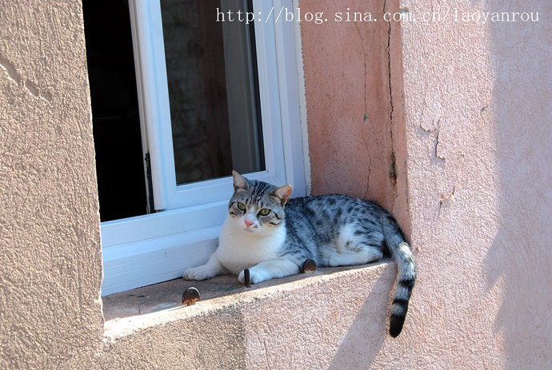

马赛路边的小猫

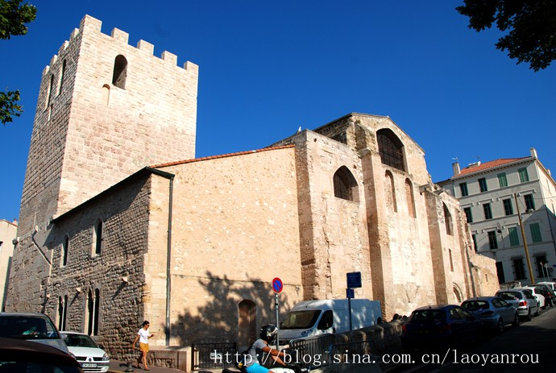

圣维克多修道院

马赛老港

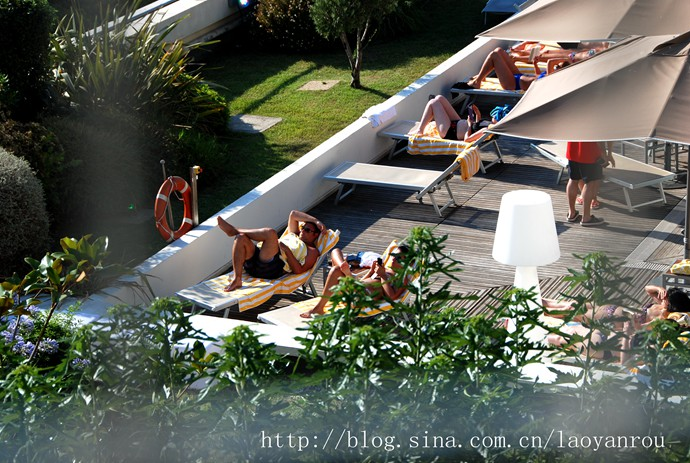

晒日光浴的马赛人

说到肚子问题，我们其实早已对马赛著名的鱼汤有所耳闻，在圣维克多修道院碰了一鼻子灰以后便化悲愤为食欲，顺着马赛老港南岸的街道绕着到了东面的港口广场，拧不过两母女补充弹药的需求在广场附近的Amorino小天使冰淇淩店打了下牙祭，然后满血复活似地直杀向港口北岸的La
Miramar鱼汤店，我们一开始还担心该店名气太大去晚了连位置都找不到，可到了一看才发现是多虑了，大多餐饮店铺都是要到晚上九点钟才开始正式营业，而我们按照国内的用餐习惯八点钟多就赶过去的话也只能扑空了。已经被一天的不爽折磨到麻木的我们毫无抱怨地直接改道去了旁边的一家Savon
de
Marseille马赛肥皂店去购买据说是旅游手信必备的马赛肥皂，传统马赛皂的一项必要指标就是其必须含有仅从橄榄油中制得的72%的脂肪酸(十七世纪由法国国王路易十六规定了此制作标准)，因此即便被五颜六色形状各异的马赛皂晃得眼晕，我们还是坚定不移地按照网上的推荐选择了一些颜色暗淡、气味清香、形状不规整的马赛皂纳入囊中。（PS：
回国后洗手很好使，干净清香耐用，确为旅游之必备手信，居家之必用佳品！）。买好肥皂也没啥地可去了便在肥皂店外的码头边找了一长凳坐着干等了，旁边长凳的两位看似韩国的漂亮MM突然扭过头来问我几点钟了，差点被受宠若惊地搞得小心肝一颤颤的我好不容易定下神来看到她们直勾勾盯着我的手表才恍然大悟，悻悻然地告诉她们时间尚早未到九点，原来她们也是冲着喝马赛鱼汤来的。考虑到La
Miramar鱼汤店人气太旺，价格必定不菲，于是和LP商量着就在刚才买肥皂时路过的一家同样提供鱼汤的Les
Galinettes餐厅对付一顿得了，于是我们一家三口踏正九点便第一个正襟危坐在餐厅露天的餐桌边上了，而第二位进来的顾客竟然是刚才问我时间的那两位韩国MM！如此之巧不由得你不信，所谓人生何处不相逢啊！还没来得及继续唏嘘呢，服务生的一句话就立刻把我们硬生生地拽回现实来——“马赛鱼汤需要提前预订才能提供”。我擦！已经被命运捉弄了一天的我气急攻心，差点没马上跳起来走人。还好他又补充说了一句话便把我牢牢摁在凳子上了—“虽然没有马赛鱼汤，但我们可以提供类似的鱼汤”。唉！你早说不就没事了么，搞得俺一惊一乍的多不利于身心健康啊！我心里合计着反正都是各种鱼熬的汤，不见得马赛鱼汤就能高明了多少去，而且价格还实惠，舍此其谁呢？于是欣然地点了一份鱼汤、一份牛排和一份意粉便百无聊赖地吃起服务生送过来的面包片来，颇为期待地等了好一会把面包片都干光后总算守得云开见月明看见服务生把一大碗黄橙色的汤及其配酱和配料端上来了，但总感觉好像哪里不太对，仔细回想当时在网上看到的喝鱼汤的程序，一拍大腿“坏了！要给咱国人丢脸了！”，因为我们把原本是用来蘸鱼汤吃的面包片当成餐前小食给吃光了，难怪服务生看到我们在鱼汤没上前狂吃面包片的眼神都是怪怪的，保不准心里还在暗自嘲笑咱们土鳖呢。没办法认栽吧，我们只有死乞白赖地让服务生又上了两碟面包片，往鱼汤里倒入了酱料和配料，然后把三五面包片直接浸入汤中，看着其吸收了鱼汤的汤汁而慢慢发涨，心里嘀咕着这也能叫喝汤？不就和我们以前小时候用油条蘸豆浆的吃法一个造性么？不过你还别说，等我们把湿哒哒、软趴趴的面包片送入嘴里的时候，那种新鲜的鱼味马上顺着面包中渗出的汤汁直抵味蕾，回味无穷，的确不失为马赛当地独特的一种享受鱼鲜的方式。吃饱喝足后心满意足地环顾四周，不知不觉中原来仅坐了我们一家和韩国MM两桌人的露天餐厅已经座无虚席了，基本每个桌上都是一盆鱼汤，尽管和真正的马赛鱼汤（据说由二十几种海鱼熬制而成）有一定差距，但总算是不虚此行了。

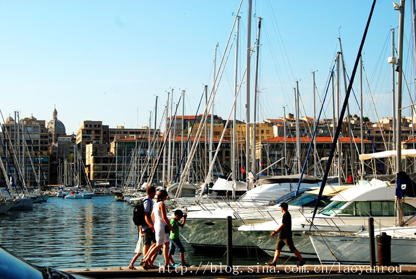

马赛老港的游艇

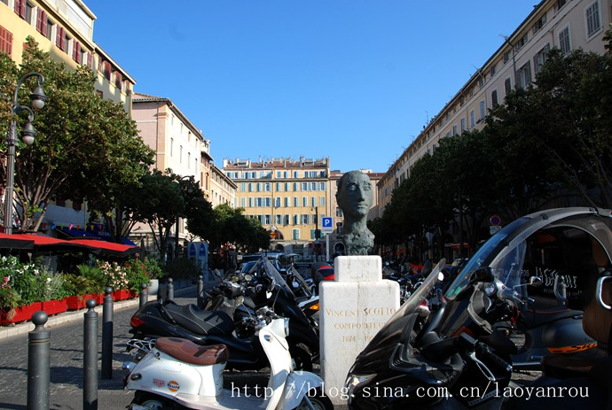

老港附近的雕像

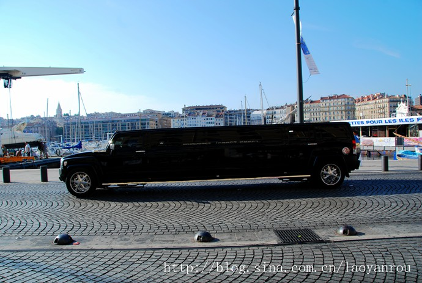

老港码头的加长豪车

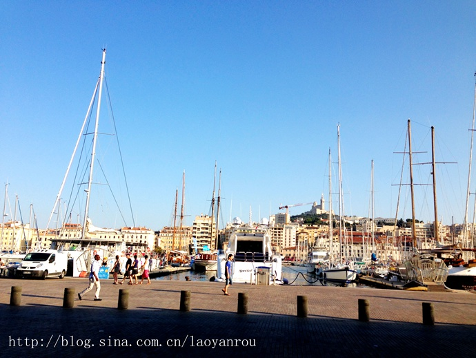

夕阳下的马赛老港

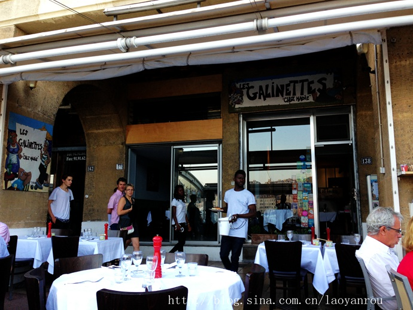

晚上用餐的餐厅

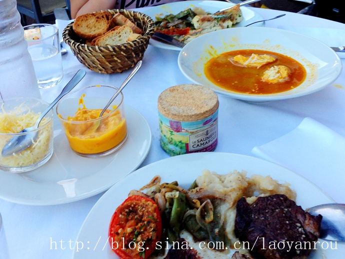

马赛鱼汤

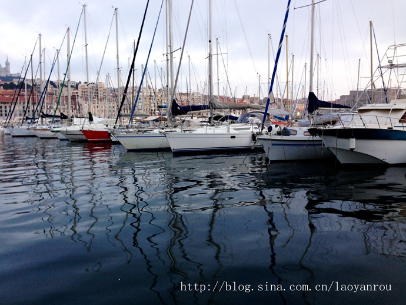

老港停泊的船只

买完单的时候天色也逐渐暗下来了，但天空尚有余光，所以我们大胆地做了一个现在回想都有些后怕的决定——走路回酒店。其实从马赛老港走到酒店估计也就二、三十分钟左右的路程，不过心里还是对网上传言的马赛令人堪忧的治安环境颇为忐忑，因此尽量选择了路灯看起来比较明亮的大马路，两大人中间夹着一小孩左顾右盼保持警惕地快速前行。随着夜色渐浓，行人变稀，貌似街头游荡者开始出现，我们的心情也愈发紧张，拽着小孩的手心也汗涔涔的，好不容易走跑并用地回到了酒店附近的马赛火车站广场的时候，又被广场台阶上几个嘻哈风格的小混混行注目礼搞得心里发毛，诸多担惊受怕后总算有惊无险地回到了酒店，还是古话说得好“小心驶得万年船啊！”​

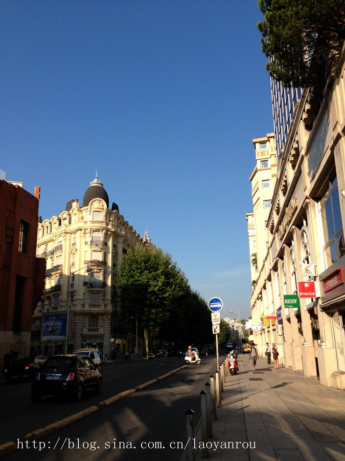

马赛街道
