# 欧游札记之徜徉法兰西(DAY8.2格拉斯香水小镇)

格拉斯花宫娜香水坊

DAY 8.2 格拉斯香水小镇

在车站没等多久我们便一起登上了开往格拉斯的巴士，在某个小镇巴士站，小伙子下车前爽朗的回头跟我们打了个招呼道别，看着他跳下巴士的身影消失在宁静朴素小镇的巷子里，心里面默默祝福他能找到自己心中的归宿。而我们要去的格拉斯小镇大约在半个小时后便出现在视野中了。至今仍号称世界香水之都的格拉斯被称为是嗅觉的天堂，公元17世纪因生产皮革需祛除异味而开始制作香水，兼之其自然环境也适合蔷薇、茉莉等香水原材料生长，从此便一发不可收拾，继而发展拥有了众多的香水博物馆、试验室以及生产厂。其实我们对小镇的第一印象不太好，毕竟这里商业味道浓郁很多，顶着香水之都的头衔，小镇街道上的汽车来回穿梭、行人匆匆如鲫，两旁琳琅满目的各类商店包括香水店比比皆是，给人感觉不像是到了法国南部的一个乡村小镇反倒像是到了巴黎附近某座中小城市一般，不过可能千人千面各有所长吧，这里本来就不是以乡村风光而闻名的，到访的游客主要还是冲着香水而来。

香水小镇的紫色鲜花

格拉斯小镇街道上的花饰

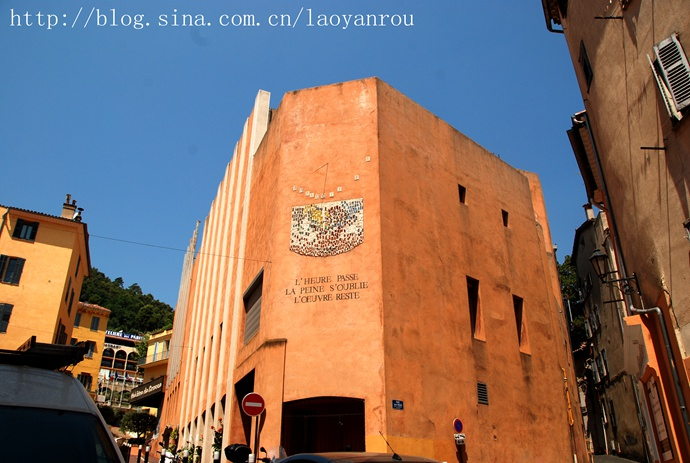

香水小镇老建筑之一

尽管往镇中心走了没多久便看见了著名的花宫娜香水坊的招牌，但我们还是按耐住躁动的心情先去造访了镇上的国际香水博物馆来扫扫盲，进去看后才发现博物馆里陈列的展品简直就是一整部完整的世界香水发展史！收藏了从古埃及到现代的香水瓶及其他化妆用品近4000多件，不同年代、各式各样、五光十色、材质各异的香水容器满满当当地摆满了好几个馆的陈列柜，使人不得不惊叹人类为迎合女性对香水的欲望而爆发出的无穷想象力和创造力，偷偷说句比较反动的话就是“唯小人与女子难养也！”。更为令人啧啧赞叹的是，博物馆还陈列展示了各年代制作香水的器具和工艺方法，并且还很细心地在每个展馆设置了很多种不同香水的嗅觉体验机器，使得游客整个参观过程都游走在各种香味萦绕中，果真达到了喜“闻”乐见的境界。

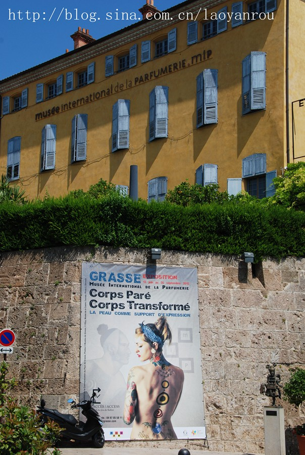

国际香水博物馆外的广告

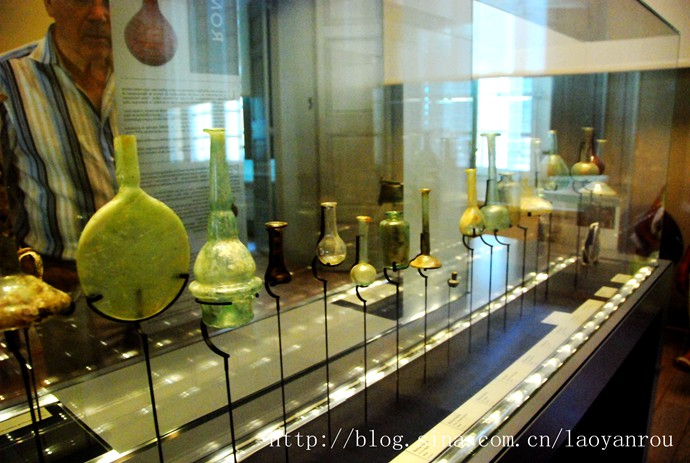

香水博物馆中不同年代的香水

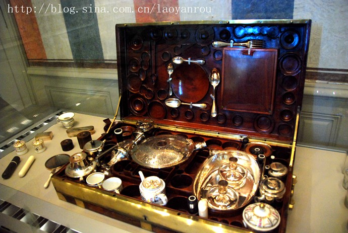

貌似皇室餐具套装

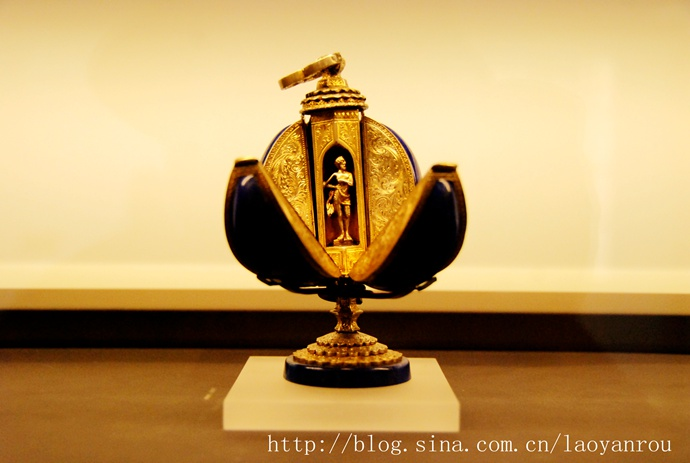

雕工精致的香水瓶

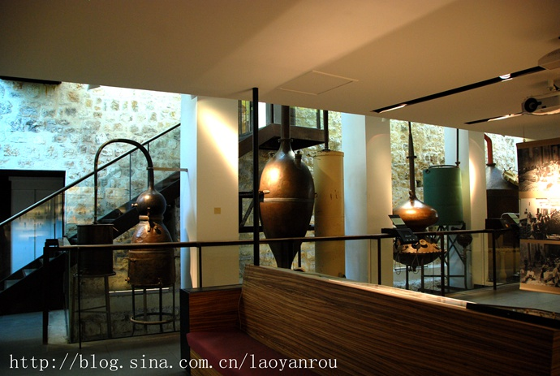

香水制作工具

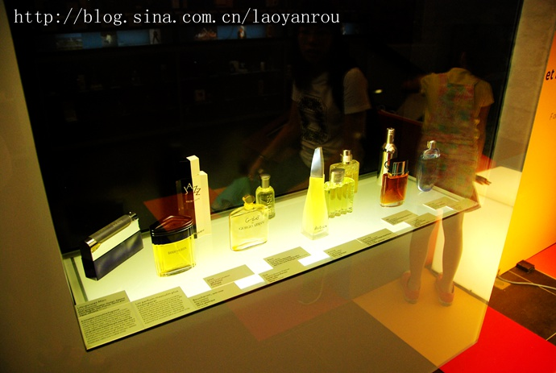

现代香水陈列

把国际香水博物馆看下来后，接下来去花宫娜香水坊就变得轻松多了，尽管那里也陈列了不少关于香水的各种历史物品，但与博物馆所看到的基本八九不离十，我们只需走马观花浅尝即止地随便看看就够了。在花宫娜香水坊我们所关注的最重要的事情，更准确来说应该是LP和女儿更关注的是如何挑选购买香水手信来犒劳自己和亲朋好友。但是在花宫娜买香水说起来容易，实际要下手的时候看到里面几大类柜台摆满琳琅满目、五花八门、档次高低不一的各种香水的时候确实还是存在选择困难问题的。于是我在LP和小女已经闻了不下几十种香水样品试纸并似懂非懂地比较了一大圈以后，终于忍无可忍地建议她们挑了一盒物廉价美的香水套装，里面有十几种不同香味的香水，而且每瓶的容量仅十来二十毫升，如果拿来送人可选择性多，即使不好用也不造成太大浪费。等买了单心里暗自庆幸幸好LP她们平常不好喷香水，否则我的钱包又要为这些令全世界女人痴迷的法国香水而饥肠辘辘了！不过话又说回来，其实香水的起源也并没有今人所想象的那么诗情浪漫，据说以前法国的皇帝由于特殊的卫生习惯长期不洗澡而导致身上异味很重，为了掩盖其身体的异味才命人发明制造了香水，后来经皇室及达官贵人的仿效推广而慢慢变成了一种全球流行的时尚。直至今天尽管大部分人喷洒香水是为了增加自身的时尚感并希冀唤起异性荷尔蒙上升，但仍有部分人比如欧美或非洲地区的男士还是借香水来掩盖浓重体味的，试想若是体味过浓未能被完全掩盖的话，那种香水和体味混合的酸爽对周边人们将会是怎样一种嗅觉折磨啊！反正对我来说最多只能接受清淡的纯天然香水味，喷上浓郁夸张的香水招摇过市在我看来无异于是一场悲剧，不是万不得已还是保持天然的体味最好吧！（PS：估计好多香水制造商要打我）

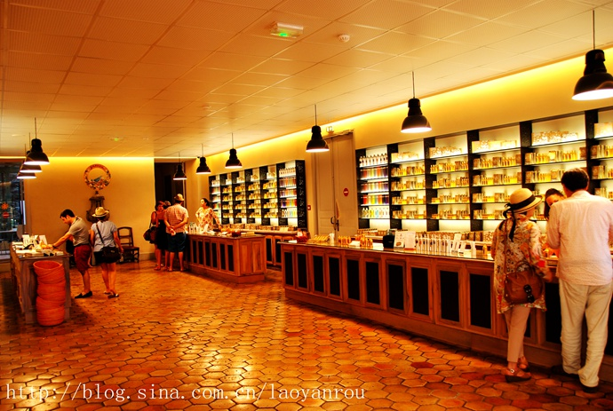

花宫娜香水坊的香水专柜

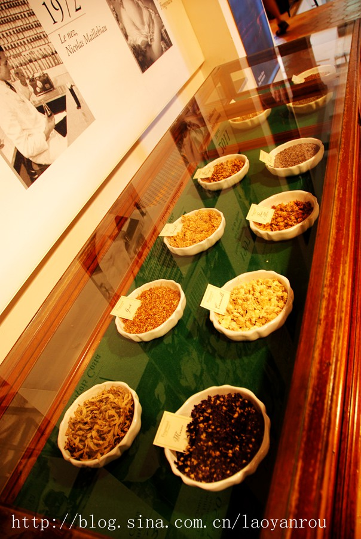

制作香水的各种香料

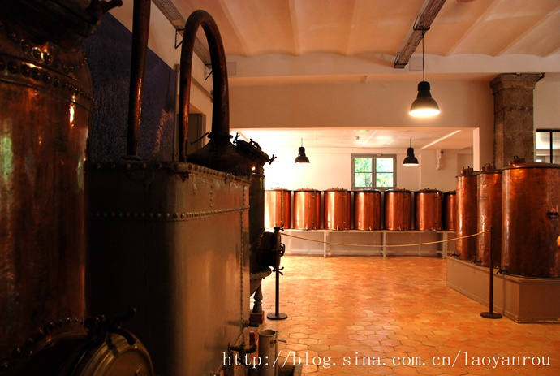

香水制作器具之一

领着心满意足的两母女离开花宫娜香水坊以后，格拉斯小镇的其他建筑或景色似乎都无法再引起我们更多的兴趣了，不过说实话这里除了香水也的确没什么值得看的。所以我们头也不回地登上开往尼斯的巴士，询问了司机去圣保罗小镇转车的站点后便在车上小憩了一会。到了中途转车去圣保罗小镇的站点，在近半个多小时的等车过程中，我们着实担惊受怕了一把，因为就在巴士站旁聚集着一大群身上有纹身、奇装异服的小年轻，他们就这样三五成群围着肆无忌惮地在大声招呼谈论着什么，看到黄皮肤的我们还有意无意地多扫了几眼，搞得从来没想到会在南法乡下见到纽约黑帮聚会场景的我们诚惶诚恐的不敢多瞄他们一眼，不过幸好我们不是他们的菜吧，好不容易熬到他们纷纷开上自己的汽车或摩托车大呼小叫地扬长而去后我们这才大大松了一口气，赶紧登上往圣保罗的巴士，半个多小时后心情逐渐平复后才抵达了圣保罗小镇。

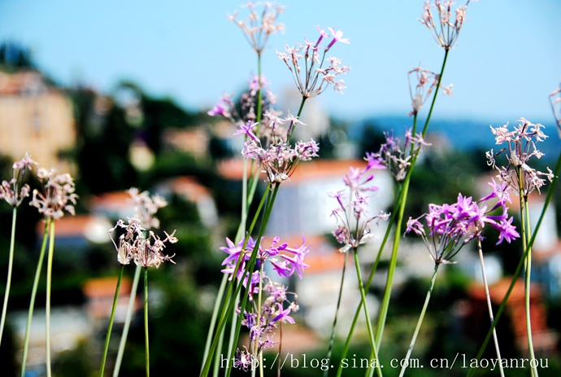

香水小镇巴士总站旁的无名紫花
