# 欧游札记之徜徉法兰西(DAY10.3阿讷西湖)

阿讷西湖上的三角帆船

DAY 10.3 阿讷西湖

时间不早，我们登上游船开始了将近两个小时的游湖，据说这是每个来阿讷西的游客必作功课。等船离开港湾开到湖面上的时候，方才发现阿讷西湖的“大”，碧绿清澈的湖水一直延伸到远方看不见的延绵起伏的阿尔卑斯山脉的山脚下，湖水颜色也随着湖底深度增加逐渐从岸边的浅绿色慢慢变为深绿色、墨绿色，但无论颜色如何随光线而改变，源自于阿尔卑斯山雪山的湖水依旧保持清冽纯净、沁人心腑的本质，若从空中俯视的话，阿讷西湖宛若仙人无意失落人间的一块翡翠一般，晶莹剔透，鲜翠欲滴。

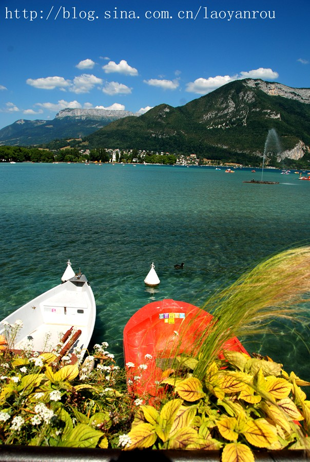

阿讷西湖的各色湖水

与国内很多大湖景区限制游人玩水规矩不一样的是，阿讷西湖无比宽容地拥抱着八方来客，游人们可以搭乘各式各样的小船在湖面上徜徉，有双人的也有多人的，有电动的也有脚踏手划的，有单人小舢板的也有三角翼帆船，划船晒太阳腻味了还可以直接冷不丁一个猛子扎入冰凉的湖水中酣畅淋漓的畅游一番，这些“城会玩”的不仅包括成人而且更多的是一些未成年小孩和青少年，这在视小孩私自下水游泳为洪水猛兽的国内简直是不可想象的。

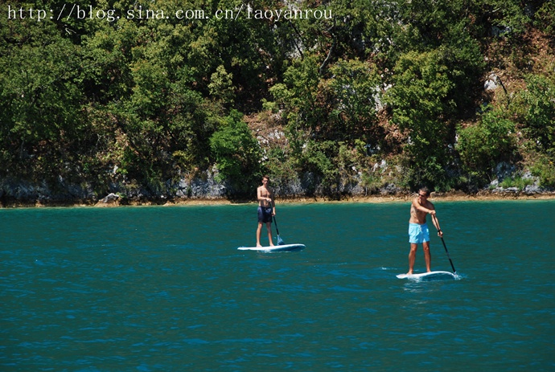

湖里的小舢板

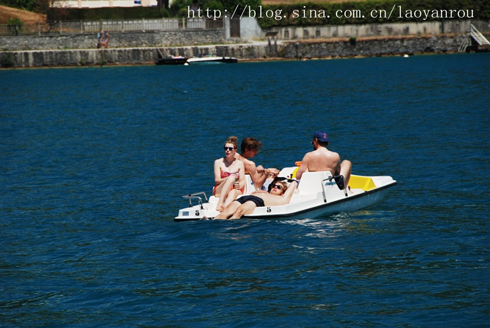

电动船

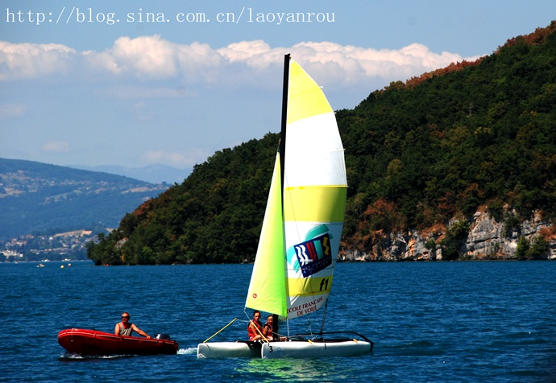

三角帆船

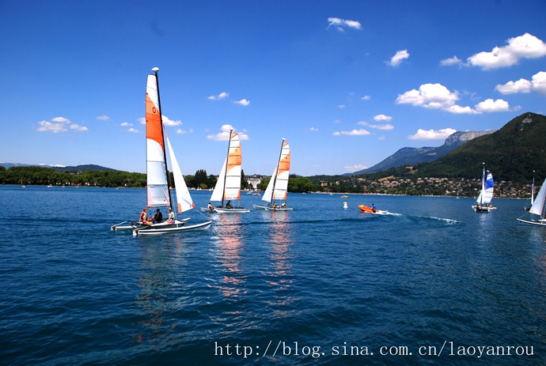

三角帆船

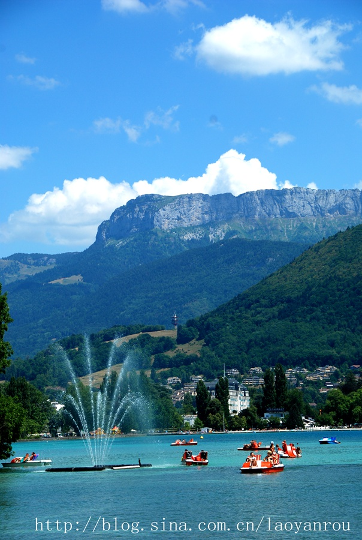

湖边的喷泉

除了在水里嗨皮的还有更刺激的在天上，在远方绿树成荫的山地中拔地而起、裸露出灰白色岩石的阿尔卑斯山峰附近隐隐约约可以看见一些零零星星的滑翔伞爱好者凌空而下，从空中一睹阿讷西湖另一个角度的美。

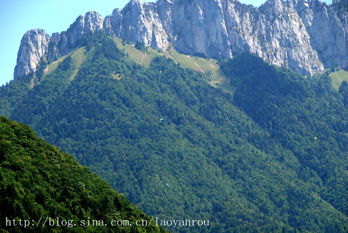

阿尔卑斯山的滑翔伞爱好者

人与湖的水乳交融不仅如此，沿着阿讷西湖岸边有不少小镇的房屋在绿树掩映下时隐时现，屋前湖边的草地上三五成群的本地居民或外地游人都光着膀子悠哉悠哉地享受日光浴，男女老少好不热闹，而且有些临近湖边的老房子甚至还带有石头塔楼，想必就是古时哪位达官贵人的度假别墅吧，足可见人类与阿讷西湖亲密接触历史之久远。两个小时的游湖之旅说短不短、说长也不长，细细回味着在湖中看到的一人一船、一岛一树、一山一屋，所有一切都仿佛汇成一曲人与大自然完美相处的天籁和弦,余音袅袅，绕梁不绝。

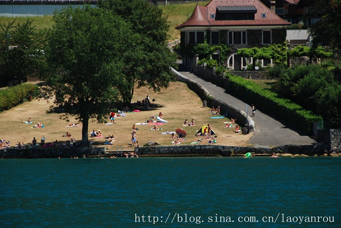

岸边日光浴的人们

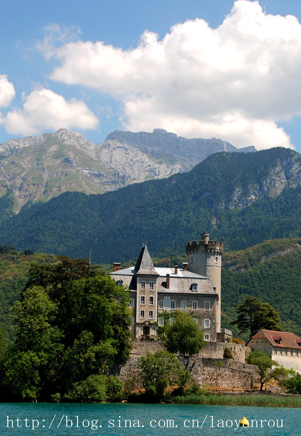

湖畔古堡

从游船上回到岸边，我们信步走进了附近的一个湖滨公园，与法国大部分公园一样，沿袭着凡尔赛花园轻修饰重自然的风格，公园中参天古树林立，林间地面除了碎石和泥土不假修饰，倒是靠近湖边的大片嫩绿的草坪修剪维护得齐整干净，不少法国人在上面席地而坐惬意地嗮着太阳，有带小孩的一家三口，也有貌似退休的老头老太，尤其佩服一些法国老太敢露的勇气，穿得和小年轻一样非常清爽地躺在草地上任凭阳光肆意抚摸，对路边行人的异样眼光熟视无睹，这才是所谓的爱美之心不以年龄为限的真实写照啊！公园里人工修饰最多的是沿着林间小道随处可见供游人休息的长椅，对于精疲力尽的背包客来说无异于雪中送炭的人性化服务，我们在众多长椅中选了一张有树荫的坐下歇脚，迷离的目光一一掠过草地上休憩的人群、湖边的木栅栏和小木屋、澄清碧绿的湖水及水上嬉戏打闹的男女老幼、湖对岸隐约可见的红屋小镇和镇后巍峨秀美的阿尔卑斯山脉，直抵飘着白云的蔚蓝天空的最深处，耳边聆听着啾啾鸟语、嬉笑言谈、还有掠过湖面的山风吹拂柳树叶子的沙沙作响声，呼吸着纯净如水晶一般的清爽空气夹杂着新鲜草味及时隐时现的幽幽花香，终于也是醉了。

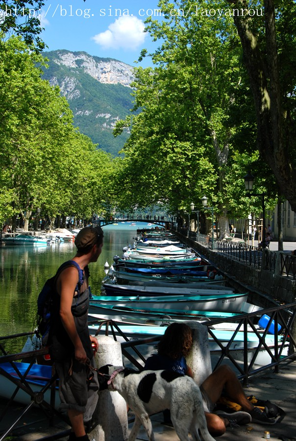

停泊湖边的小船

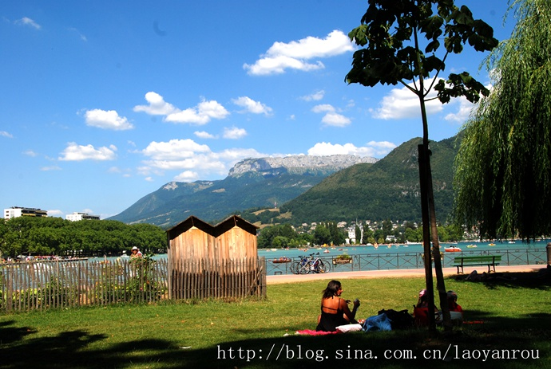

草地休闲的一家

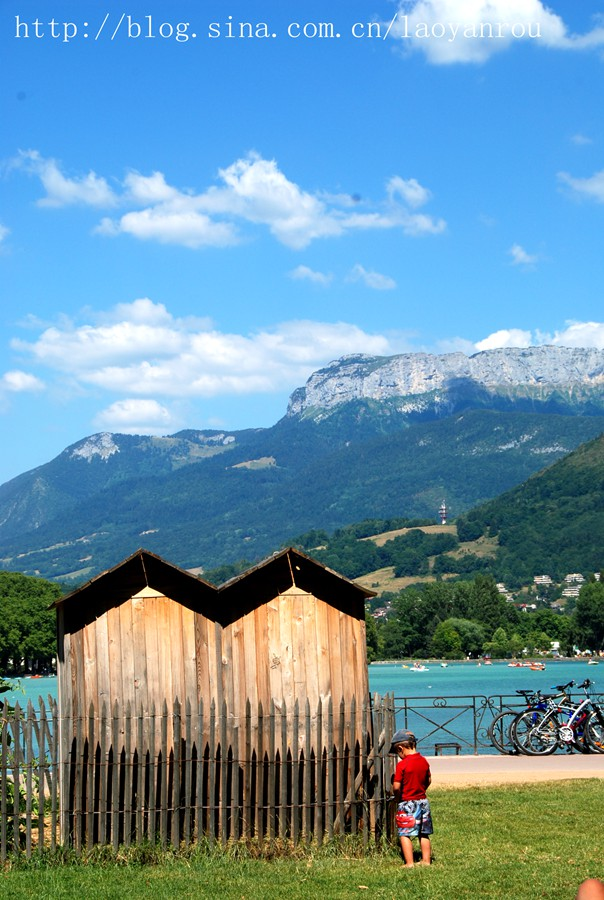

大胆小孩

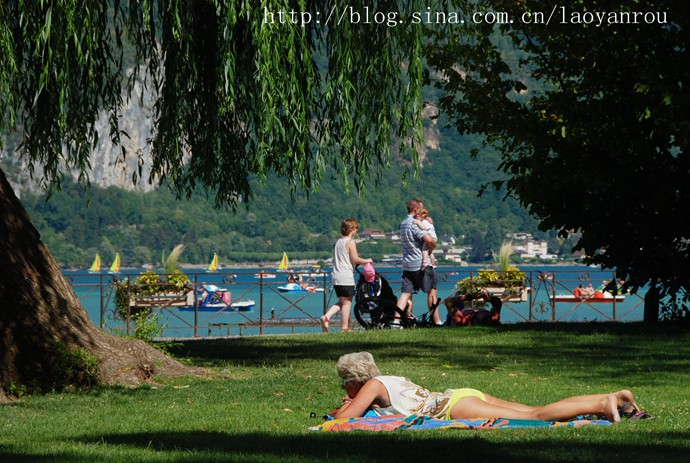

勇敢老太

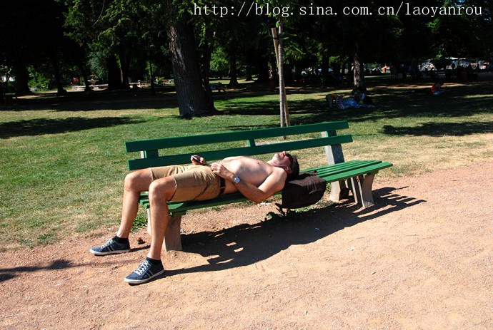

豪放小哥

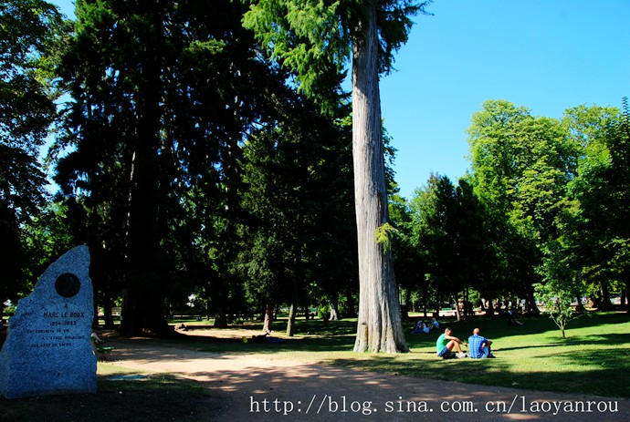

古树参天

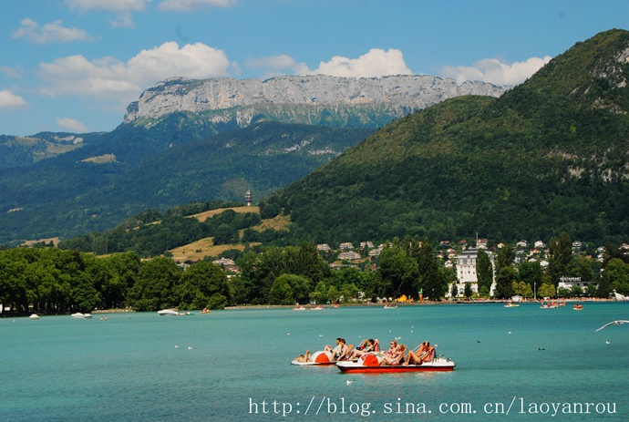

脚踏船

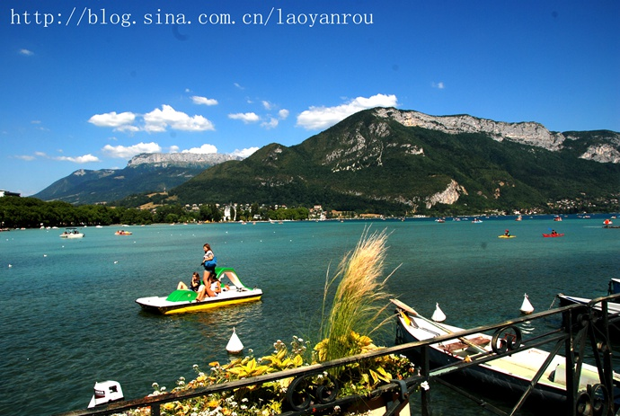

湖畔远眺

一直很纠结该如何全面地评价阿讷西小城，曾居住此镇的法国伟大启蒙主义思想家卢梭认为他在这里度过了“人生最美好的12年”，还有人评价说阿讷西小镇号称“阿尔卑斯山的阳台”，是法国阿尔卑斯山地区最美丽的小镇，他们的溢美之词我认为均不为过，但冠冕堂皇的重复赞誉之词不想多说，我只想说的是作为唯美的旅行者，你一定要来阿讷西、来阿讷西、来阿讷西，重要事情说三遍！而作为普通居民，若有机会的话阿讷西毫无疑问地将是我移民定居的首选之地！​

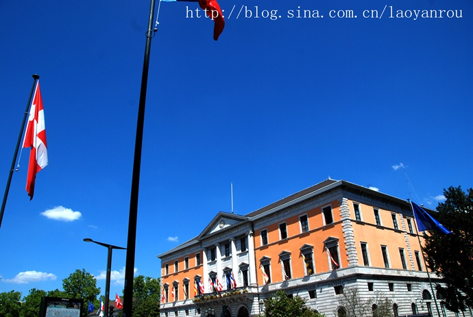

湖边老建筑

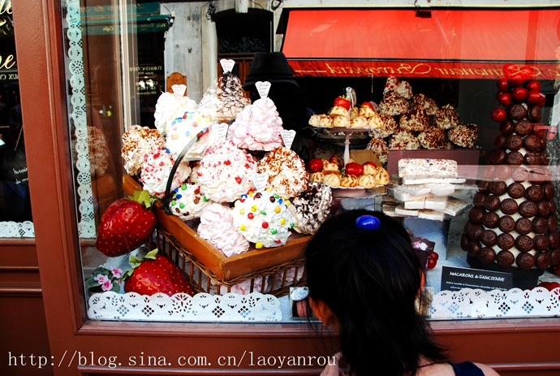

垂涎欲滴

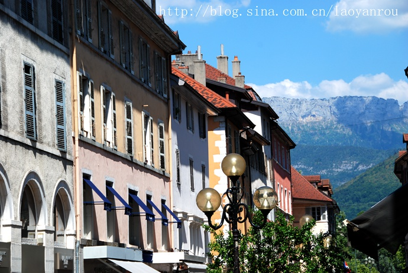

街灯

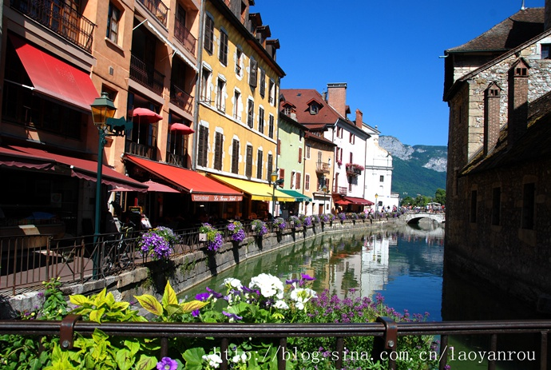

回望阿讷西
