# 欧游札记之徜徉法兰西(DAY11.1巴黎巴士底广场-圣母院)

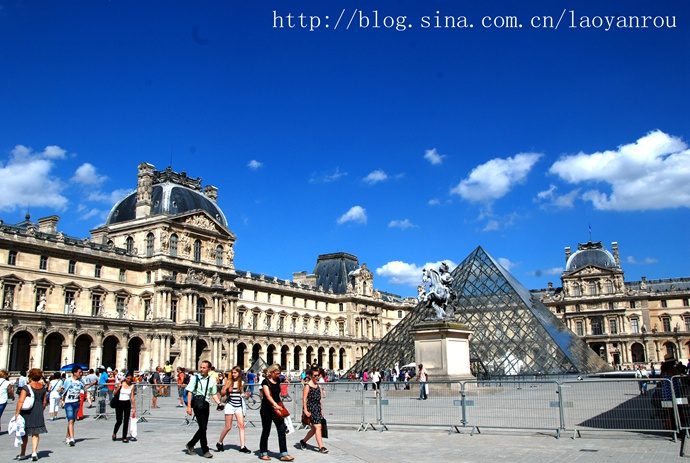

巴黎卢浮宫

DAY 11.1 巴黎巴士底广场-圣母院

在法国南部晃荡了近一周后终于要回到既熟悉又陌生的巴黎，去还之前欠下的未能参观的几个景点的旧债了。从里昂到巴黎的TGV火车速度很快，班次也多，我们大概一个多小时就回到了巴黎，驾轻就熟地住回原酒店后搭乘地铁在巴士底站下了车，和原先预想的一样，位于广场原址象征封建统治的巴士底狱已然随同被法国大革命推翻的波旁王朝的覆灭而荡然无存，留给后人的只有原址改造的巴士底广场及其中央默默伫立的铜柱注视着广场四周川流不息的车流，这座巨大的铜柱高
52 米，柱顶立着象征自由战胜专制暴政的金翅自由神像，是1830年巴黎政府为了纪念“七月革命”的烈士而建造的
“七月圆柱”。巴黎人民是如此痛恨封建专制压迫，甚至连巴士底狱的一砖一瓦都不曾给后人留下，也许可以理解为某些痛苦的记忆可能会随着特定建筑的消失而淡化，但其实有罪的并不是建筑而是利用这些建筑残害压迫人民的封建统治者，恨屋及乌的做法想来不一定是为后人保存那一段历史记忆的最好方法，就像日本731部队在东三省的细菌试验基地以及南京大屠杀的万人坑等等承载了太多血泪记忆的历史场所一样，更应得到恰当的保护以警醒后人前车之鉴，正如列宁那句名言所说的：“忘记过去，就意味着背叛!”

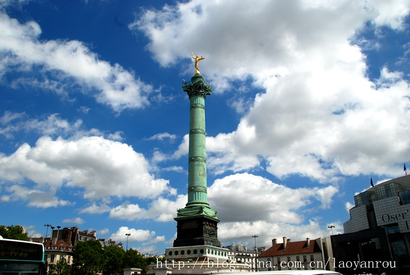

巴士底广场

既然已经来到了巴黎核心城区，我们就打算用脚步来丈量一下巴黎的街道，于是便沿着塞纳河一直朝西岱岛巴黎圣母院走去，希望可以弥补一周前未入内参观的遗憾，和上一次拜访不同，这天的巴黎艳阳高照，蓝天白云下的塞纳河两岸风光旖旎、光艳照人，河水缓缓流淌的岸边一长溜的太阳伞下躺着服装各异的巴黎人，比基尼豪放派、T恤短裤自由派、短袖牛仔的休闲派的男女老少一应俱全，唯一共性之处均是一边慵懒地享受着塞纳河边阳光的“滋润”一边欣赏着河两岸的迷人风光，岸边的人行道上时不时还会有一些小活动比如涂鸦绘画展，儿童公益活动等等，据说不久还会举办一年一度的塞纳河沙滩节，届时将用数以万吨的天然河沙将塞纳河岸变身为一个天然的沙滩供巴黎市民游玩休憩，试想在一个世界最繁华都市的河畔出现海边沙滩度假休闲的景象，岂不会令人误以为是“海市蜃楼”么？游船穿梭如云的塞纳河不仅令游客们流连忘返，而且更重要的是让巴黎人得以将其小资生活情调发挥得淋漓极致。

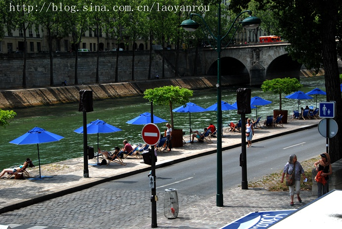

塞纳河畔太阳伞阵

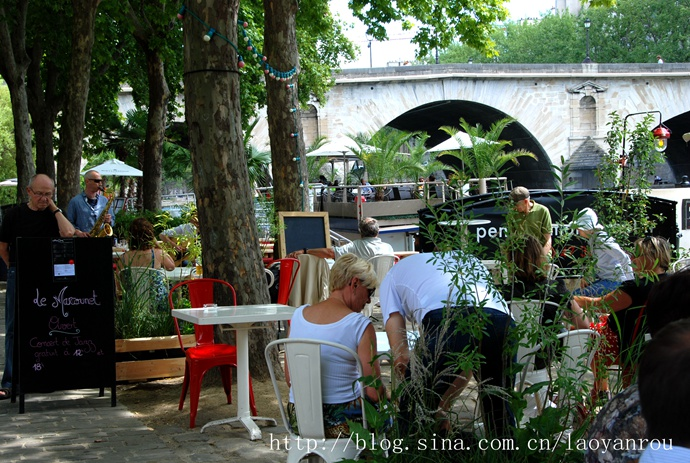

河边咖啡座

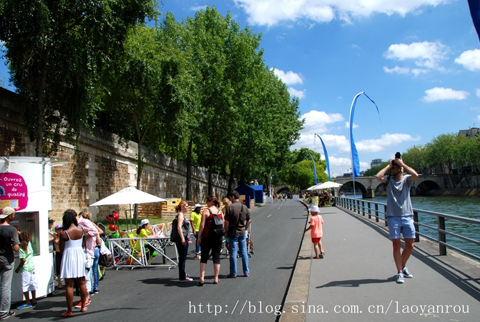

难得一见的摄影者

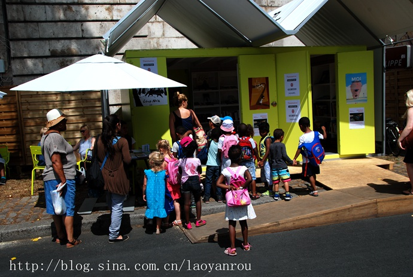

河边游玩的小朋友

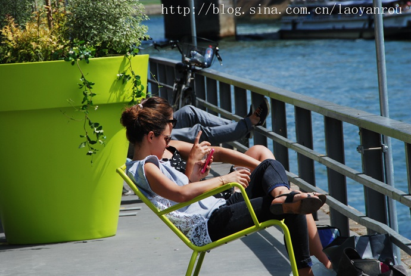

晒日光浴的低头族

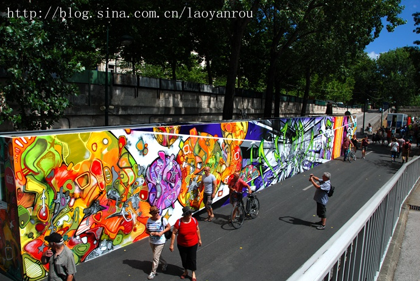

街边涂鸦

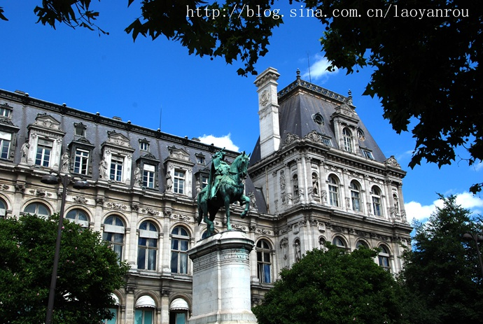

河边老建筑

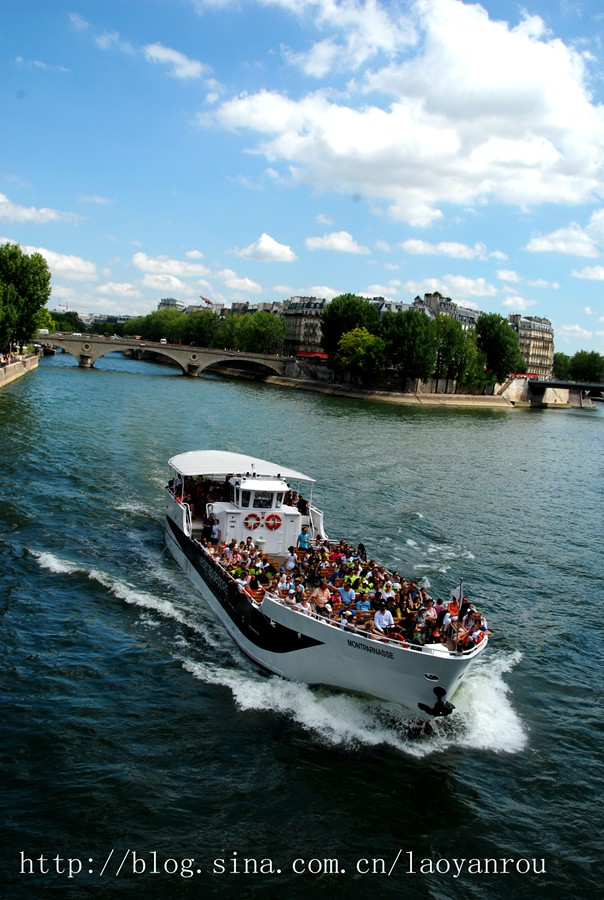

塞纳河游船

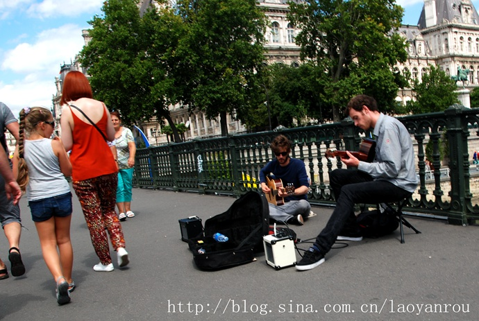

河边卖艺的街头艺人

来到圣母院首先看到的依旧是广场上排队的蛇形人潮，我们早有心理准备，见怪不怪地耐心排了近半个小时，总算得以一睹圣母院内部的真容，兴许是一路下来教堂看得太多有点审美疲劳，即便是看见了极度挑高的哥特式拱顶、精雕细琢的廊门和立柱以及五彩斑斓绘着栩栩如生圣经人物的窗户玻璃，已俨然无法给予我们更多的震撼了，令我们感兴趣的是里面有一块展区，专门展示教堂自1163年以来从无到有、从小到大的风云变幻发展史，还有一座精美绝伦、细致入微的教堂等比例缩小的木质模型，尽管展区的很多英文的介绍来不及消化，但依然使我们对巴黎圣母院的前世今生有了更为全面和直观的认识了解，领悟了何为万地高楼平地起，何为人类薪火相传的历史文明结晶。除了欣赏建筑艺术以外，我们在圣母院里面还受宠若惊的享受了一次专人讲解服务，一位慈眉善目的华裔阿姨，应该是基督教志愿讲解员，看见我们来到耶稣复活故事的木刻浮雕组画前，便非常耐心且声情并茂地用英文向我们介绍起这组浮雕背后所讲述的故事，惭愧的是本人英语听力水平一般估计最多也就听懂了个四五成吧，对她的讲解甚少回应，但这位虔诚敬业的阿姨不为所动，始终精神饱满地完成了一次高质量的免费讲解，仿佛不单是向我们讲述耶稣受难复活的故事，而是在进行自己的一次修行。信仰的力量非常可怕，对比起国内某些景区讲解员随意散漫的工作作风，这位法国阿姨没有任何经济利益驱动，纯粹把宣传基督教作为个人信仰的实践，所迸发出来的工作激情和态度着实令那一小撮没有信仰、没有道德底线、无所畏惧、唯利是图的国人所汗颜。

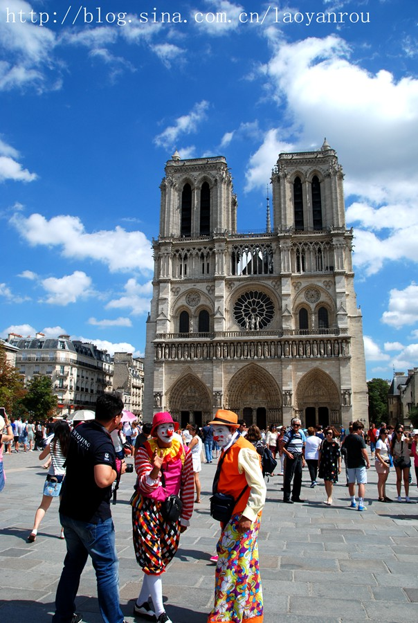

圣母院与小丑

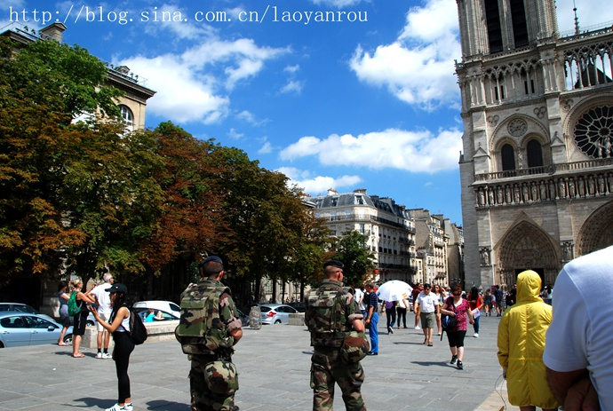

圣母院前巡逻的士兵

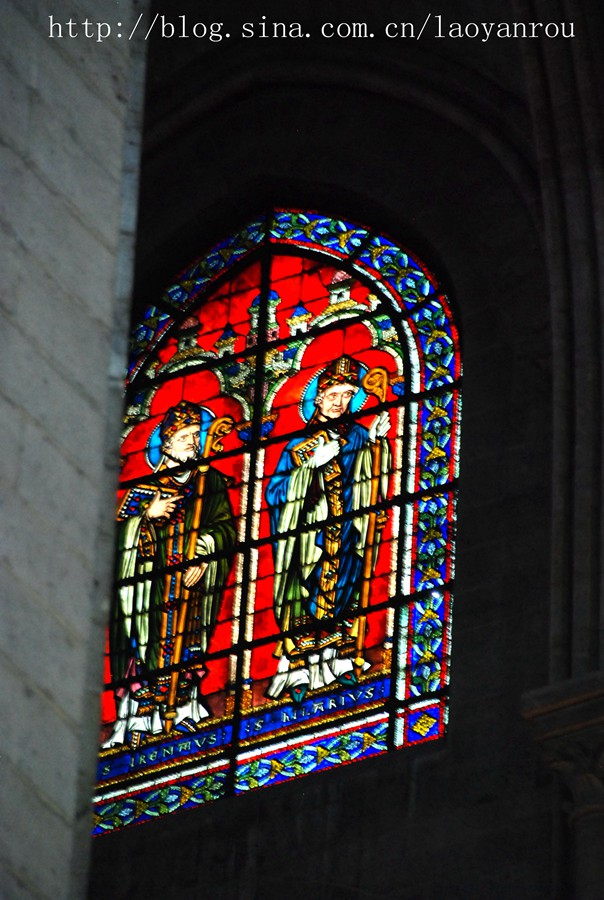

圣母院里的玻璃窗

直入云霄的穹顶

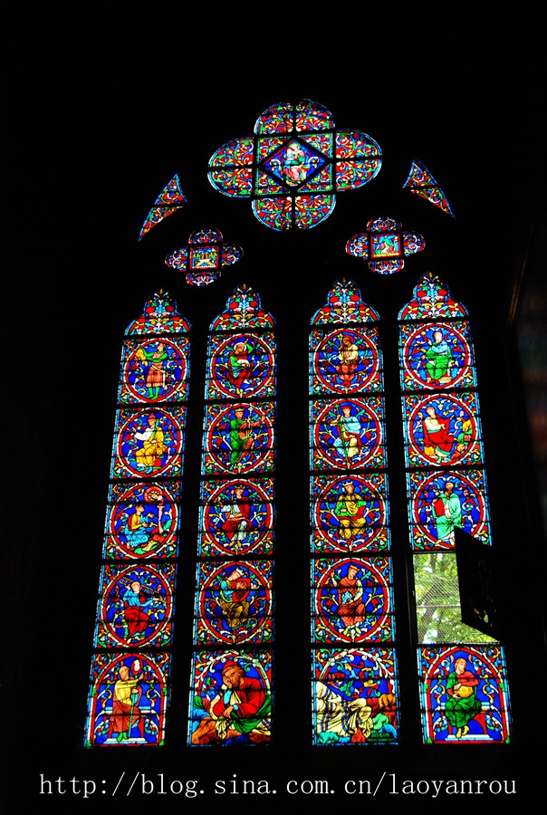

五彩斑斓的玻璃窗

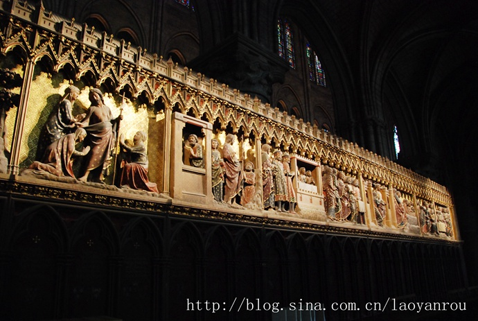

耶稣复活记浮雕组

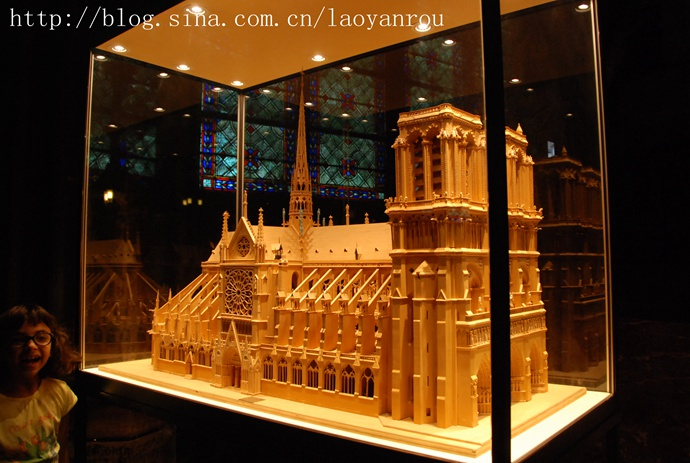

圣母院模型

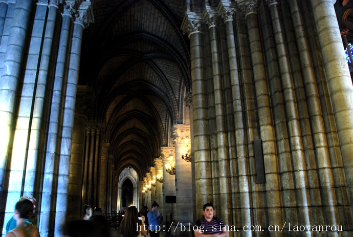

幽深的长廊

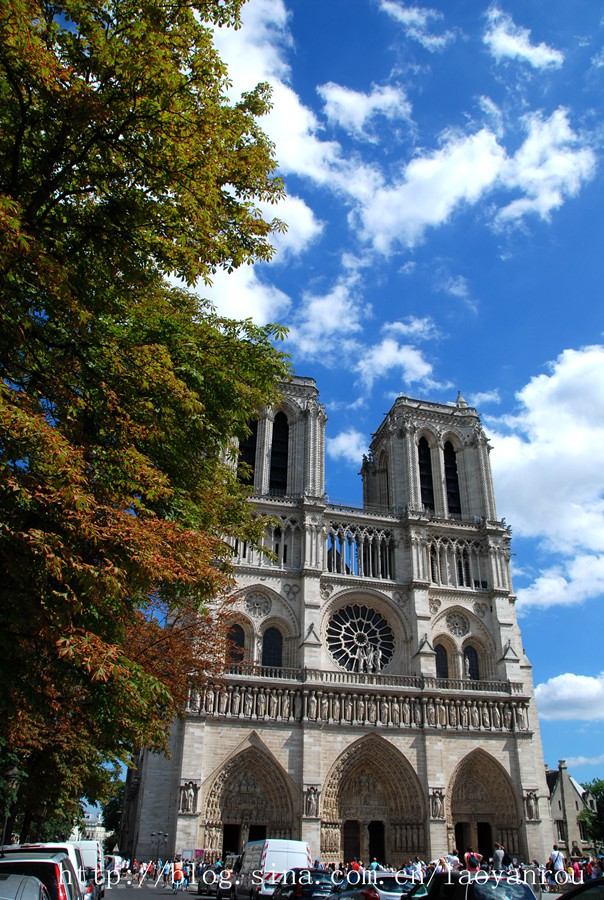

绿树掩映下的圣母院

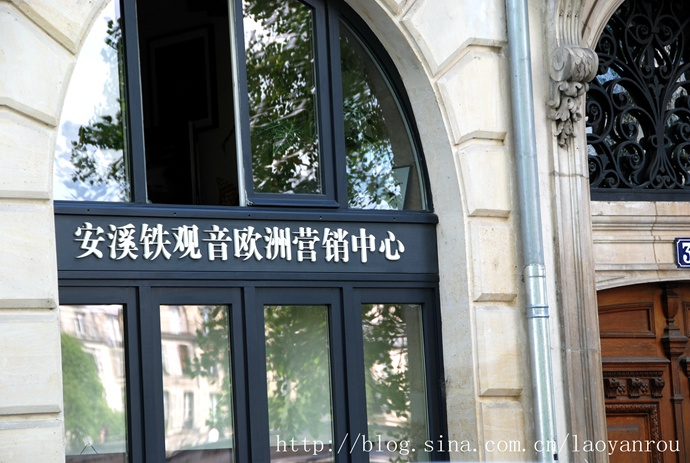

生意作到西岱岛上的中国茶商

仰视某浮雕
