# 欧游札记之徜徉法兰西(DAY11.2加尼叶歌剧院-红磨坊-圣心堂)

圣心堂

DAY 11.2 加尼叶歌剧院-红磨坊-圣心堂

了却了参观圣母院的心愿后，我们步行前往下一站加尼叶歌剧院，加尼叶歌剧院号称世界上最大的抒情剧场,由查尔斯•加尼叶于1861年设计，完美地结合了古希腊罗马式柱廊、巴洛克等几种建筑形式，被誉为是一座绘画、大理石和金饰交相辉映的剧院。更令人感到神秘且惊奇的是其复杂的结构和长久的历史，剧院有2531个门，7593把钥匙，6英里长的地下暗道，而且在歌剧院的地下室最底层竟有一个容量巨大、漆黑幽深的蓄水池！可惜的是，当我们抵达歌剧院时已近中午吃饭时间，对建筑艺术的兴趣毕竟也得服从人最基本的生存需要，加之下午还要去红磨坊和圣心大教堂两个景点，因此只好忍痛割爱，远远地眺望了一眼罗马柱拱立、屋顶两侧两金色女神雕像和中央青铜雕像互为犄角加冕的加尼叶歌剧院，悻然而去，留下点缺憾待日后弥补吧！

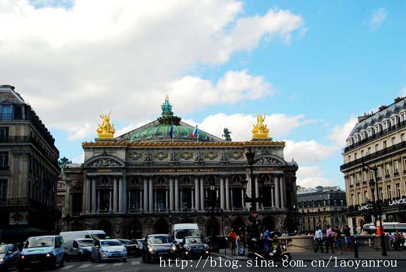

加尼叶歌剧院

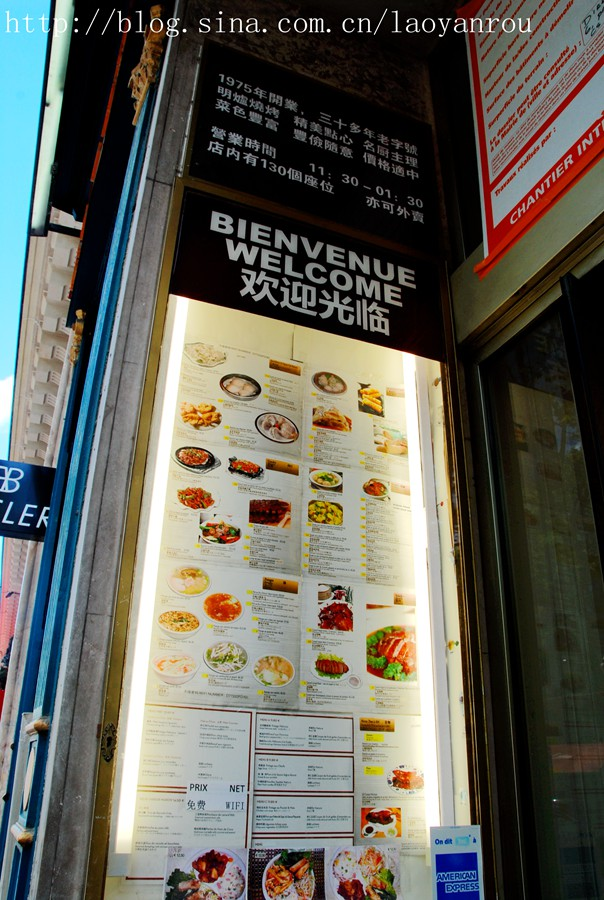

歌剧院旁的中餐厅招牌

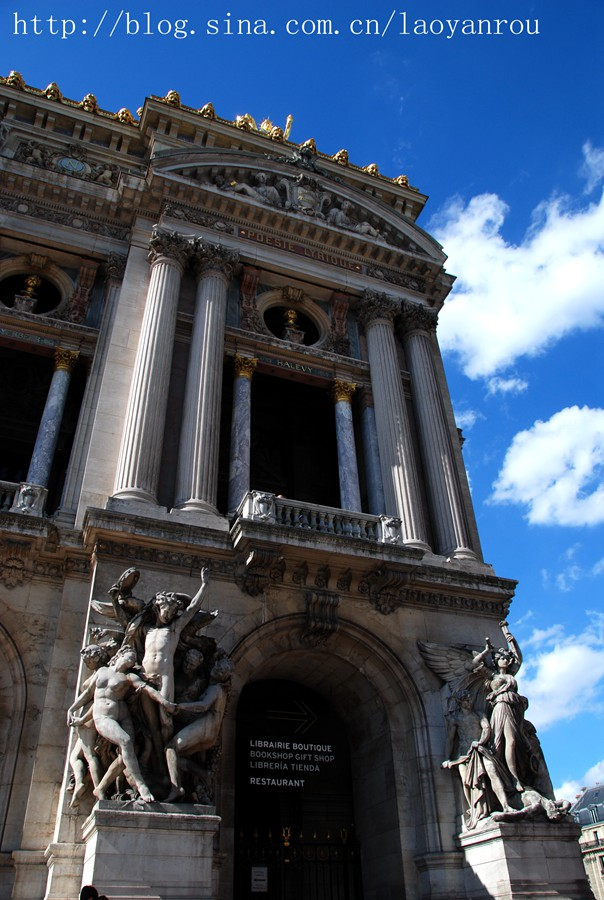

歌剧院一角

在巴黎老城区一通好走总算找到了一家麦当劳解决温饱问题，之后又暴走数公里来到巴黎的蒙马特高地，这里有巴黎最著名的两个歌舞厅之一的红磨坊，如果说位于香榭丽舍大街的丽都歌舞厅具有典型美国百老汇风格，那么屋顶上装着修长、闪烁着红光的大叶轮的红磨坊则是较为地道的法国式歌舞厅。我们刚进入红磨坊地区没多久就注意到了歌舞厅屋顶上那标志性的红色大风车，但同时也发现沿着红磨坊两侧的大街上也密集地遍布了很多XX用品及相关的店铺，门外挂着赤裸裸的霓虹灯招牌尺度大到令路人不忍直视，幸好小孩尚小不懂这些东西，但我们还是拖着小孩疾步快走，避免冷不丁被问而陷入尴尬，加速我们离开红磨坊的另外一个原因是所途经的街道中间的长条型小广场的两侧，或躺或坐着不少貌似无业游民的人，而且相当多都是黑人，回想起关于此地区臭名昭著的治安状况的报道，多一事不如少一事赶紧溜之大吉为妙吧。

幸好圣心大教堂也在蒙马特地区，离红磨坊仅两三站地铁吧，我们三步并作两步连爬了几百级台阶，总算登上了号称整个巴黎最高处连塞纳河都为之绕道的蒙马特高地最高处，这里伫立着著名的圣心大教堂，教堂建筑风格独特，结合了罗马式和拜占庭式的风格，而最吸引人眼球的则是教堂拱门两侧两座骑马的雕像，一座是国王圣路易，另一座是法国的民族女英雄贞德。走进教堂后，里面装饰有许多浮雕、壁画、马赛克镶嵌画及五彩玻璃窗，无论艺术风格还是装饰工艺都达到了较高的水准。这里另一个颇具吸引力的地方是教堂前的蒙马特广场，号称巴黎最有艺术特色的地方，我们站在广场上往下看可以将千年巴黎的繁华都市尽收眼底，尽管不如从埃菲尔铁塔上俯视巴黎那么辉煌壮观，但从第二高度俯视巴黎却反倒是多了些真实感觉。广场上的游客出人意料的多，我们又恍然有回到国内某景区的感觉了，其实除了游人还有不少玩音乐的、搞绘画的街头艺术家，甚至有个弹吉他的哥们还在广场台阶上以身后的大巴黎城为背景举办了一个小型的音乐会，此时夕阳西下，微风从塞纳河徐徐吹来，耳边飘荡着音乐会悠扬的音符，空气中弥漫着大巴黎延绵千年的浪漫气息，愈来愈浓，浓到怎么也化不开。​

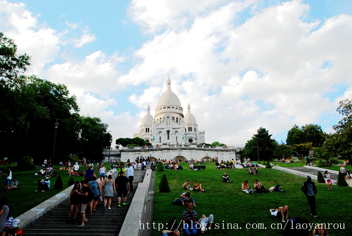

山脚仰视圣心堂

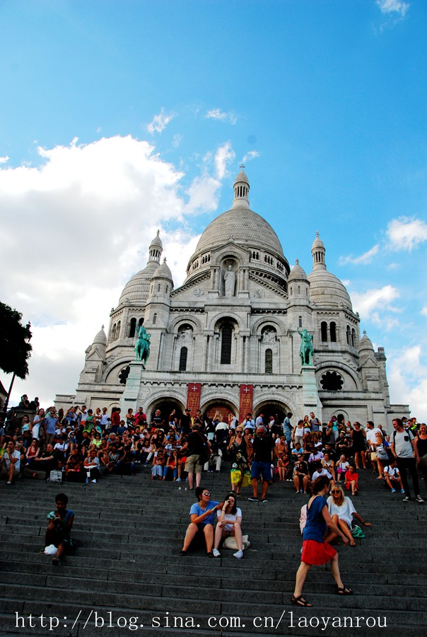

圣心堂前的游客

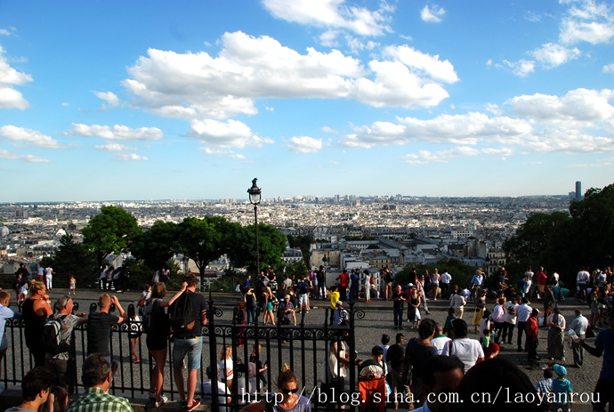

圣心堂俯视大巴黎

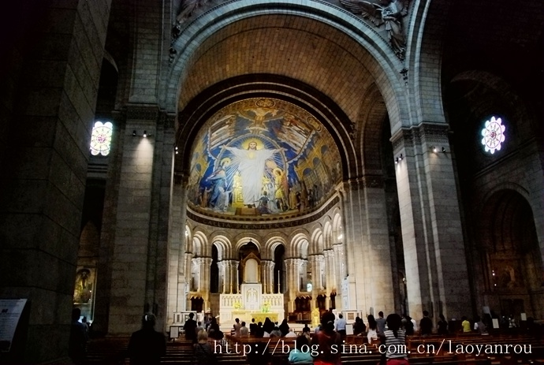

圣心堂教坛

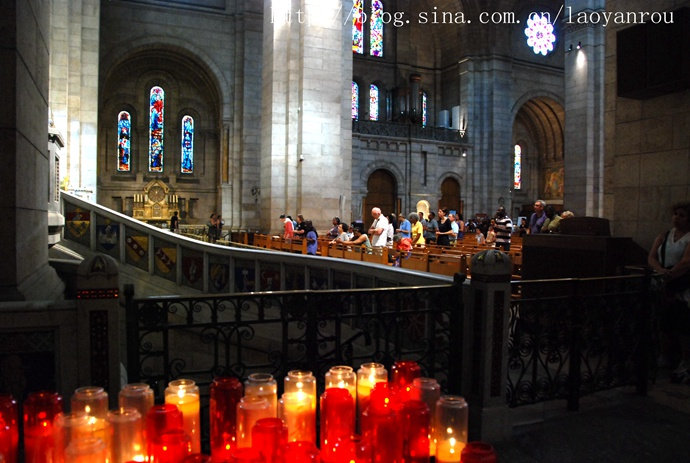

做礼拜的信徒

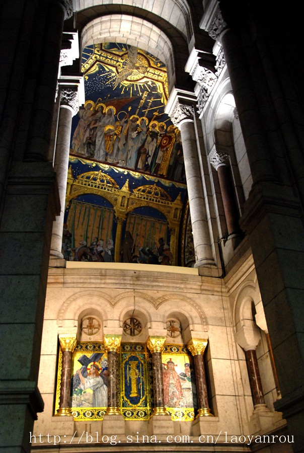

圣心堂壁画

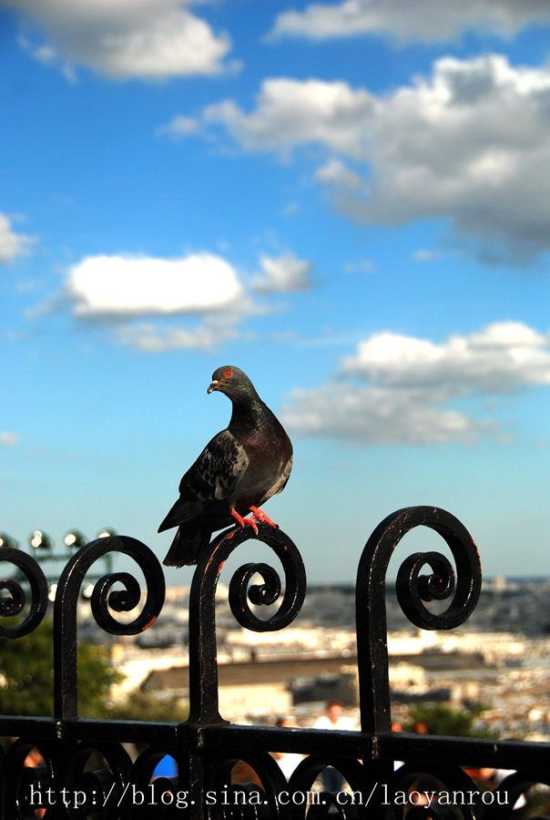

圣心堂外的灰鸽子

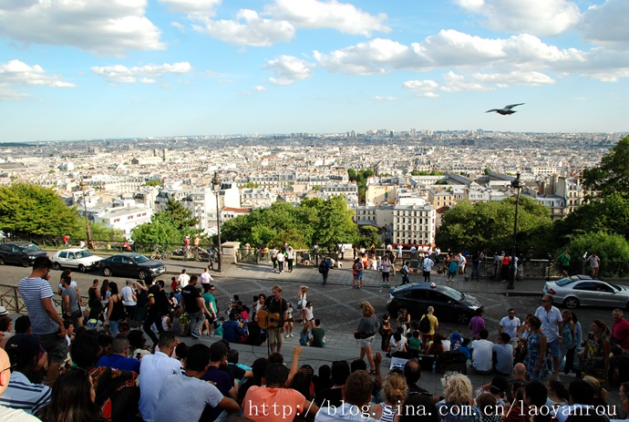

广场上的小型音乐会

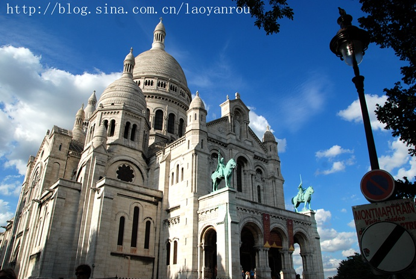

远观圣心堂

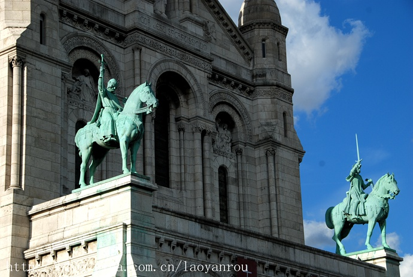

圣路易与圣女贞德青铜雕像
