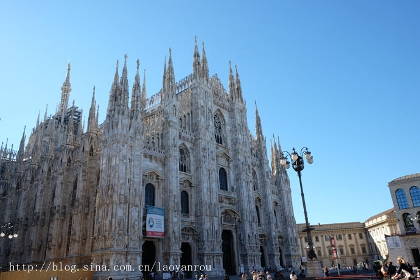
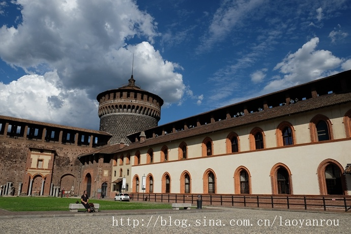

# 欧游札记之意大利朝圣(DAY1米兰)

Day 1
广州——米兰

  
  

序言：总算静下心来为今夏的意大利之旅小结一下了，因为工作原因一直拖，抑或只是逃避爬格子的借口吧，因为要动笔描述一个历史文化源远流长的古罗马帝国之旅的确需要做好充分的心理准备和时间准备。

旅程是从意大利米兰时尚之都开始的，依旧是搭乘熟悉的卡航历经十几个小时从广州飞抵米兰，因为事先已经和米兰当地的一位高中同学说好要来看他，中午一出机场便搭上同学的车直奔市区，毫无违和感地融入到米兰这座意大利北部最重要的城市里了，或许之前抱有太多憧憬，和同学一路往市区开车一路聊天时，车窗外掠过的老旧高速公路、路边稍显老态的建筑逐渐将我们躁动的心情逐渐抚平下来，不客气地来说和国内一些二线城市的交通设施相比差别不大。以至于我们到了米兰市区，穿行过全城最大仅双向两车道或者四车道的主要干道到达火车站附近的一家酒店时，也没感觉到太大的失落感了。

可能是长途航班的疲劳和时差所致，我们也顾不上更新对米兰更全面的印象，简单在酒店附近吃了个晚饭、探了下第二天去米兰火车站的路便回到酒店，怀着稍许失落和对瑞士卢塞恩之旅的期冀悻悻睡去。

