# 欧游札记之意大利朝圣(Day5米兰)

Day 5米兰

  
  
人们提及米兰一般首先想到的是其现代“时尚之都”的名号，而较少人会想到它历史上曾是兵家必争之地的战略要地，由于其位置北扼连接欧洲南北的阿尔卑斯山要道，南临亚平宁山脉北麓进入意大利中南部的必由之路，因此算得上意大利北部的喉舌要地，其相应的历史也是跌宕起伏精彩纷呈。而这一切也只有真正深入探访米兰城的时候才能亲身体会到。

迎着清晨阳光我们开始了一天的米兰之旅，从瑞士连绵几天阴雨天中抽离出来的心情如同米兰阳光般格外灿烂，酒店位于米兰中央火车站附近，因此距离各主要景点也比较近，估摸走了20多分钟便来到了米兰大教堂附近。首先和我们不期而遇的是达芬奇的纪念雕像，这位意大利天才艺术巨匠受斯福尔扎家族之邀来到米兰并将其艺术生涯最好的18年都留在了这里，不仅帮助斯福尔扎家族规划设计了米兰城和斯福尔扎城堡，而且还在这里完成了包括《抱着白貂的女士》和《最后的晚餐》在内的几幅巅峰巨作，为米兰开启了文艺复兴的黄金时代。雕像上的达芬奇身穿长袍，戴着其标志性的圆顶软帽，抱着一本书若有所思，四位较小的得意门生立像围绕其四周，衬托出大师的睿智。窃以为尽管达芬奇个人取得了极其辉煌的艺术成就，但也不可否认米兰的名门望族如米兰公国开创者维斯孔蒂家族和其继承者斯福尔扎家族对艺术事业的不遗余力的支持和资助为其提供了施展抱负的空间，无论他们出于沽名钓誉还是个人喜好的目的，客观上均推动了米兰甚至意大利文化艺术事业的蓬勃发展。说得直白一些就是艺术大抵就是吃饱了没事干的人才做的事，毕竟如同梵高一样孤芳自赏一生穷困潦倒直到后世才被最终认可的天才艺术家确实凤毛麟角，大多艺术作品的生长都是需要肥沃的环境土壤和充足经济养分的滋润才能开花结果流光溢彩的，其典型的例子就是达芬奇因生活拮据而为富商乔孔达的妻子丽莎画了一幅举世闻名的肖像画《蒙娜丽莎的微笑》以及受斯福尔扎家族卢德维科资助而创作了《最后的晚餐》。

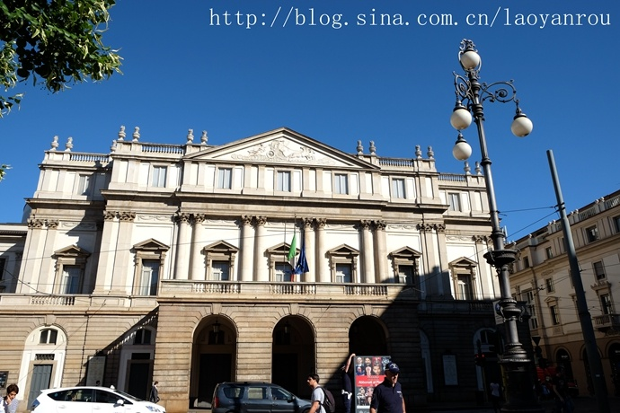  
  
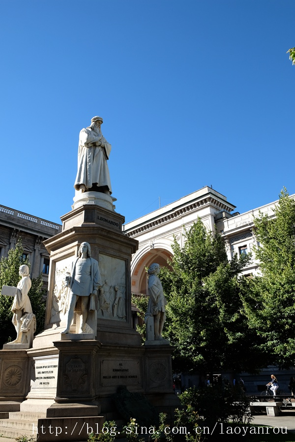  
  
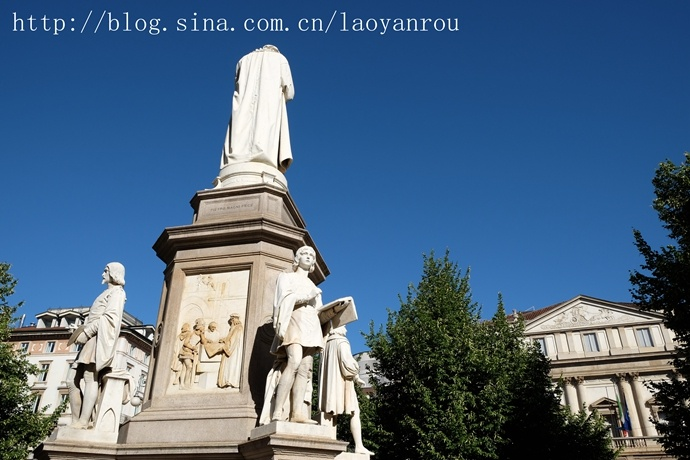  
  
离达芬奇雕像不多远就是埃马努埃莱二世长廊，此长廊建于19世纪，得名于统一意大利的第一位国王，是现代玻璃顶封闭购物中心的原型始祖,从长廊的一侧入口走进去，两侧一道道拱形门廊里分布着金银首饰、时装、礼品店、餐馆，咖啡厅和书店等,门廊顶部依次雕着一座座低头俯视的人物雕像，而最上方是整个长廊的点睛之笔—由彩色玻璃和铸铁搭建而成的透明拱顶，而两道长廊交汇之处的大玻璃穹顶尤为壮观，颇有教堂大拱顶的气势。整个长廊尽管已使用了130多年，至今仍金碧辉煌、富丽堂皇，直慑人心，不愧为代表米兰国际时尚之都的地标性建筑。我们知道修建这一长廊的初衷是纪念意大利统一，可想而知自罗马帝国衰亡之后，意大利分裂为许多王国、公国、自治城市将近五六百年之久，米兰公国也先后被法国、西班牙及奥地利等外族入侵统治，饱受分裂之苦的米兰人对于国家统一是多么地期望和向往。
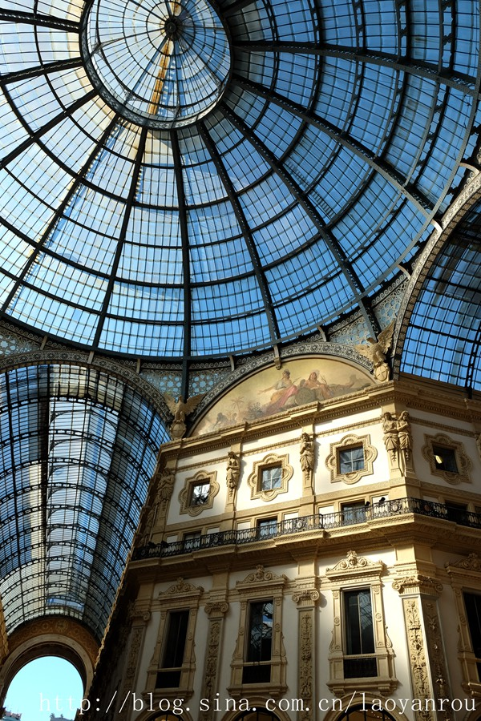  
  
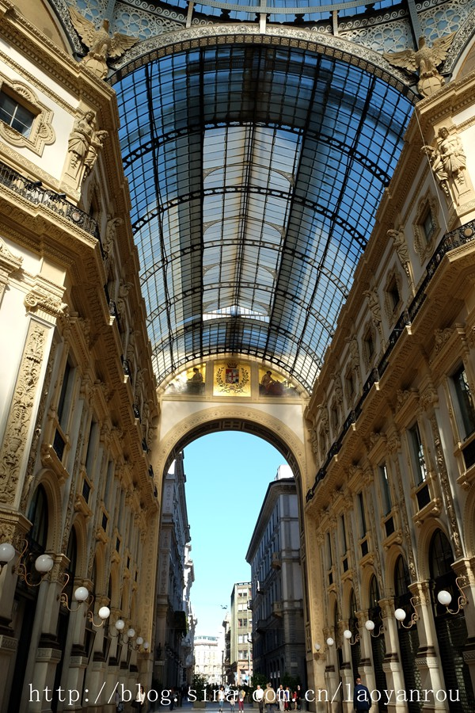  
  
埃马努埃莱二世长廊其实就位于米兰大教堂广场的边上，一穿过五光十色的玻璃拱顶长廊后我们便被眼前广场上矗立着的一座白色大理石精雕细琢般的哥特式大教堂给震撼住了，这便是世界五大教堂排名第二仅次于梵蒂冈圣彼得大教堂的米兰Duomo主教堂，先姑且不论在该教堂颁布的《米兰敕令》奠定了基督教合法地位成为罗马帝国国教，也不说拿破仑在此加冕、达芬奇为其设计了电梯，而仅仅凭其修建历史前后超过五百年、建筑形制规模及尖塔装饰雕像数量均代表了全世界哥特式教堂建筑的最高水平来看，米兰大教堂已当之无愧可称为世界建筑史和世界文明史的奇迹，世界上影响力最大的教堂之一了。
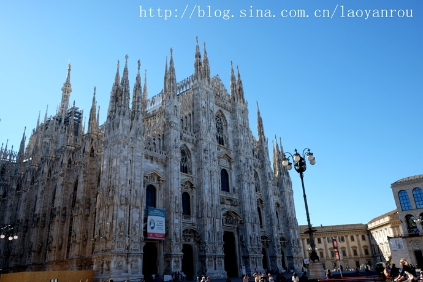  
清晨的阳光从教堂的背面射过来，将整个教堂的轮廓雕刻在浅蓝色的天空幕布上，只见环绕着教堂四周的白色大理石雕刻而成的无数尖塔如塔林般直指云霄，每个塔尖上均站立着一尊圣人雕像，塔身上的雕刻也玲珑剔透极尽繁琐之能事，而其中一座高达107米的尖塔上伫立着金色的圣母玛利亚雕像俯瞰着苍苍众生。整个教堂仅从外部来看大理石雕像就有2000多座，若包括内部则总雕像数竟达6000多座，不愧为全世界雕像最多的哥特式教堂，难怪被马克吐温誉为“大理石的诗”。我们仅仅远远地站在广场上便能感受到米兰大教堂强大的建筑艺术魅力和因之营造的震慑性宗教气场，其鬼斧神工的建筑技艺和精雕细琢的雕刻工艺水平着实令我们不得不对几百年前的建筑大师和工匠们表示由衷的敬佩。

穿过教堂正面被六个巨大方柱分隔的雕刻着教堂历史、神话与圣经故事五扇大铜门进入了教堂内部，里面的建筑风格总体呈灰黑肃穆的色调，顶上是典型简洁的哥特式尖拱营造了苍天高高在上的气势，而两边灰黑色粗壮高大的一排排大理石立柱的装饰又采用了注重装饰的巴洛克式的风格，顶上雕着一圈圣人圣女雕像。虽然由于哥特式教堂内部色调较为压抑的缘故令我们略感阴森不太舒服，但里面的人物雕像青筋毕露栩栩如生，彩色玻璃窗画活泼生动，为肃穆压抑的教堂内部平添了一抹亮色。

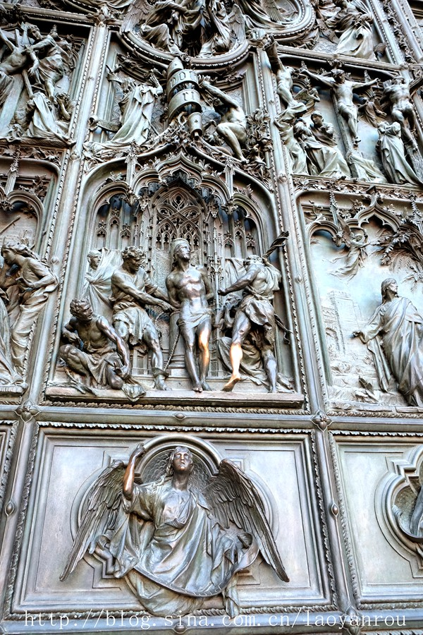  
  
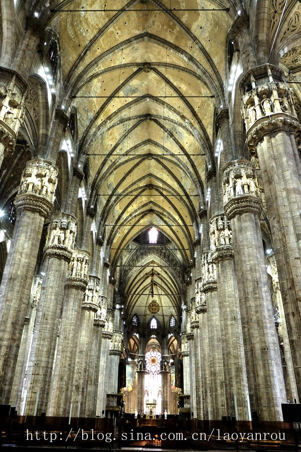  
  
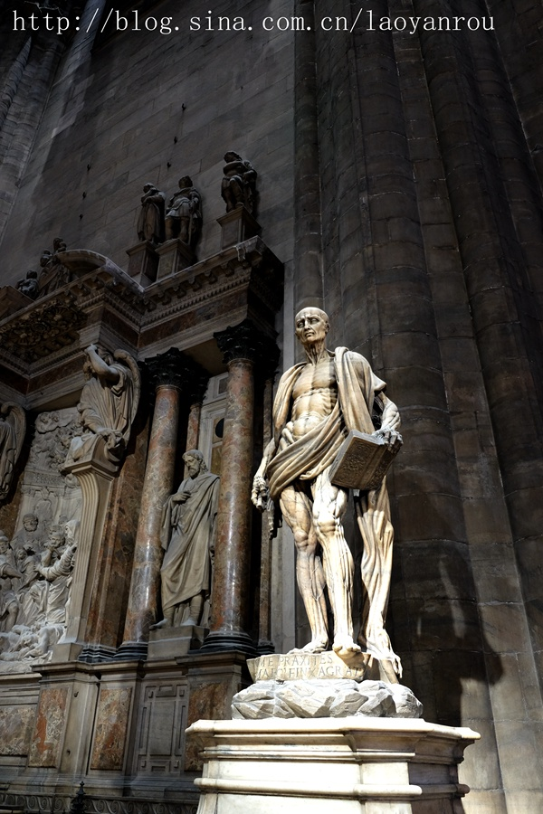  
  
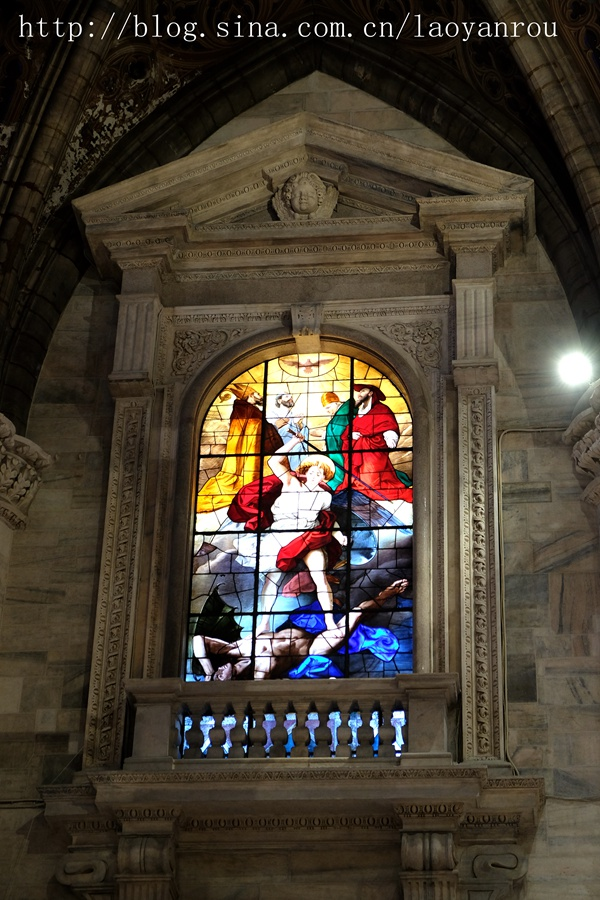  
  
完整的米兰大教堂参观除了教堂外部和内部参观游览以外其实还包括“入地上天”两个重要的部分，所谓“入地”是通过一道小楼梯来到教堂地下，这里有砖砌的深度为4－8米的空间是大教堂基础的圣特库拉教堂的遗址。此外最不能错过的就是“上天”游览参观教堂的屋顶，游客可以乘坐电梯或走楼梯到教堂的屋顶近距离观看135座尖塔的雕像和其雕刻细节。由于我们过于低估了屋顶楼梯台阶的高度，结果只能喘着粗气吭哧吭哧地爬了920多级旋转楼梯台阶才上到了大教堂屋顶，三人累成狗似的瘫了几分钟才好不容易缓过劲来。但只要四周一看，顿时感觉之前的登顶辛苦是值得的，原来高高在上的尖塔林雕像变得触手可及，远望时只是定性地感觉上面的雕刻非常复杂，而到了近处将一个尖塔自上而下细细观察才知道所谓的精雕细琢繁杂极致到了什么程度，而且从圣人所站立的角度远眺米兰城又是别有一番风味，可以好好体味一下诸神在天上俯瞰众生万象悲天悯人的心情。
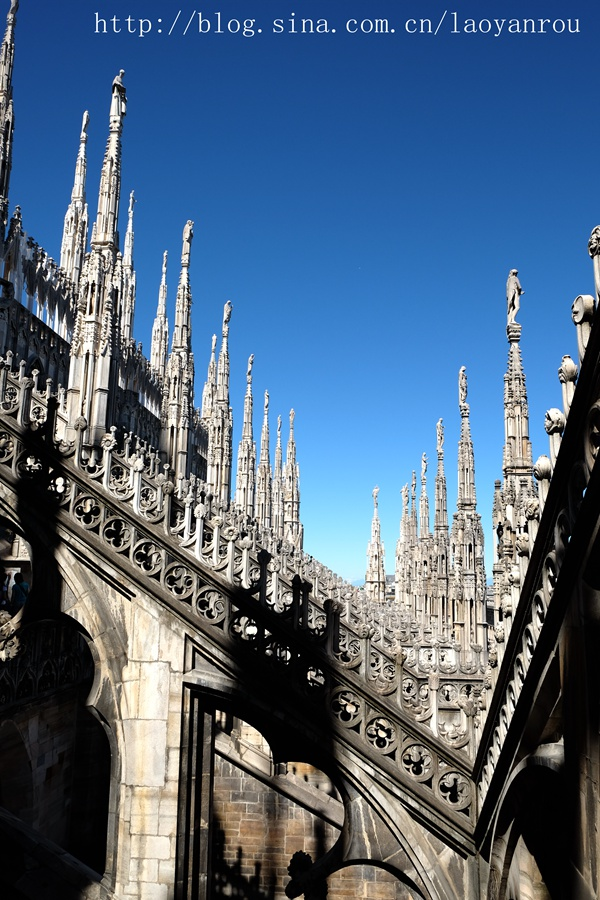  
  
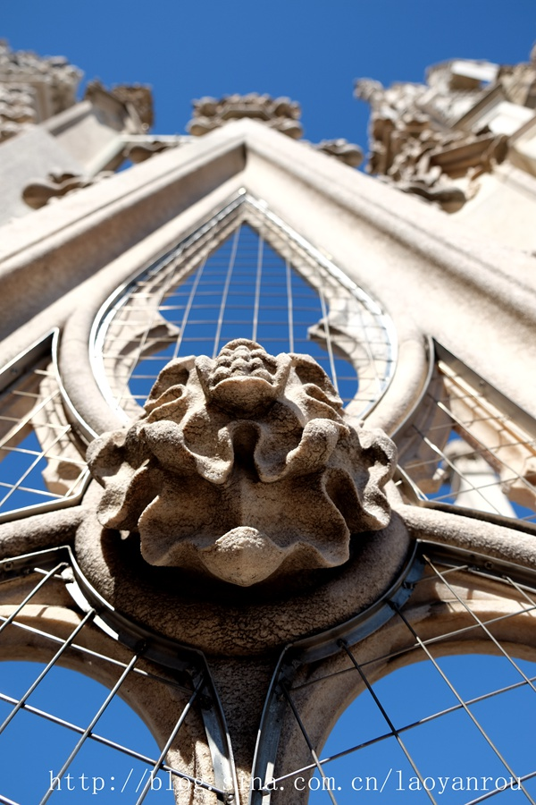  
  
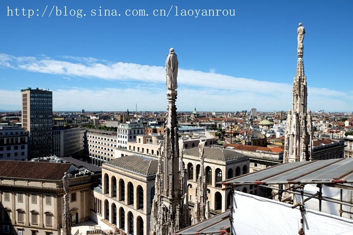  
  
屋顶的这些尖塔历经了几百年的风吹日晒很多都已经过多次的修缮，从其颜色及污损程度来看包括塔尖的雕像和塔身的装饰雕刻构件都是后期用复制件更换替代上去的，甚至包括教堂屋顶经常被游人踩踏的花岗石屋面估计也更换了几拨了，但是我们通过与收藏在教堂宝物库和博物馆的雕像原件进行比较后发现，这些复制件均严格遵循沿用了原件的大小、材料甚至雕刻工艺，非常严格地做到了对珍贵的历史文物建筑“修旧如旧”的科学保护，从这点来看国内某些文物保护采用“修旧如新”的做法是如此荒谬和不负责任，说难听点就是打着文物保护的旗号行破坏文物之实。所以说，也正因为得到了科学及时的修缮和维护，今天的米兰大教堂才能继续屹立在米兰大地上见证其曾经的辉煌和宗教文明的延续。

提到米兰大教堂的宝物库和博物馆还确实值得再书一笔，里面不仅收藏了数量众多的教堂外部石雕塔尖及怪兽排水口原件，还有许多大理石、青铜圣人像或全身包裹了大量金片的圣母圣婴像、圣天使像及古希腊神像等，各类璀璨夺目的宝石钻石镶嵌的金银宗教祭祀用品包括圣杯、圣册、圣十字架，甚至还包括一座同比例缩小的米兰大教堂木质模型，精美绝伦美不胜收，不得不让我们惊叹于基督教通过宗教信仰收敛聚集财富的强大能力。此外还有不少宗教题材的油画艺术品收藏，包括贝里尼《圣母哀痛耶稣画像》、拉斐尔《圣母玛利亚的婚礼》、伊佩利扎《第四阶层》等多幅名作。在参观教堂玻璃花窗画的时候，博物馆一个很热情的意大利讲解员大叔看见AMY对花窗很感兴趣便耐心地通过我当翻译向她完整地介绍了用传统的刮刻法制作玻璃花窗的工艺流程和技艺难度，甚至还亲自帮我们用手机拍到其中最精彩的刮刻技艺呈现点，最后他很感叹地说这种巧妙利用自然光线透过刮刻处形成画面的玻璃花窗技艺已经失传了很久，博物馆所收藏的是从教堂里取下仅存的几幅玻璃花窗孤品了，希望更多的年轻人能好好地欣赏它们。听君一席话我们不仅对如此精妙绝伦的意大利玻璃工匠手艺留下了难以磨灭的印象，而且还为博物馆讲解员尽忠职守不遗余力地向下一代弘扬传统文化的精神所深深感动。

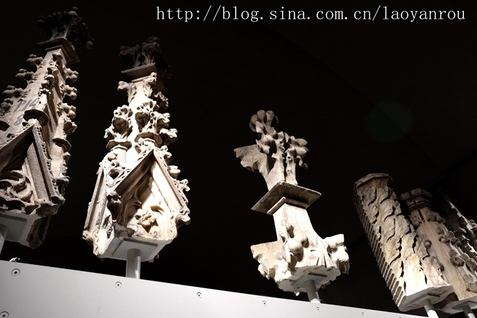  
  
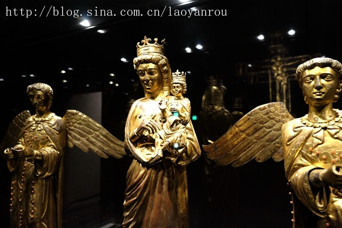  
  
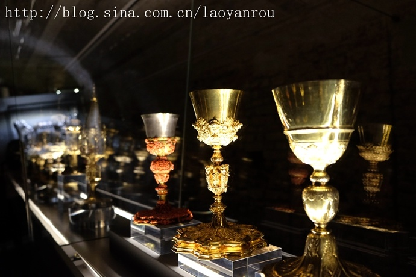  
  
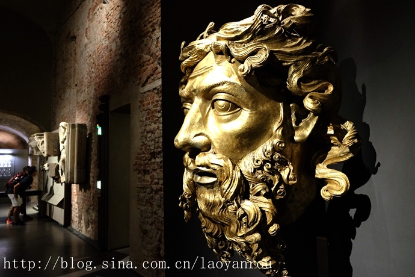  
  
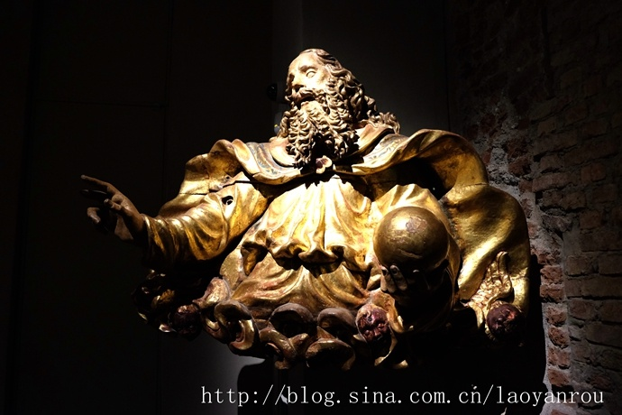  
  
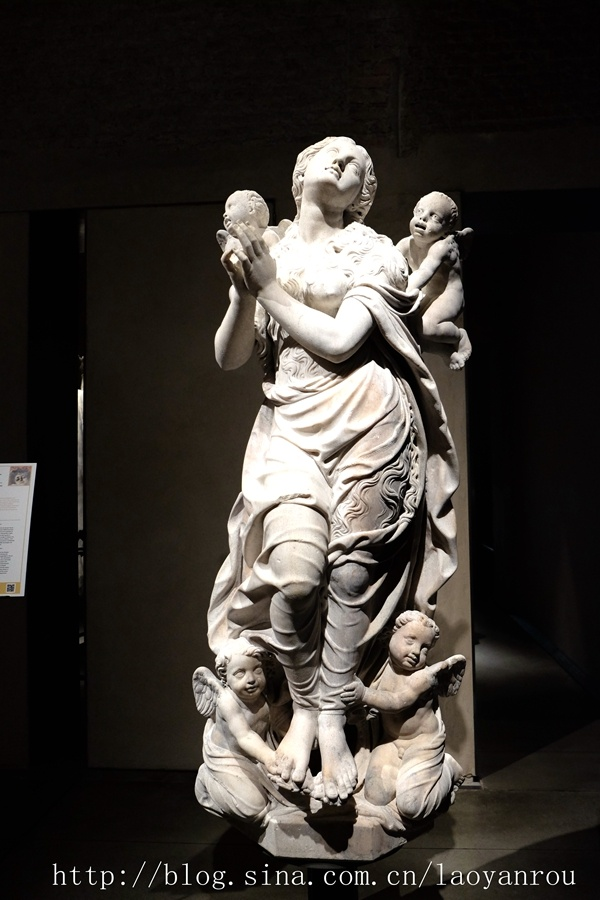  
  
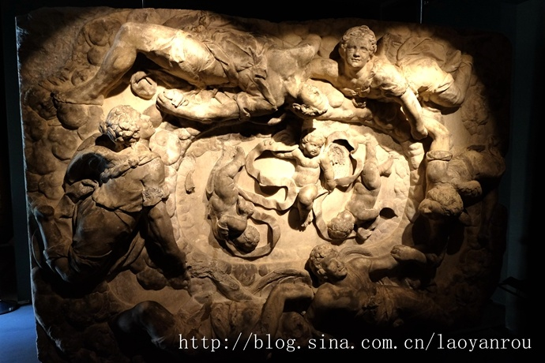  
  
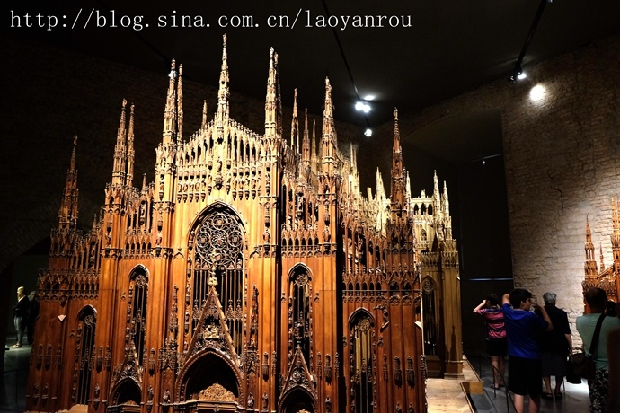  
  
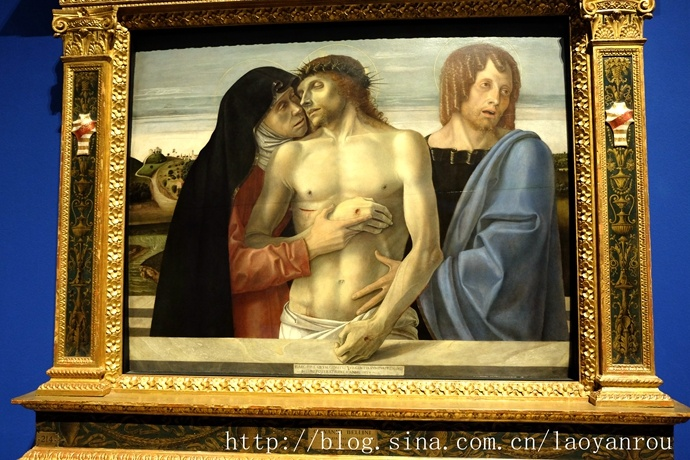  
  
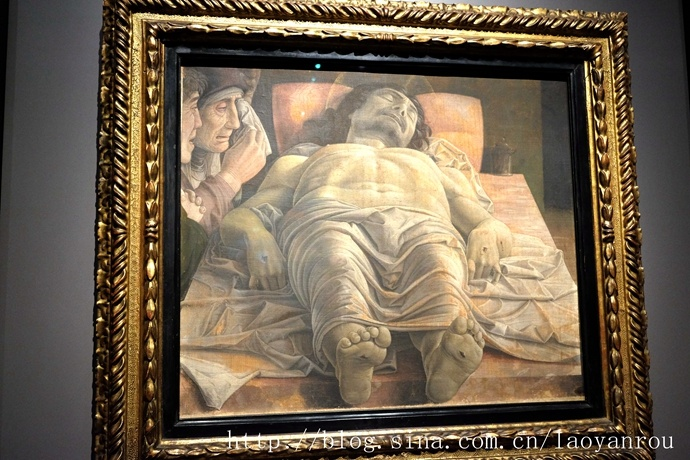  
  
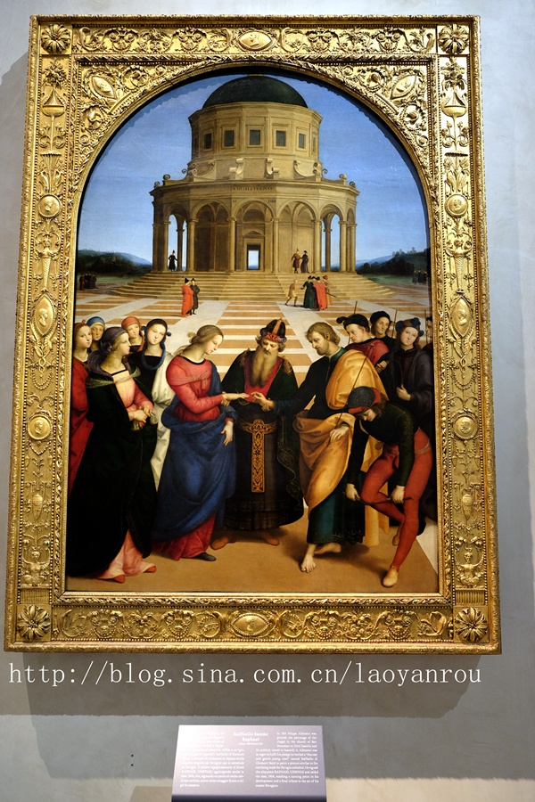  
  
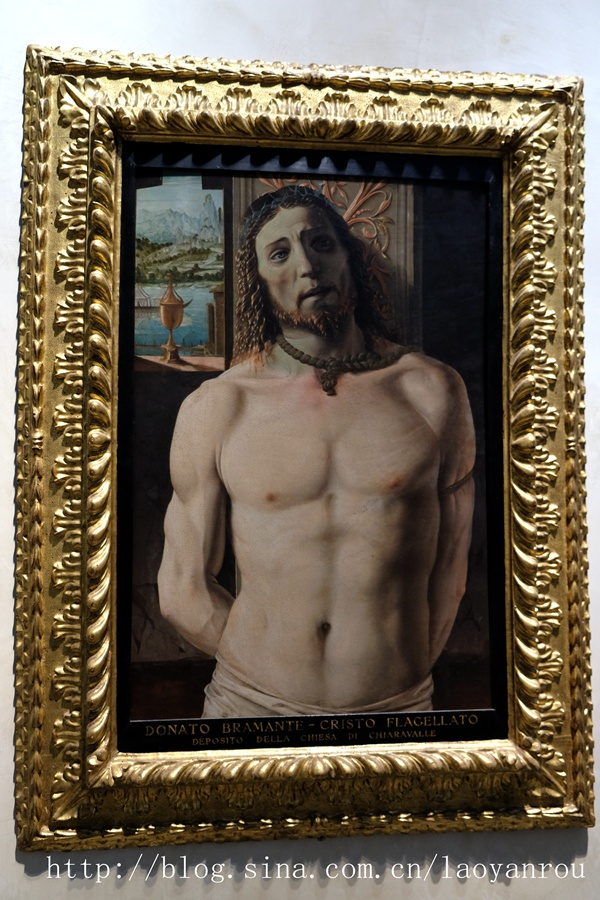  
  
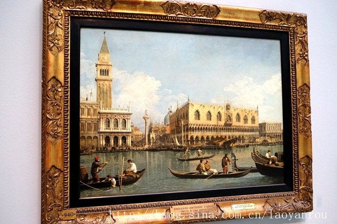  
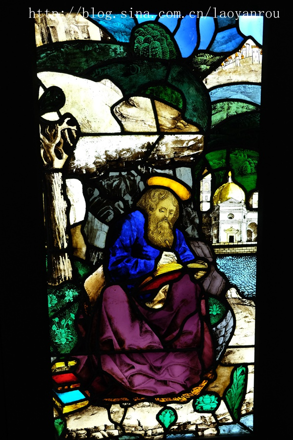  
  
当看完米兰大教堂博物馆和宝物库后算作是全面地将米兰大教堂参观完毕了，尽管整个参观过程耗时费力，但感觉还是收获满满非常值得的，毕竟米兰城整个核心历史文化的传承是与米兰大教堂作为意大利伦巴第大区的宗教中心的作用密不可分的。当然如果来到米兰还有一个地方如果不去则肯定会留下遗憾，那就是达芬奇在圣玛丽亚修道院创作的《最后的晚餐》，为了观赏这幅名作我们不得不提前好几个月就在国内就打电话到修道院预定了参观，当时与操着口音很重英语的预定接待员沟通时还颇费了好一番口舌。可当我们按预定时间赶到修道院时却不太敢确信是否找对了地方，说老实话这个修道院从外观来看只是由红砖砌成，规模不大甚至感觉有点小家子气，难道真能容纳那副惊世骇俗的巨作么？怀疑总归怀疑，我们最后还是老老实实按照预约要求跟随着一拨拨的各国游客朝圣般地进入了修道院，期间总共通过了三道独立的玻璃门才进入了恒温恒湿全封闭的修道院大厅中，此时映入眼帘的便是耳熟能详经常在各种媒体杂志上看到的宗教鸿篇巨制《最后的晚餐》，在仅有的20分钟参观时间里，我们近距离细细地打量着这幅达芬奇巅峰时期的作品，这幅表达传统宗教故事题材的壁画无论在整体构图、光影运用、明暗对比技法还是对十二门徒和耶稣的表情神态及身体动作的入木三分的刻画等均堪称独具匠心及完美无缺，而且壁画采用了平行透视画法使其与修道院大厅仿佛融为一体，感觉上就像耶稣和十二门徒就在修道院里用餐一样，画面上的耶稣摊开双手，神色黯然地注视着左前方，平静地宣布门徒中有人出卖了他，而其两边的门徒如同炸开锅似的交头接耳、相互猜疑、四处求证，做贼心虚的犹大身体后仰而打翻了盐瓶，如此鲜明生动无声胜有声的画面令每个前来参观的游客无论是否信奉基督教都有强烈的现场感和代入感，深深地沉浸在耶稣被犹大背叛后无声的喧哗中。据说达芬奇为了创作《最后的晚餐》殚精竭虑，不仅博采众家之长几易其稿，而且作画中经常笔不离手或者长时间审视画中人物等有灵感再添上几笔，尽管得到了斯福尔扎家族卢德维科的资助但也曾因陷入了经济困境而无法保证正常作画时间，历经坎坷才最终创造性地将这一圣经故事诠释得淋漓极致，而此画完成后又经历了先天制作不足导致的颜色剥离、后人的不断重画修补问题，而且还仰仗米兰人民用沙袋前后上下全面遮挡才躲过了拿破仑大炮袭击和二战轰炸的破坏，所以直到今天仍能基本完整地展现在世人面前，实属不易。当我们站在《最后的晚餐》这幅达芬奇为数不多尚且留存在意大利的传世画作前，联想起被永久收藏在法国巴黎卢浮宫的《蒙娜丽莎的微笑》，眼前仿佛浮现了这位天才巨匠在脚手架上忙忙碌碌作画的身影，估计他怎么也不会想到自己的画作穿越几百年时空完成了与亿万灵魂的精神交流。
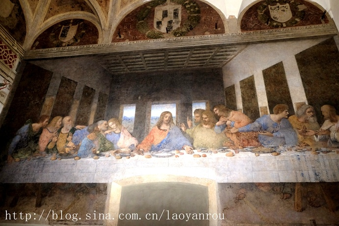  
  
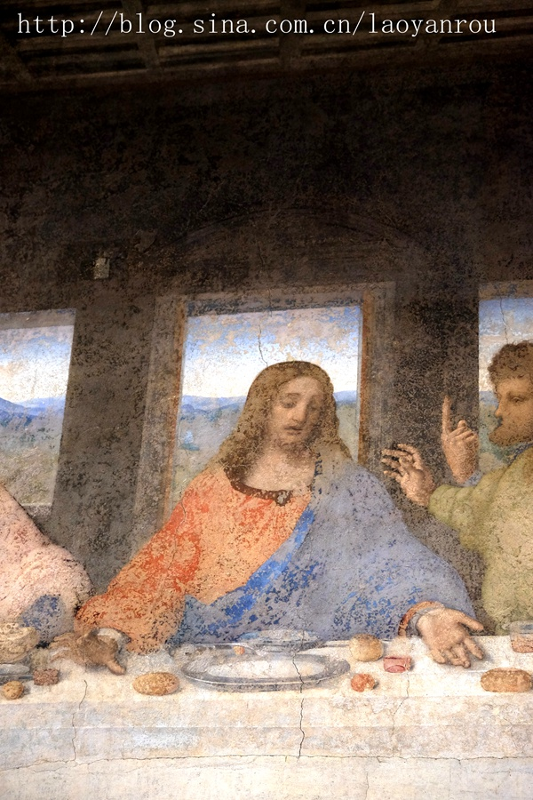  
  
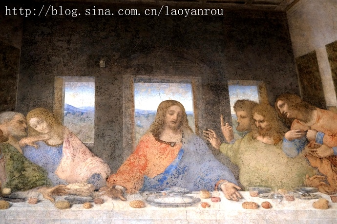  
  
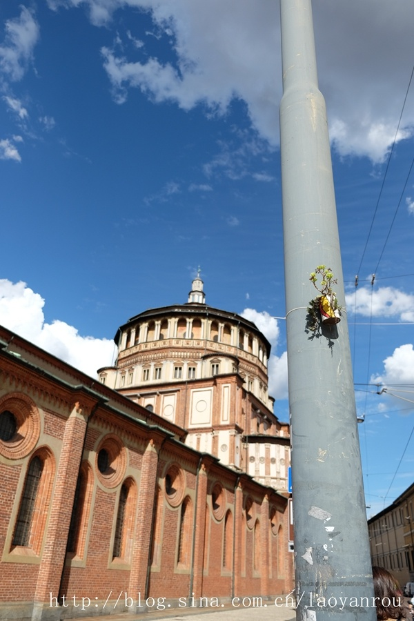  
  
回酒店的路上顺路经过了斯福尔扎城堡，这里即是意大利文艺复兴时期最著名的艺术赞助者斯福尔扎家族的遗产，据说这座四方形的城堡的部分设计出自达芬奇之手。城堡最初的修建目的不是为了防御外敌入侵而是为了与聚集于米兰大教堂周边的米兰富商阶级分庭抗礼，由于当时斯福尔扎家族接过了维斯孔蒂家族的衣钵后仍不能完全掌控米兰大富商阶层，因此只能另起炉灶在米兰大教堂的西北边兴建了城堡，并在其家族统治期间成功地将米兰的城市中心挪离了米兰大教堂广场。整个城堡高墙周立，戒备森严，四角建有圆形塔楼，中部建有四方形多层的巨大门楼，足可见斯福尔扎家族的雄厚经济和政治实力，但与米兰商人隔离的同时也或多或少地折射出该家族对维护稳固米兰政权缺乏自信的微妙心态。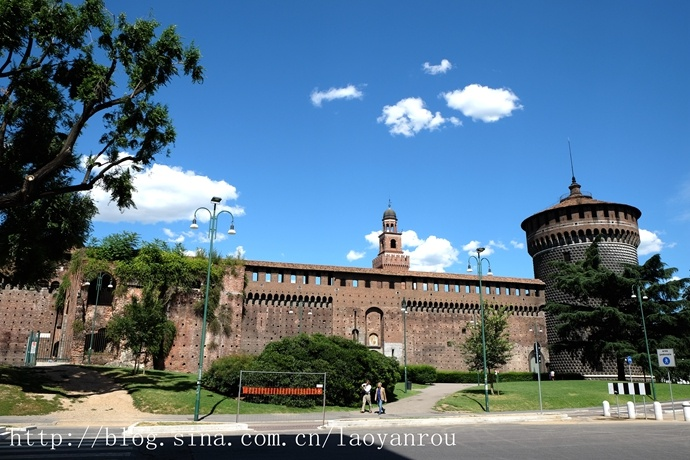  
  
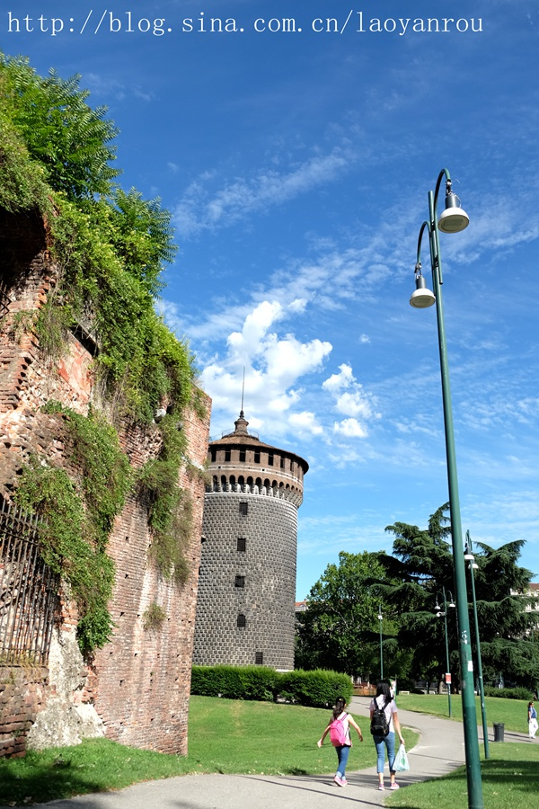  
  
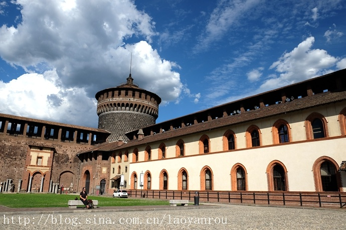
