# 欧游札记之意大利朝圣(Day10圣吉米尼亚诺)

  
  
Day 10佛罗伦萨—圣吉米尼亚诺

领略过了海边风光，是时候深入托斯卡纳大区探访中世纪的小镇了，于是我们从翡冷翠搭乘火车一个小时到了波吉邦西然后转公交车约30分钟便来到了圣吉米尼亚诺这个美塔之城，该城的塔曾是13、4世纪教皇派与皇帝派血腥战争的战场，最繁盛时塔的数量达百座，如今只剩十几座，而实际能开放登塔的更是寥寥无几。

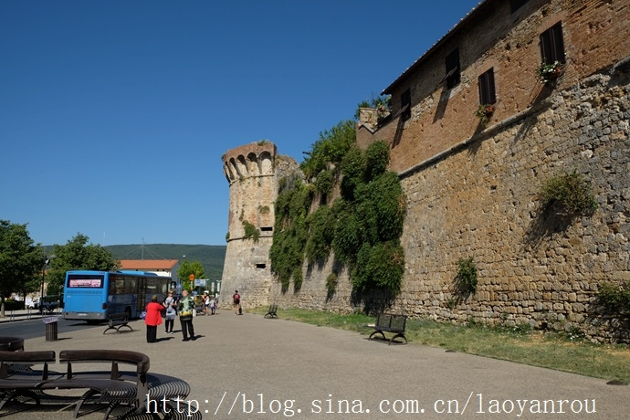  
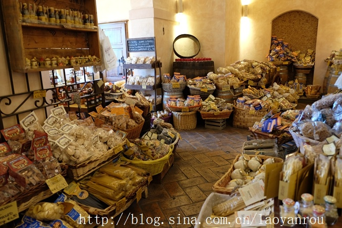  
  
小城其实不大，南北1千米东西500米左右，从圣乔万尼门顺着圣乔万尼大街和与其相连的圣马特奥大街一路走到底就基本把所有的主要景点逛完了，而我们到小城的第一件事并不是看风景而是来到了水井广场上的“世界冠军冰激凌”Gelateria
Dondoli店里趁着人少买了几杯冰淇淋大快朵颐，我一直纳闷人们大清早地早餐都没消化跑来吃啥冰淇淋啊，可一杯藏红花冰淇淋下肚后浓郁的藏红花香与冰淇淋奶昔味水乳交融、口齿留香霎时直接从味蕾层面打消了我的疑虑，果然是世界冠军的冰淇淋，估计迟一点来连排队都很难买到了，而之后中午时分顾客人满为患的事实也印证了我的猜测准确无误。
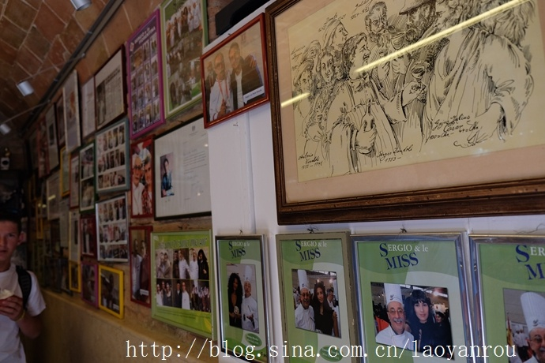  
  
吃饱喝足也该开始在塔城干正事了-登塔，我们买票进入波波罗宫（市立美术馆）的塔楼，俩母女还没登几层便推说有恐高症而败下阵来，只剩我孤家寡人扛着相机一鼓作气杀到了五十几米高的塔顶，从塔顶俯瞰下去的圣吉米尼亚诺似乎有一览众山小的感觉，远处托斯卡纳平原的连绵山丘、绿色原野和一直绵延到地平线以外的葡萄园将小城环抱其中，而灰红、褚红色屋顶的小城房屋又以十几座塔楼为中心向四周散开直至城墙，除了屋顶上的电视天线锅以外没有任何现代文明的痕迹，想必今天我所目光所及之处与几个世纪前意大利人眼中的托斯卡纳小城并没有丝毫的不同吧！
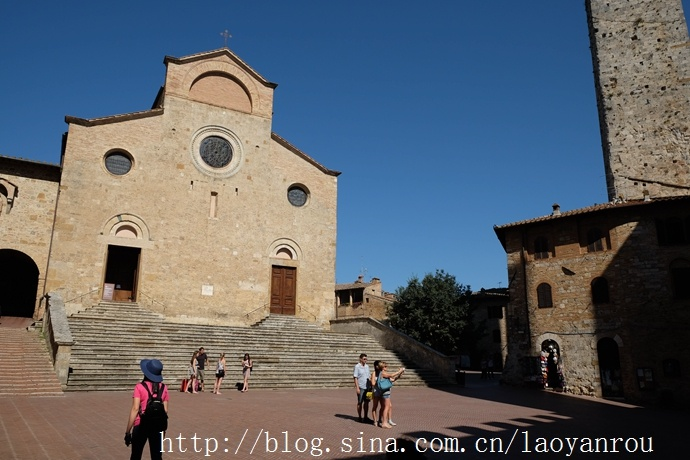  
  
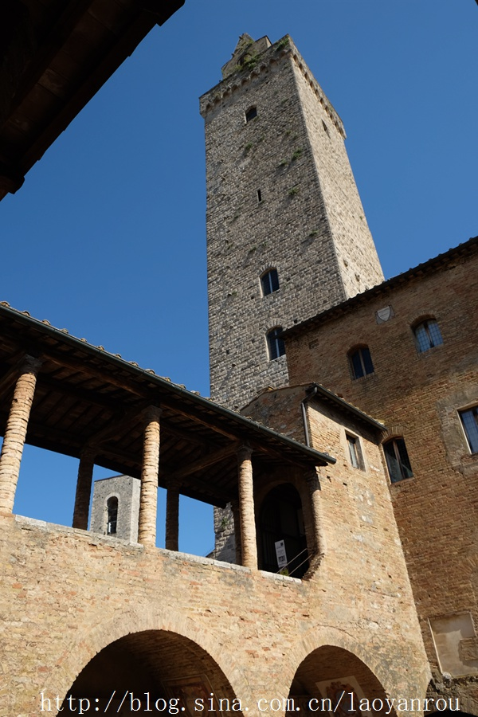  
  
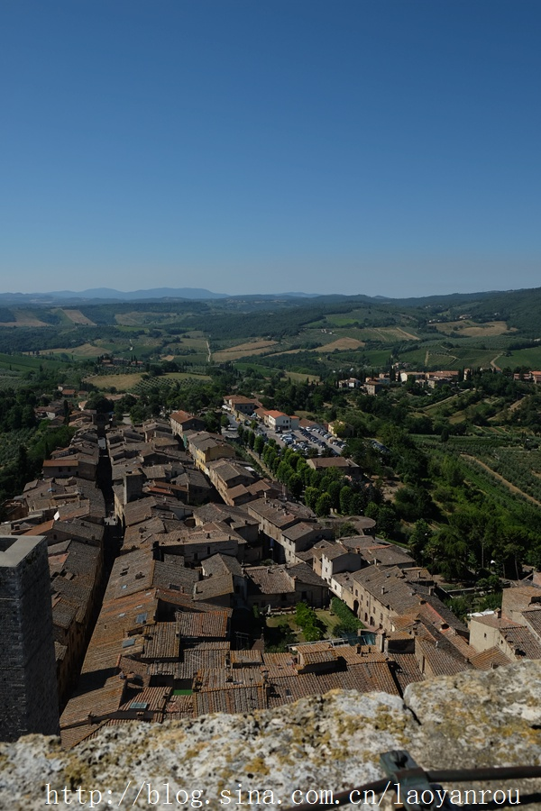  
  
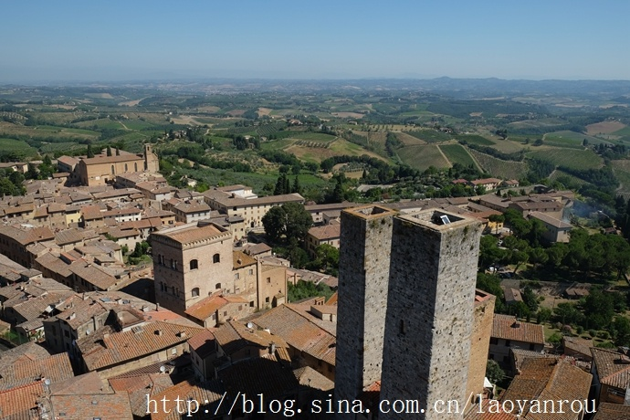  
  
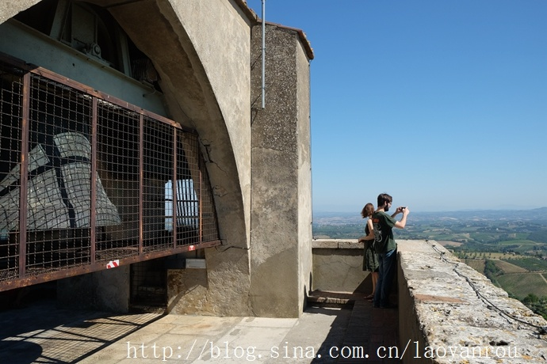  
  
从塔顶下来和早已等得不耐烦的俩母女汇合后在波波罗宫的美术馆欣赏了一下里面陈列的湿绘壁画和当地的一些纺织工艺品，然后便开启了四处游荡模式在城里逛了起来，这里的房屋建筑多是典型的中世纪风格，由黄色石灰岩的石块或烧制的砖块砌成，不少石头历经风吹雨打已变成了黄黑和灰黑色，有些房屋墙上用了灰浆抹平，有些直接就是粗糙裸露的石头，尽管外表是十足中世纪建筑简单粗暴的风格，但几乎每栋建筑都显得结实牢靠，估计要不是天灾人祸再撑个几百年绝对不成问题。大街两旁散布着一些餐馆、小商店、工艺品店和酒坊，尽管同样是做游客生意，但在这里逛街总觉得特别舒服自在，没有招揽游客的音乐、没有炊烟袅袅的烧烤、也没有此起彼伏的叫卖吆喝，与国内所谓的某某古城相比少了很多铜臭味却多了一些清新的文化气息。
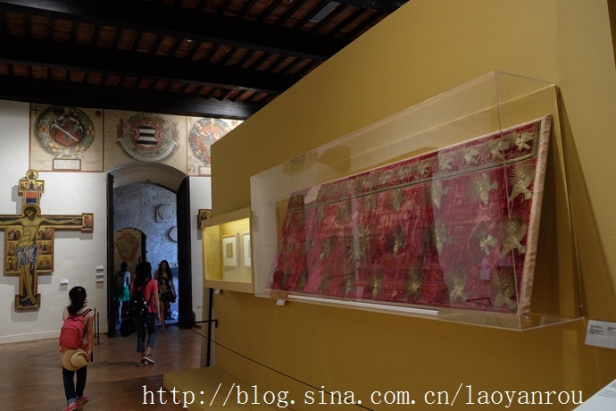  
  
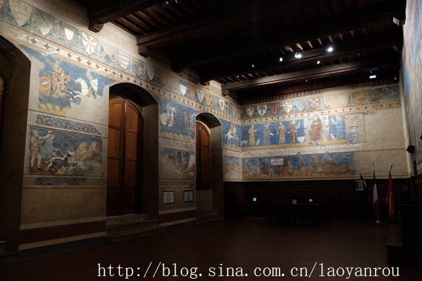  
  
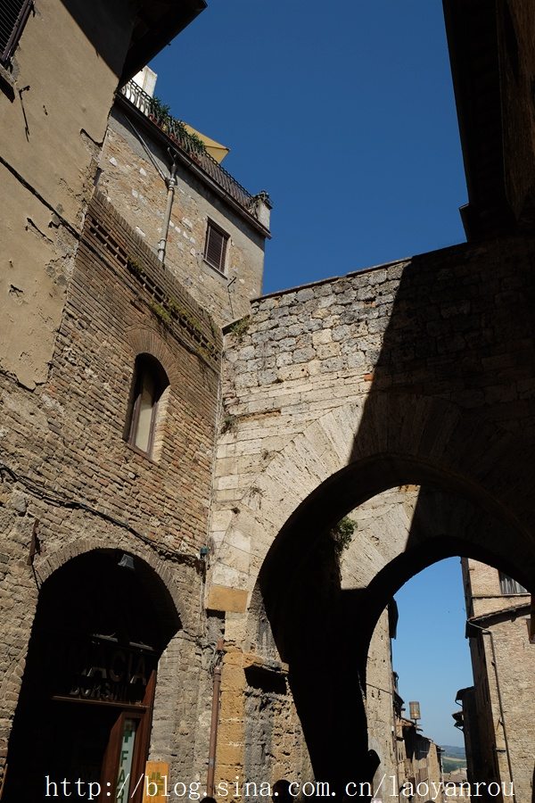  
  
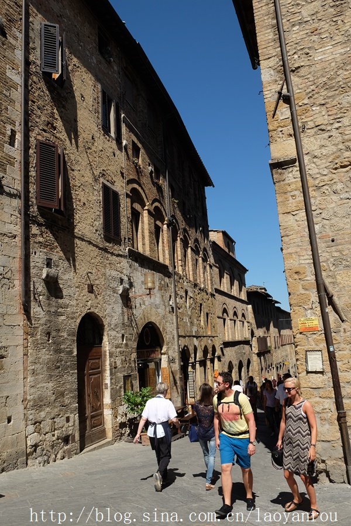  
  
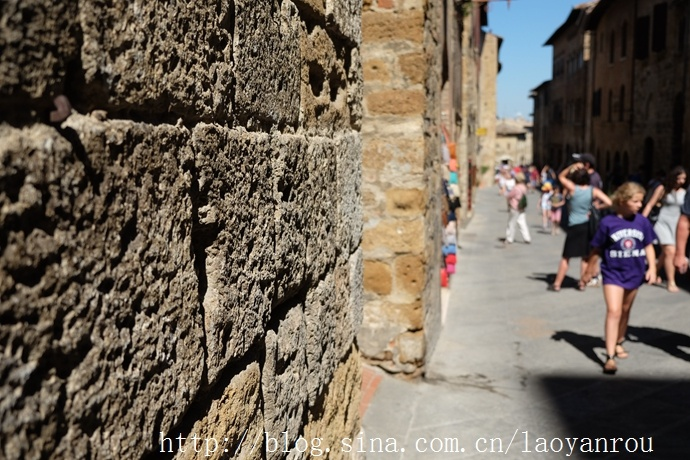  
  
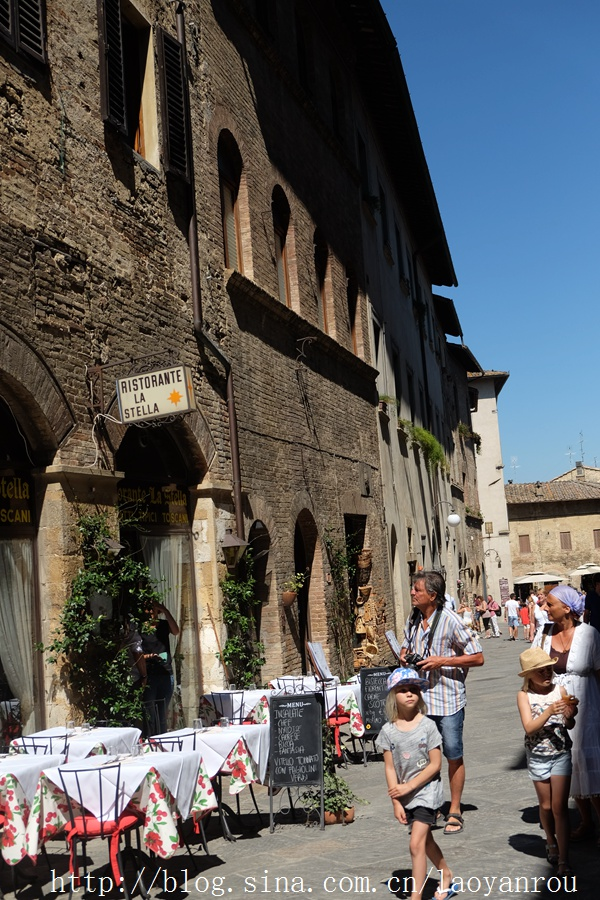  
  
也正是在街上的酒坊里，我们逐渐开始了解托斯卡纳葡萄酒的魅力，圣吉米尼亚诺所处地区周边的葡萄园盛产全世界最著名的Chianti葡萄酒，其中带黑公鸡标志的是古典Chianti葡萄酒，由位于翡冷翠和锡耶纳之间最古老的葡萄园出产的葡萄酿造的，象征着品质的保证。此外这个地区还盛产很多意大利最高级别的D.O.C.G葡萄酒，其中就包括圣吉米尼亚诺本地特产的一种白葡萄酒Vernaccia
di San
Giminignano。尽管品质一流，但我们在好几个酒坊里逛的时候都发现货架上售卖的葡萄酒价格其实并不算贵，最贵也不超过100欧，折合人民币也就是800块钱左右，很多葡萄酒的价格都在50欧以下甚至10欧左右（餐酒），当然在特殊位置摆放着的落满灰尘和蜘蛛网的年份葡萄酒的价格则另当别论了。一言以蔽之这里简直就是葡萄酒爱好者的天堂，难怪意大利人无论男女老幼早中晚餐动不动就开支红酒助兴，根本原因就是其价格非常亲民，普罗大众都消费得起。我们也装模作样买了几支黑公鸡Chianti回酒店品了一下，确实口感比国内所谓的高档红酒不是好了一点半点，但价格却是其几分之一甚至十分之一。可想而知国内进口红酒行业的利润率该有多高，真是不出来看不知道，一看吓一跳。
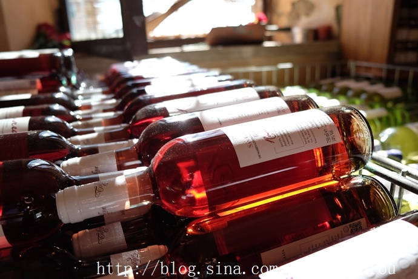  
  
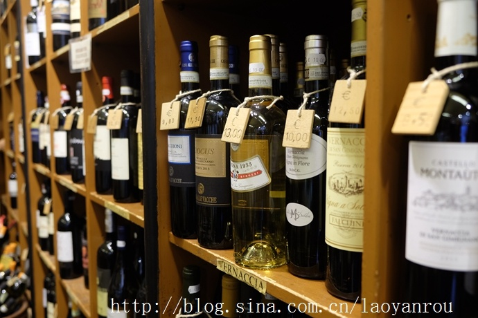  
  
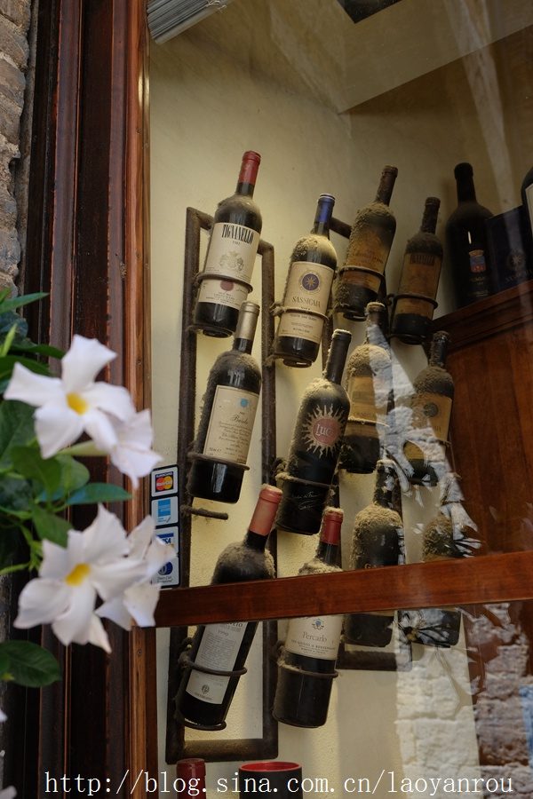  
  
俗话说红酒配红肉，我们中午在小城里瞎蒙乱撞地找到了一家米其林推荐的意大利餐厅咬咬牙点了块当地最出名的翡冷翠牛排，说起这块牛排来还真是与我们以往吃过的牛排完全不同，首先重量最小1KG起，其次牛排煎熟程度只能3、4成，最后完全不配任何酱料只配粗海盐，于是好奇的我们望眼欲穿终于等到牛排端上餐桌，只见一大块黑红色T-bone牛排滋滋往外淌着油散发着扑鼻肉香隆重登场，一刀下去外焦里嫩，刀刀见血，从来没有吃过那么生的牛排我们刚开始都有点懵，硬着头皮尝了一口后却发现入口即化是毫不夸张的评价，而蘸着天然的海盐则充分吊出了牛排本身独有的鲜味，于是三个人风卷残云般地将一公斤多的牛排就地解决不留一丝遗憾，这顿翡冷翠牛排确实是我们有生以来吃过最有特色也是最好吃的牛排，没有之一。
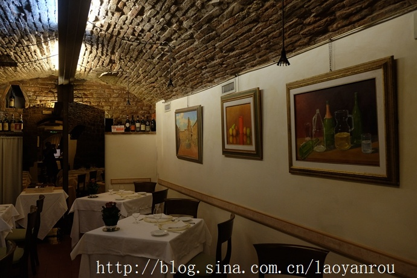  
  
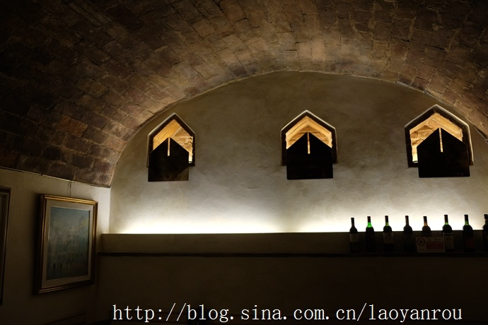  
  
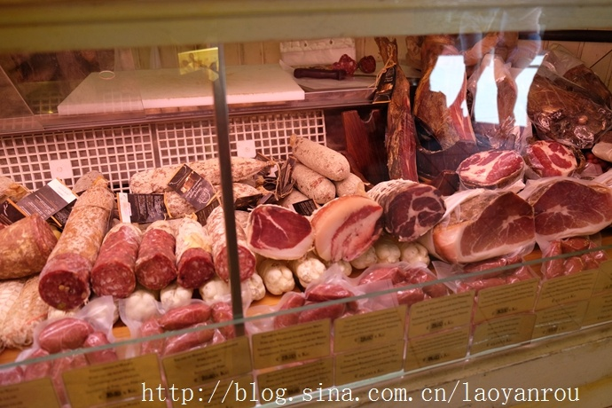  
  
带着浓浓回忆离开圣吉米尼亚诺回到了翡冷翠，由于欧洲的夏天天黑得比较晚，所以我们又一次欣赏了夕阳下的圣母百花大教堂，前往已经闭馆的但丁故居看了下这位伟大诗人在翡冷翠曾经的居所，到亚诺河边散了下步逛了下街顺便解决了晚餐，结束了一天兴奋而又充实的行程。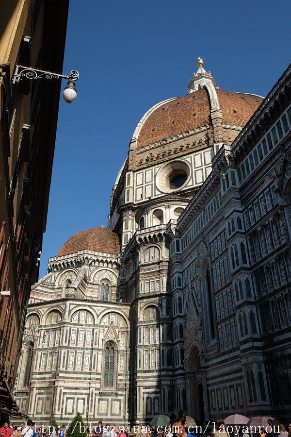  
  
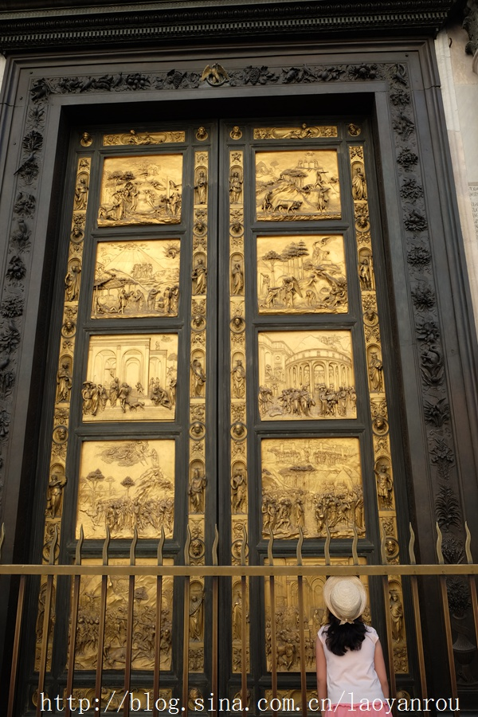  
  
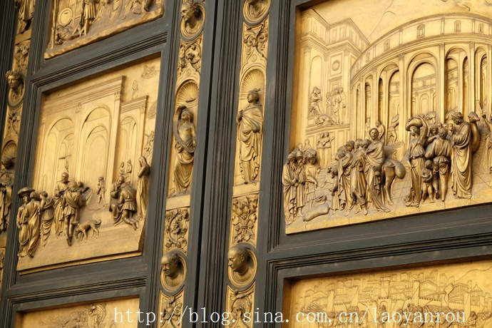  
  
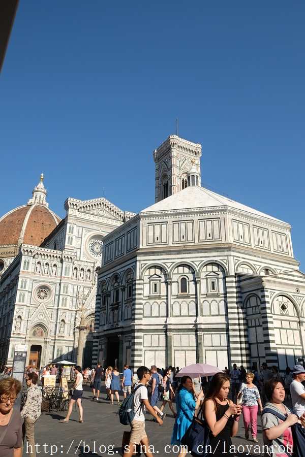  
  
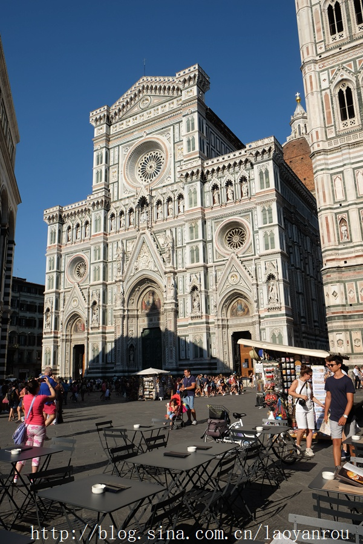  
  
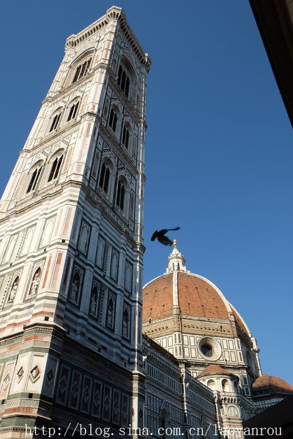  
  
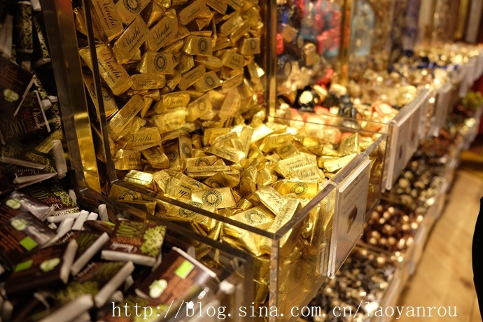  
  
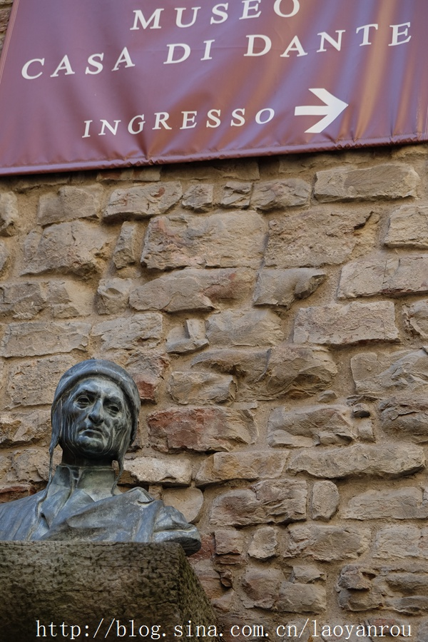  
  
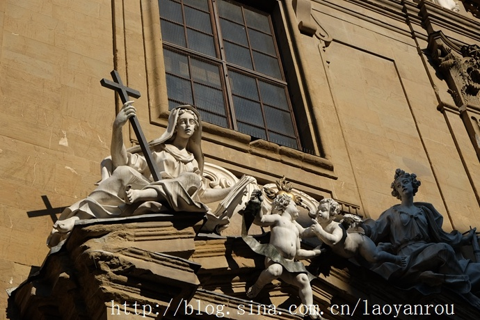  
  
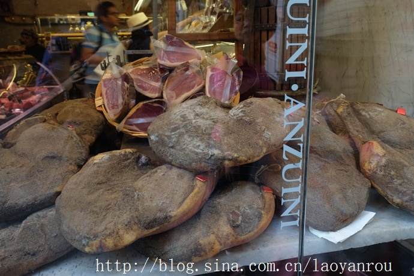  
  
  
  
  
  

