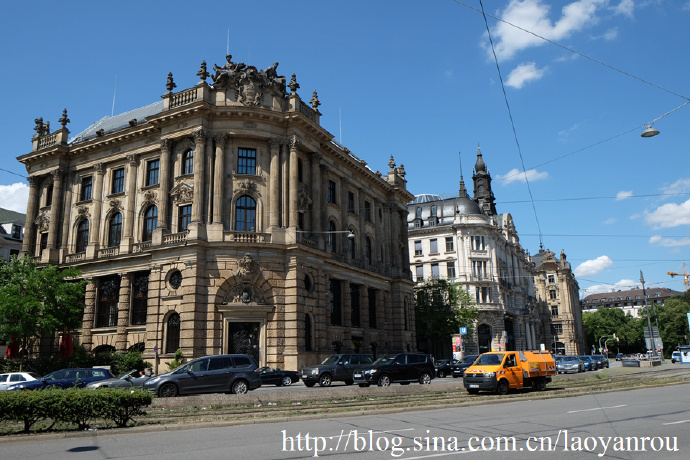
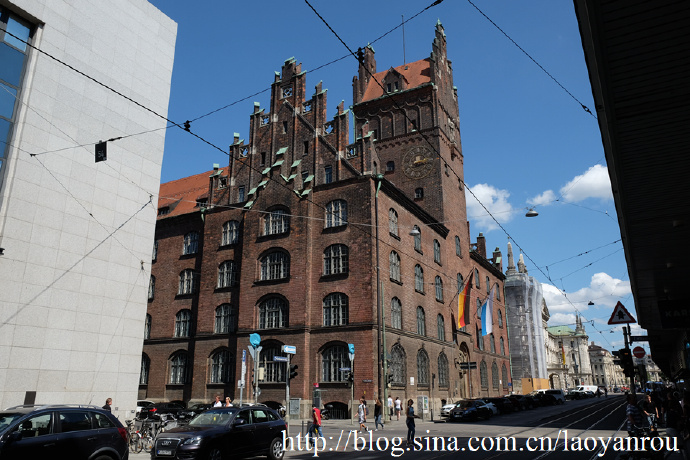
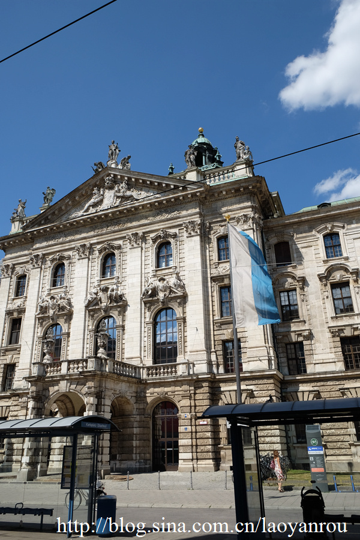
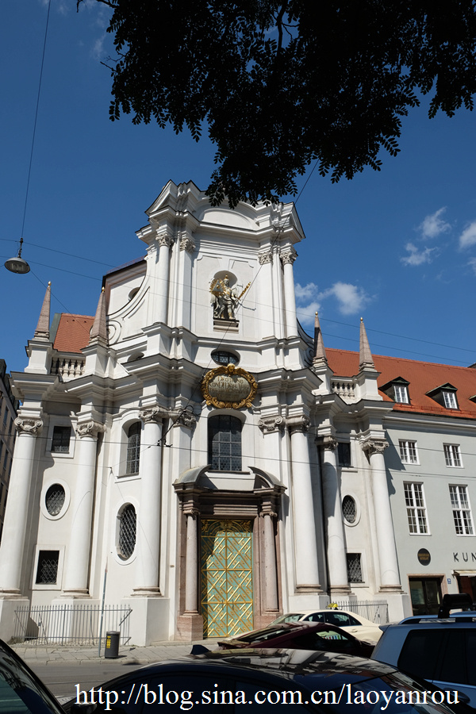

# 欧游札记之哈布斯堡荣光(Day1广州—慕尼黑—布拉格)

  
  
Day1广州—慕尼黑—布拉格

只因尼采的那句经典名言“当我想以一个词来表达音乐时，我找到了维也纳；而当我想以一个词来表达神秘时，我只想到了布拉格。”，勾起了我们此番出游捷克、奥地利及德国、一探神圣罗马帝国曾经辉煌的冲动。

三张阿提哈德航空暑假促销特价票妥妥地将我们经由阿联酋首都哈布扎比送到了德国慕尼黑，尽管一路顺风顺水但还是不得不小小吐槽一下，在中东土豪三大航空（阿联酋、卡塔尔、阿提哈德）中，阿提哈德飞机的座位舒适度、机上娱乐丰富性和餐食可口度是我体验过的最差的一个，且中转阿布扎比的机场设施与卡塔尔的多哈相比简直差了好几档，完全是七天PK希尔顿的感觉。不过看在价格便宜的份上，这些槽点俺们都能照单全忍了，谁叫我们玩的就是穷游呢？嘿！

说到机场，慕尼黑机场那还真有点国际一流机场的范儿，从飞机落地、下机到排队过关，整个过程酣畅淋漓，绝无拖泥带水，好好体验了一把德国人做事的严谨和守时。时间就是金钱啊！因为我们计划就是到慕尼黑不作停留马上赶到市中心的长途汽车站搭19欧的国际大巴直杀布拉格，幸好长途汽车站离慕尼黑中央火车站只有两三站地铁，且机场与中央火车站也仅一小时的地铁，所以我们按之前网上做好的慕尼黑地铁攻略，在机场地铁自动售票机上捣鼓了一会买好了三张天票，紧锣密鼓地拖着两个大行李箱在中央火车站转了趟地铁便在大巴发车前赶到了慕尼黑长途汽车站，定下神后我掐指算了下，从机场下机排队过关到买地铁票再到坐地铁全程加起来不到3个小时，各个环节都没耽搁，运气啊！速度啊！莫非是个好预兆？

  
  
  
  
  
  
长途汽车站里停满了从慕尼黑发往周边国家主要城市的跨境大巴，经济实惠任君选择，实乃囊中羞涩吃苦耐劳的背包客和穷游一族们的出游利器！实际上当我们凭网上预订车票在乘务员热情帮助下摆好行李踏上了双层大巴的顶层坐到了第一排的观景座位上时，才发现其实无论车辆舒适干净度还是提供贴心服务及诸多便民措施均可以让我们舒舒服服地度过6个多小时的车程。

我们订了第一排四人座的其中三个，最边上坐了一位德国潮小伙，戴着个大耳麦，非常礼貌地问了我们要不要吃点他带的饼干，我们受宠若惊地客气的婉拒了他，他便识趣地自顾自地专心听起流行歌并啃起饼干来。德国人好客但不唐突，尊重其他人的私人空间的品质在他身上表现得淋漓尽致。

大巴缓缓开出了车站，行驶在慕尼黑干净而整洁的柏油马路上，只见两旁一辆辆宝马奔驰奥迪如风般嗖嗖叱咤而过，基本看不到美国和日本车，真不愧为BBA的故乡啊！一路上风景从高楼林立的德国城市切换到牧草茵茵的田园农场再切换到郁郁葱葱的维也纳森林，途中偶尔翻下旅游攻略、喝杯大巴咖啡打个小盹，6个多小时的光阴其实没有那么漫长，而原本阴雨湿冷的天空也开始放晴了，正如同我们的心情一样，随着越来越接近神秘的捷克布拉格而愈发兴奋起来。

临近下午四五点，车窗外一个古老城市的轮廓逐渐清晰起来，还没等我们准备好适应神秘感的倏然消逝，大巴已左穿右插地稳稳地停在了古色古香的布拉格火车站前，大家鱼贯下车拎起行李准备作鸟兽散时心中霎时升起两个感慨，一是感慨这个城市历史悠久到处可见巴洛克和哥特式风格的建筑包括火车站在内，二是感慨自己的行李箱马上要经受住街道上一眼望不见尽头的凹凸不平石板路的折磨和考验了，此时才想起了驴友在攻略上忠告布拉格尽量订靠近火车站的酒店以减少拖行李箱的痛苦此言非虚了。

幸好我们还是听从了忠告预订了一家位于布拉格火车站附近位于瓦茨拉夫广场边上的小公寓，所以那两只可怜的行李箱也仅在石板路上吧嗒吧嗒地弹跳了十来分钟便如释重负般到达了目的地，让我们惊讶的是这家公寓竟然无人值守，楼下大门和房门均采用电子密码锁，内附密码的信封就放在楼下的密码箱里，只需凭之前酒店预订回复邮件的密码开取，不过也好不用处理沟通的尴尬，略为折腾了一下就进入了我们这几天在布拉格的小巢了，房间位于顶楼，打开屋顶的天窗即可望见布拉格湛蓝晴空嗅到清新的雨后凉风，不大的空间也布置下了一张双人一张单人床，袖珍厨房、小圆餐桌、锅碗碰瓢及基本调味品一应俱全，看来绝对可以满足某位领导一展身手以解决中国胃难题的愿望了！

接下来的时间我们还是决定不急于启动布拉格之行，只是在广场附近找了一家BILLA超市采购了些食品回公寓，小试牛刀解决了晚饭问题，然后在周边逛了一圈便早早睡下养精蓄锐为明天行程做好准备。
