# 欧游札记之哈布斯堡荣光(Day10维也纳—萨尔茨堡)

  
  
Day10
维也纳—萨尔茨堡

说起萨尔茨堡，给很多人的第一印象便是莫扎特的出生地，世界音乐之都，但它同时是个依山傍水、风景怡人的奥地利第四大城市。自奥地利东部的维也纳到西边萨尔茨堡搭普通火车大概只需要两个多小时即可到达，我们甚至趁着傍晚天色尚明，还从火车站附近的酒店沿着萨尔茨堡河一路晃悠到了市中心，远远瞅了眼莫扎特故居的模样。若不是要拖着贪吃杏子而闹肚子的LP回酒店休息，我们还可美美欣赏下小城的夜景。

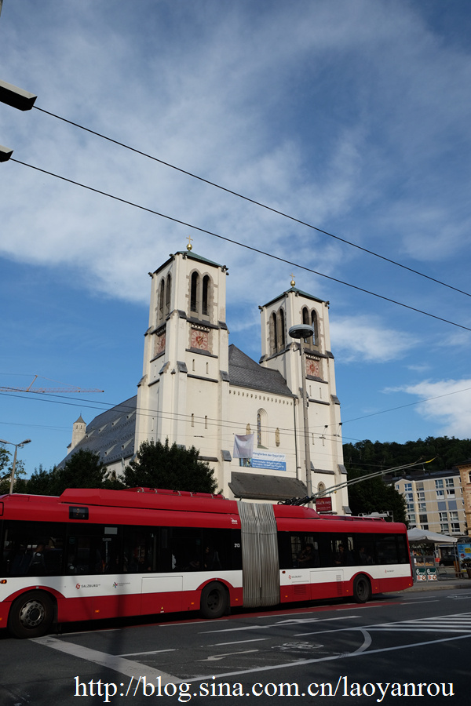  
  
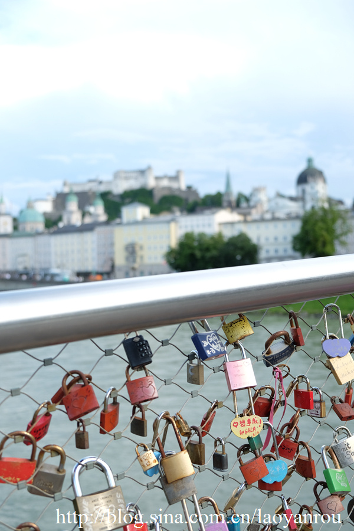  
  
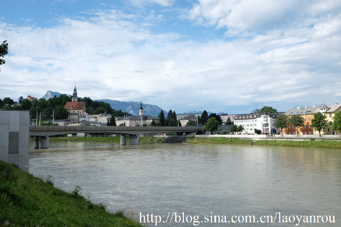  
  
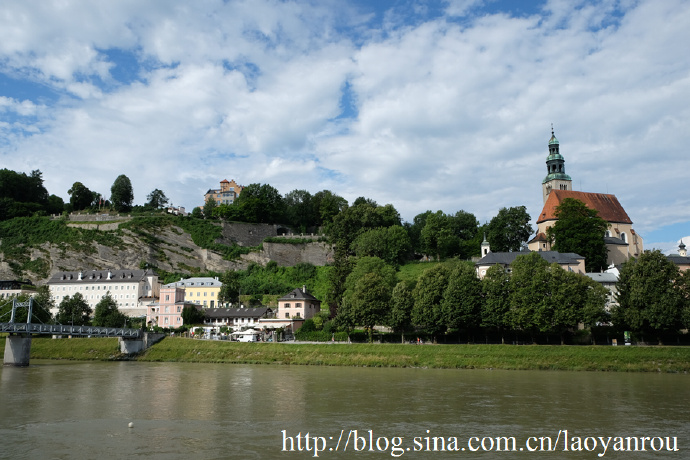  
  
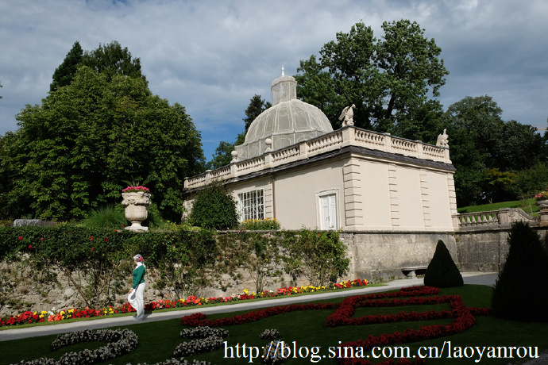  
  

幸好第二天早上一切恢复正常，我们便正式开启了萨尔茨堡之旅。早晨的萨尔茨堡河尽管不像瑞士卢塞恩小河那般清冽见底，但肯定也没有受到任何工业污染，灰绿色的河水洋洋洒洒地穿城而过，水面上一座座铁桥和石桥串起两岸的绿草茵茵，远处的古老萨尔茨堡城堡在阿尔卑斯山的映衬下显得分外巍峨。

我们的第一站是冲着《音乐之声》电影的主要外景地——米拉贝尔宫殿去的，此宫殿最早是当地权贵为取悦情人所建，后来被改建为巴洛克风格的封闭式建筑，其中央花园布满了罗马雕塑和喷泉，被选为获得五项奥斯卡大奖的著名音乐剧电影《音乐之声》的取景地。这里鲜花锦簇、游人如织，远处高耸的古堡安详地俯瞰着整座宫殿，AMY饶有兴致地在《音乐之声》场景的喷泉边上欢快地绕起了圈圈，耳边仿佛依然荡漾着当时老师带领学生们在此尽情歌唱的袅袅余音。

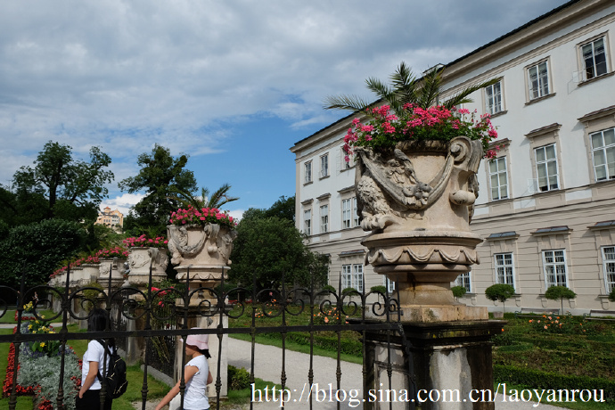  
  
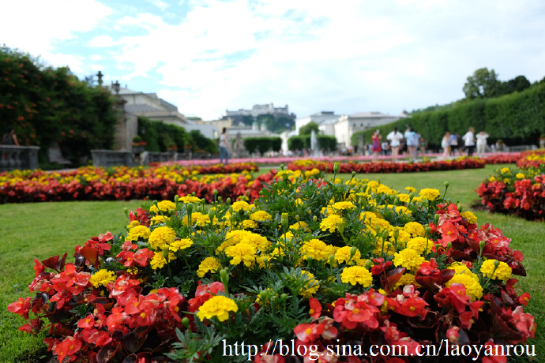  
  
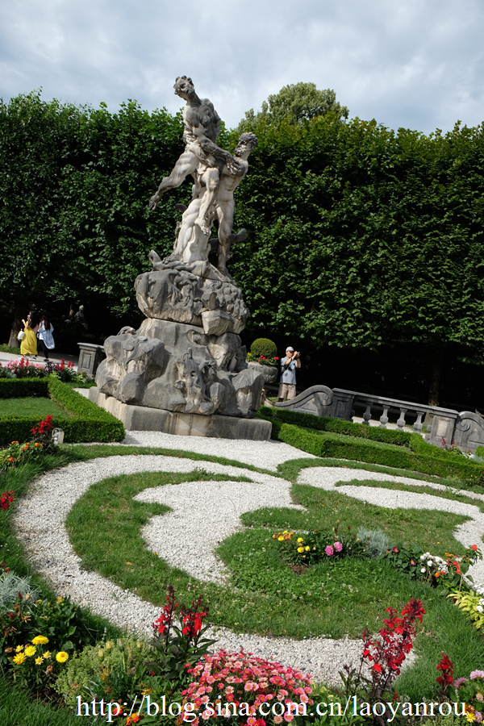  
  
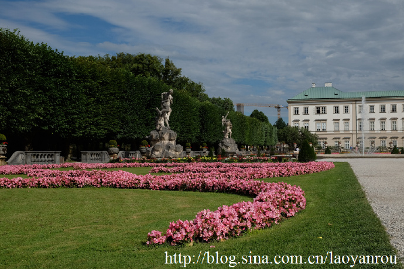  
  
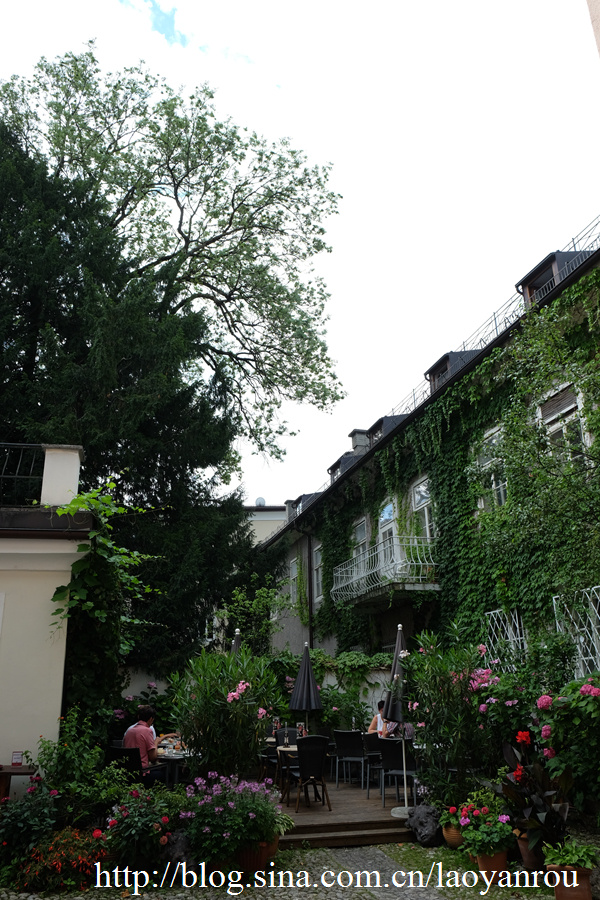  
  

沿着河边走到粮食胡同一座刷成明黄色的六层小楼前，此处即为萨尔茨堡人的骄傲—莫扎特的故居博物馆，冲着老莫响当当的名头，我们几个犹豫了片刻还是一咬牙一跺脚掏了差不多100欧的门票钱才得以入内一睹真颜，正如AMY所说的那样，到萨尔茨堡不看莫扎特故居就等于白来一趟，萨尔茨堡现世的声名鹊起绝大部分都归功于出生于此地的莫扎特，一个三岁弹曲、四岁学琴、五岁辩音、六岁开始环游欧洲各地十年巡回演出的音乐神童。虽然天资禀赋固然重要，但当我们走进莫扎特故居，发现房间里随处可见的小提琴、键琴、钢琴、乐谱手稿，又从墙上图片介绍得知其父亲是宫廷乐师、母亲会拉大提琴时，才感悟到天才的成长也是需要后天音乐环境土壤培养滋润的。实际上莫扎特在萨尔茨堡的这座房子里前后合计只住了15年左右的时间，包括六年童年时光以及欧洲巡演回来后在萨尔茨堡大主教宫廷乐队担任首席乐师的九年光阴，但他在家里渡过的大部分时间都是郁郁不得志的，因为忍受不了大主教对待乐师如同仆人般的刻薄和羞辱，莫扎特毅然与其公开决裂，冒着艰辛、饥饿甚至死亡的风险冲出宗教牢笼桎梏来到了维也纳开始了自由艺术家的生涯，在生命剩下的十年短暂时光里，创作了包括《魔笛》、《费加罗的婚礼》、《安魂曲》在内的数百部伟大的歌剧及交响乐作品，无奈天妒英才，穷困潦倒疾病缠身的莫扎特尽管收获了爱情和音乐成就，却还是最终落了个悄无声息死无葬身之地的落寞结局。颇具讽刺意味的是，他一生最为憎恨的城市—萨尔茨堡，却在百年之后凭借着他超凡的音乐成就而成为了音乐爱好者们趋之若鹜的朝圣和旅游胜地，而他的故居也变得门庭若市财源滚滚了，不禁让我们唏嘘“生之未必成之，成之未必火之”。

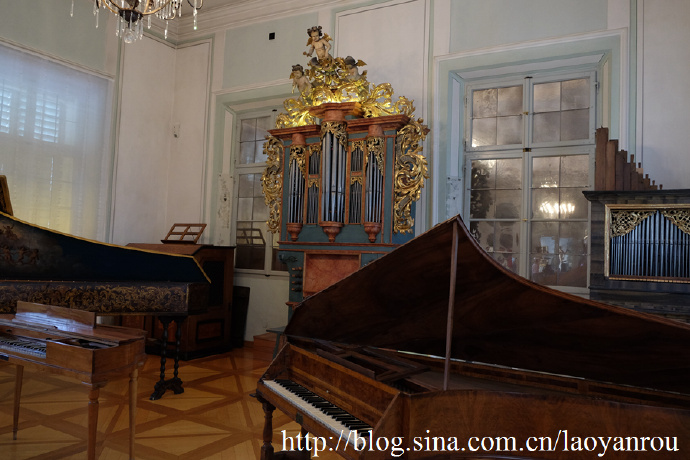  
  
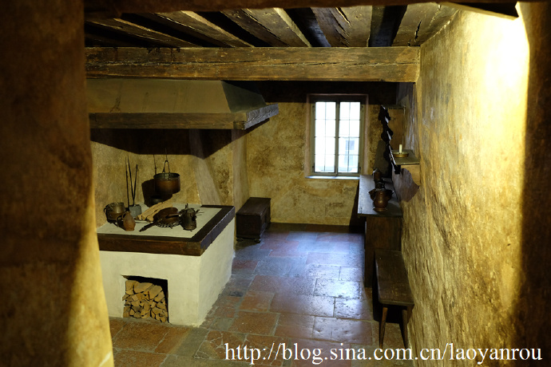  
  

犒劳了AMY一个当地最出名的萨赫蛋糕后，我们得以精神抖擞继续前行。曾于二战时被美军炸毁后又修复的萨尔茨堡大教堂穹顶上的浮雕和壁画交相辉映，令人眼花缭乱。莫扎特首次指挥演奏的世界三大弥撒曲之一的《C小调弥撒曲》的圣彼得修道院后的墓地繁花锦簇，鸟语花香，绝对称得上我们所见过的环境最优美最宁静的陵园之一。沿着山坡小径我们吭哧吭哧地爬到了萨尔茨古堡的外围高处，尽管没能入内参观，但放眼四下望去，整个萨尔茨堡老城尽收眼底，灰瓦绿顶的中世纪建筑鳞次栉比，逐渐隐没在远处墨绿的丘陵田野中，美不胜收。

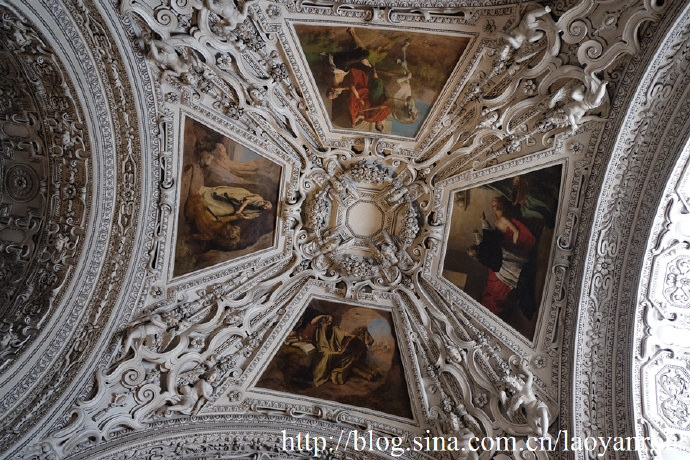  
  
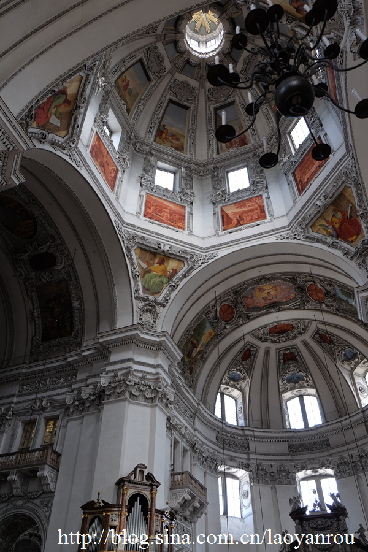  
  
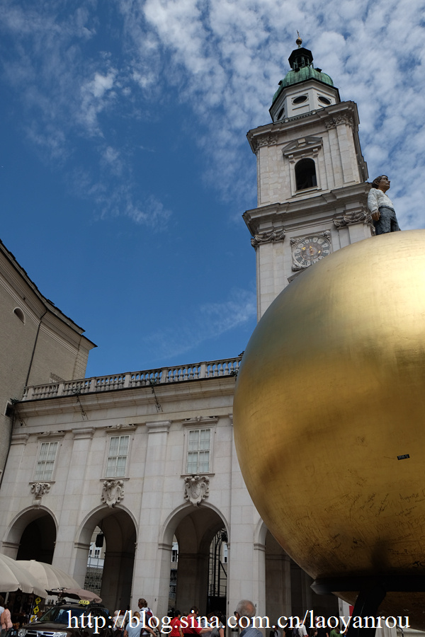  
  
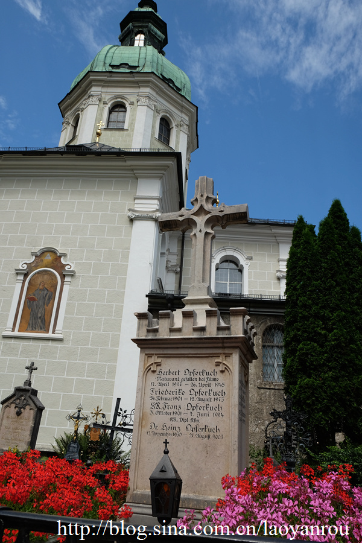  
  
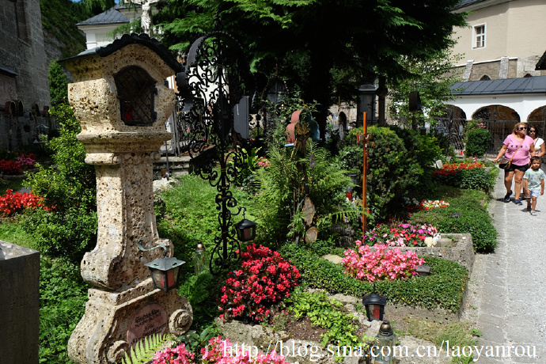  
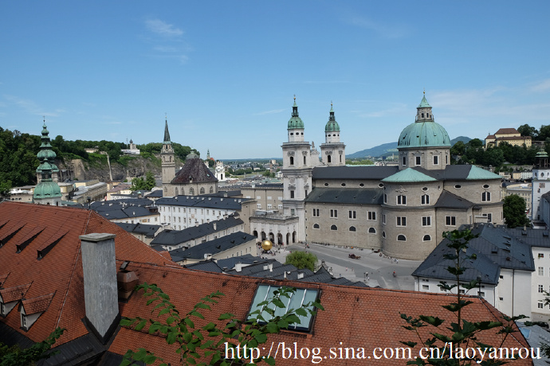  
  
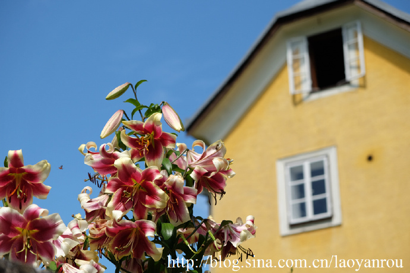  
  

等下到老城里的最著名的购物街—粮食大街时，我们看到的却又是另一派市井繁华景象，在享誉世界的古典铁质楼花招牌下，一间间琳琅满目、富有艺术气息的店铺沿着大街一直延伸向前，不仅有首饰、古董、乐器店，还有服装、香水、皮具店及餐厅等等。其中作为必买手信之一的“莫扎特巧克力球”和施瓦洛士奇水晶则几乎是大街上接踵摩肩的游客们手中的标配。除此以外，带有莫扎特标记的纪念品比如CD、书、餐具、领带、明信片那更是应有尽有通街都是，肯定不会令慕名而来的诸多莫扎特粉丝们的空手而归。

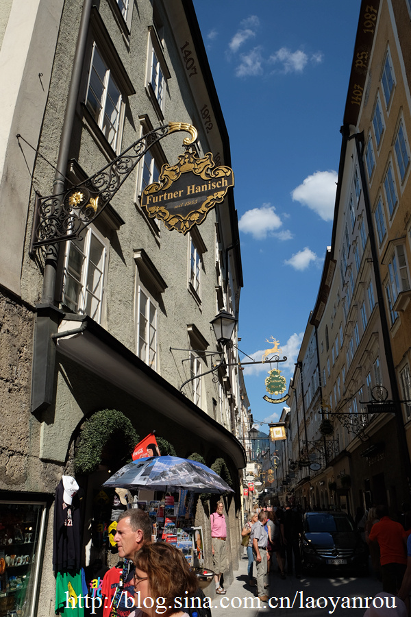  
  
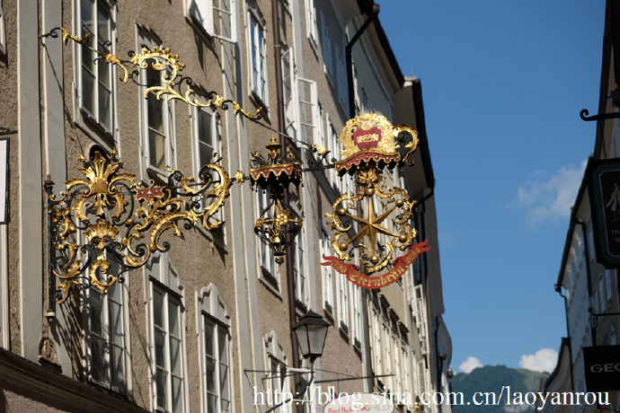  
  
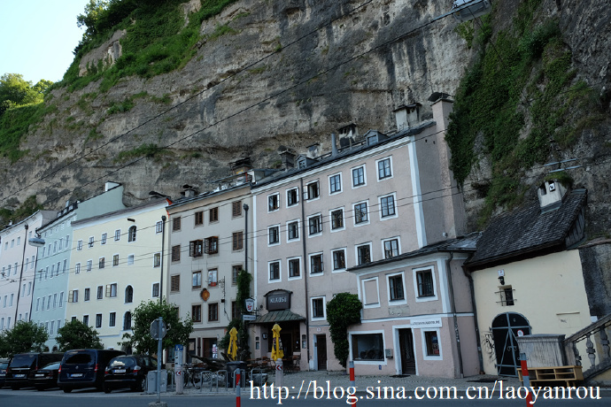  
  

一阵喧嚣过后，迎着夕阳、沿着萨尔茨河回酒店时回眸一瞥，

河中一辆水陆两用的观光车正突突突地从河中爬上岸来，为远方暮色中静静伫立的古堡和汩汩流淌的河水构成的五线谱又平添了几分跃动的音符。

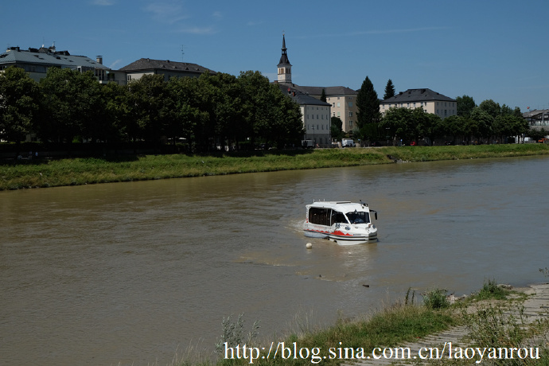  
  
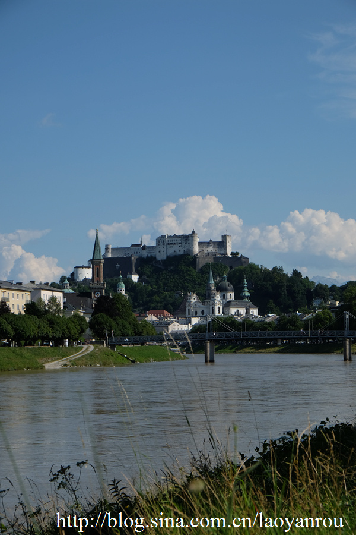  
  
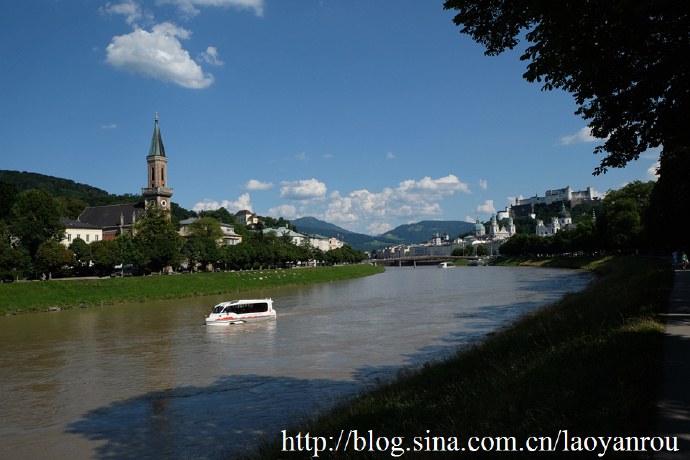  
  
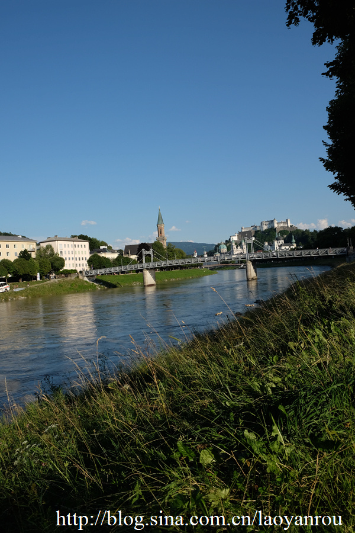  
  
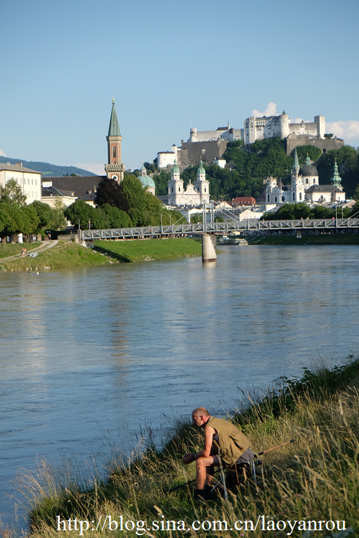
