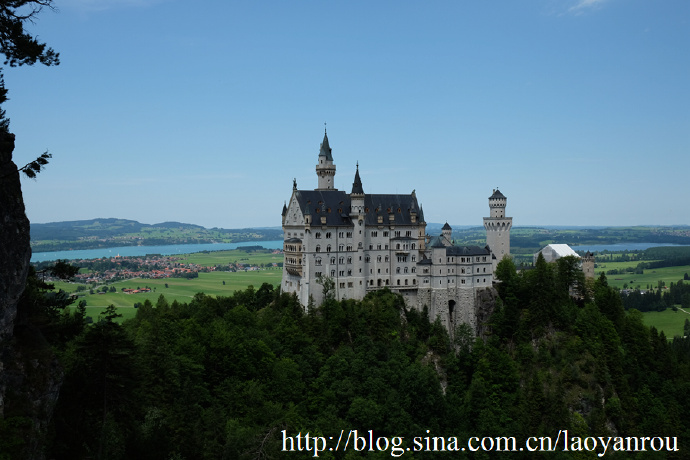
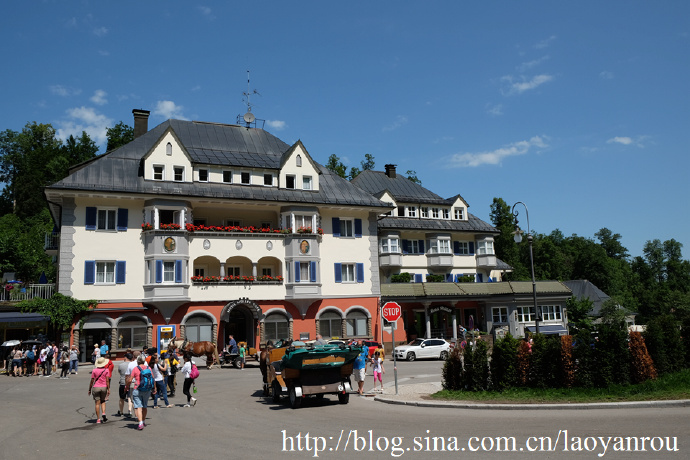
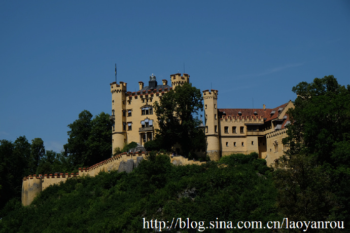
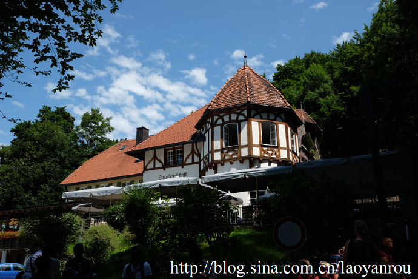
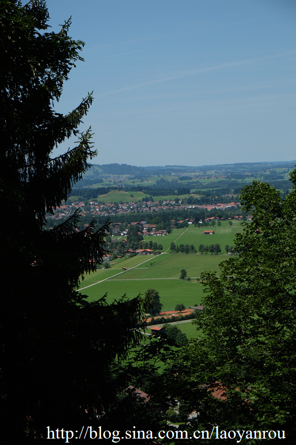
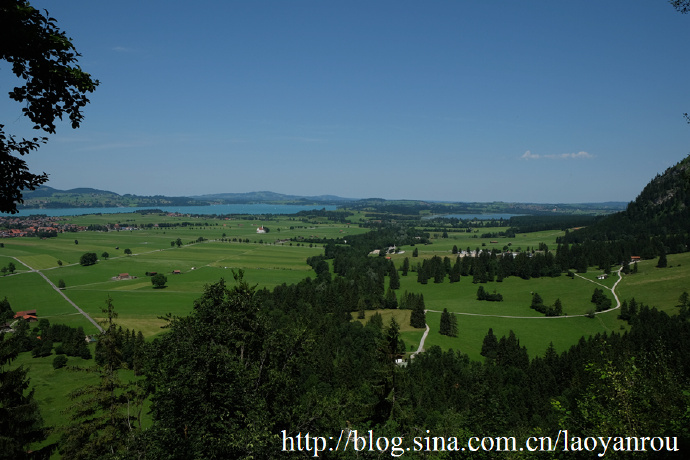
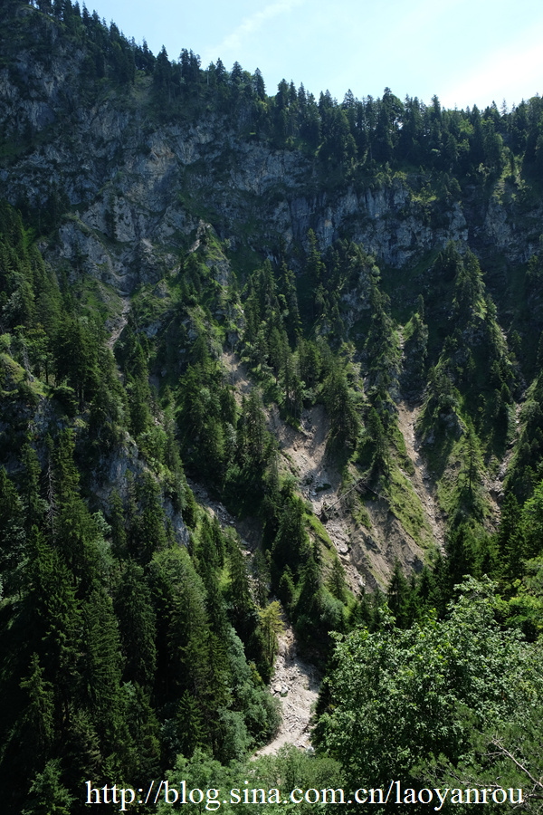
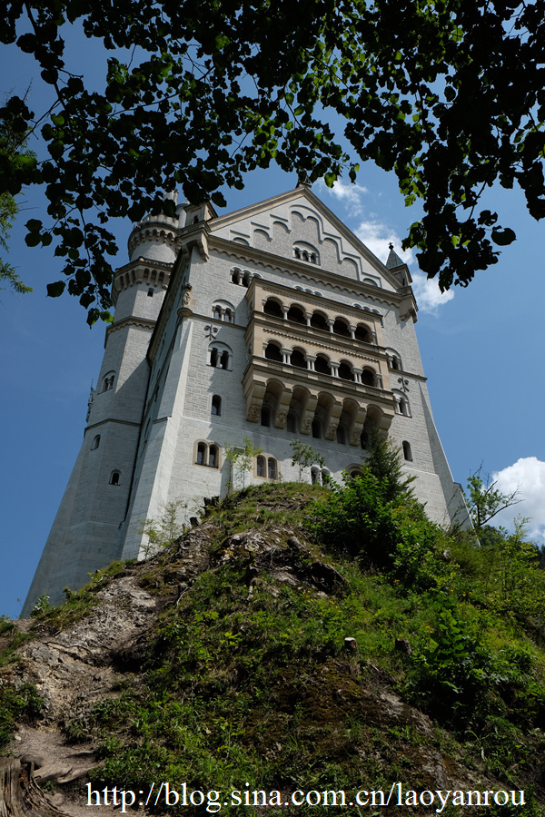
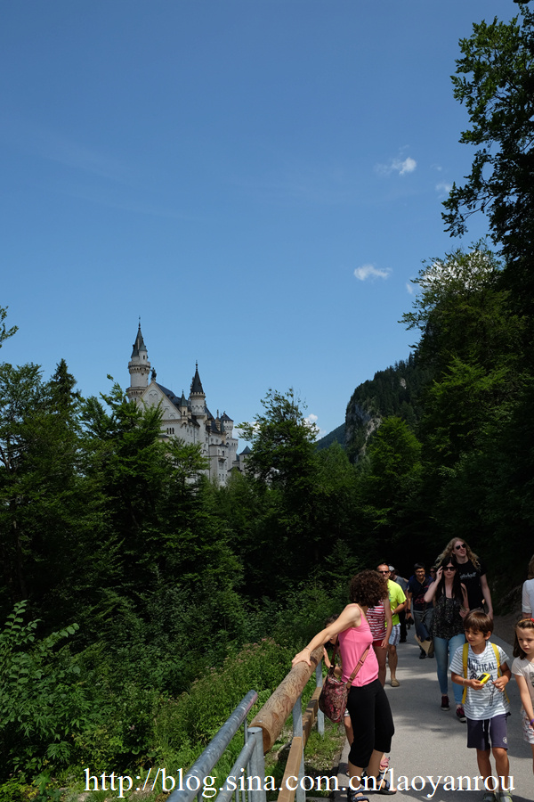
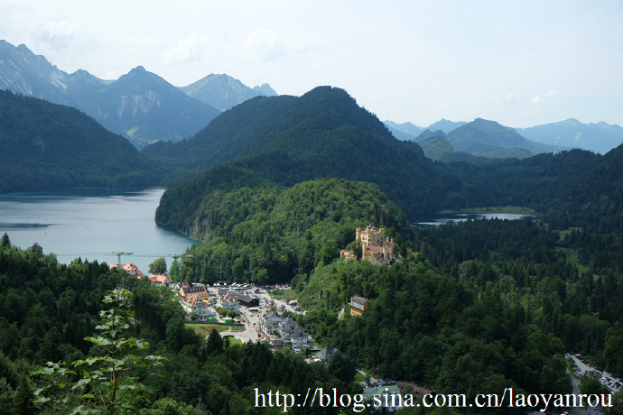

# 欧游札记之哈布斯堡荣光(Day12慕尼黑—新天鹅堡—尾声）

  
  
Day12
慕尼黑—新天鹅堡

说老实话，慕尼黑在二战盟军狂轰滥炸后所留下来的古迹屈指可数，唯一较为集中的地方就是玛利亚广场及其周边，比如建成于二十世纪初的哥特式风格的新市政厅、顶部呈洋葱形双塔的圣母教堂等等，但这些历史颇短的所谓古建筑并不能提起我们寻古探幽的兴致，反倒是在老城中心走街串巷瞎逛还额外收获了一些市井的感受。

等到逛无可逛之时我们便踏上了开往菲森方向的火车去探访德国南部最著名旅游胜地之——新天鹅堡，它和山下的霍恩斯旺高城堡一高一低相互呼应，其实分别是路德维希二世及其父亲马克西米连二世修建的行宫，从山下顺着一条大马路朝着新天鹅堡行进时，若不是睁开眼睛明辨自己身处何方，要是单凭身边游客们此起彼伏的各式国语、台语和粤语腔调来判断，还真仿若走在了广州白云山的大路上，看来传言这一德国名胜几乎已被国人攻陷此言非虚啊。也没费多大劲我们便爬到了新天鹅堡所在山头，但若是想找个最佳摄影位置还得绕到它背后再爬一段山路去到一座横跨山谷的木桥，令人胆战心惊的是木桥上已经挤满了等待照相的游客，我们一边嘀咕着桥的承重能力如何一边赶紧蹭到桥中央猛拍了一通照片便落荒而逃了。速度快到甚至来不及多看几眼这座仿佛只应存在于童话故事中的灰瓦白墙的中世纪古堡，回来才从照片中细细琢磨它的美，只见城堡山脚下的绿色田野阡陌交错，间中洒落着一粒粒红宝石般的红瓦民宅，更远处的蓝色湖水碧波粼粼、白帆点点，将眼前的古堡映衬得分外明艳动人。

  
  
  
  
  
  
  
  
  
  
  
  
  
  
  
  
  
  
  
  
  
  

压轴登场的新天鹅堡游毕，此次德国捷克奥地利之旅也基本划上了圆满的句号，只因大多所见所闻、所感所悟均已在杂糅在散记的各个片段之中，临近文末已才思枯竭语无伦次了，故也就虎头蛇尾地到此为止吧！
