# 欧游札记之火舞西班牙(Day2奎尔公园—圣保罗医院—巴特略之家—加泰罗尼亚音乐厅—毕加索博物馆）

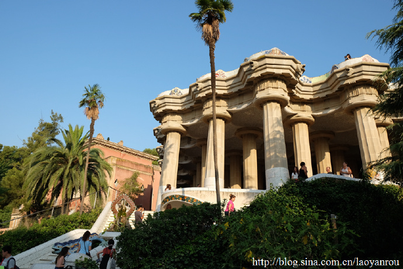  

奎尔公园

Day2广州—巴塞罗那—奎尔公园—圣保罗医院—巴特略之家—加泰罗尼亚音乐厅—毕加索博物馆

总所周知，高迪大爷是巴塞罗那的镇山之宝，所以我们整个巴塞的行程基本就是沿着高大爷的作品展开的。其中的奎尔公园安排了一大早去，为了错峰出游。清晨的巴塞安静、祥和，从所住民宿往山上的公园走去，一路的街道上行人寥寥，除了因工作需早起的上班族及晨练的大叔大妈以外，唯有零星几声雀鸣融合在清晨的熏风里一阵阵向我们拂面而来，牵引着我们快步向山上行去。随着街道两旁逐渐增多的工艺品店匆匆一瞥而过，奎尔公园到了眼前我们都没反应过来，跟着三五成群的游客进入了公园才发现竟然没人检票，心想费了好大劲网上预约买票，到头来却一分不用就进来了，不免亏大发了。但后面我们才闹清楚，8点30前参观奎尔公园是免费的，但如果你八点半之后还留在公园里，仍需要补票进行参观的。其实说白了，奎尔公园其实最初只是二十世纪初巴塞的一个富商奎尔心血来潮想在巴塞西北荒野的山上修建的一个高级社区，还请了高大爷做设计师，只是当年的巴塞富豪们不买账，社区最后烂了尾，只剩下高大爷设计的公共设施部分得以完成，没曾想这烂尾的社区却凭高大爷自然主义设计风格的公共设施就摇身一变成为了世人趋之若鹜的世界文化遗产-“奎尔公园”！简直是草根逆袭的经典案例啊。

进了大门以后立刻感觉进入了一个马赛克的童话世界，拾阶而上时两旁的护栏全都贴满了鱼鳞般不规则的白色马赛克瓷片，间中还装饰着黄色、蓝色马赛克圆盘，台阶正中还趴着一只色彩斑斓的马赛克大蜥蜴，据说内有玄机是一道水闸，下大雨时还能开口喷水，难怪乎堂而皇之地占据了镇园之宝的C位。

百柱厅马赛克台阶

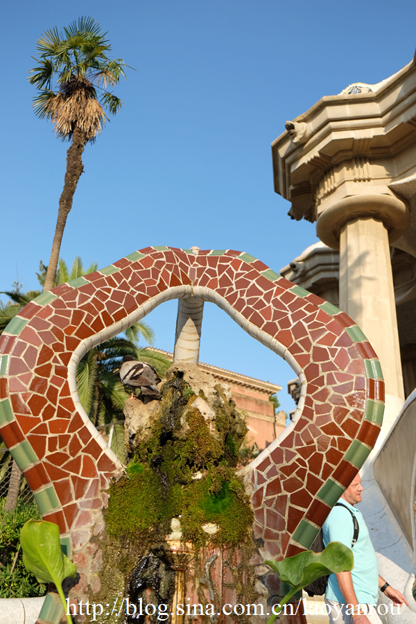  

马赛克喷泉

台阶尽头是86根陶立克式风格柱子撑起的百柱厅，大厅顶上天花板上凹凸不平，中间镶嵌着两块巨大的蓝黄绿色马赛克拼成的太阳圆盘，艳丽妖娆。

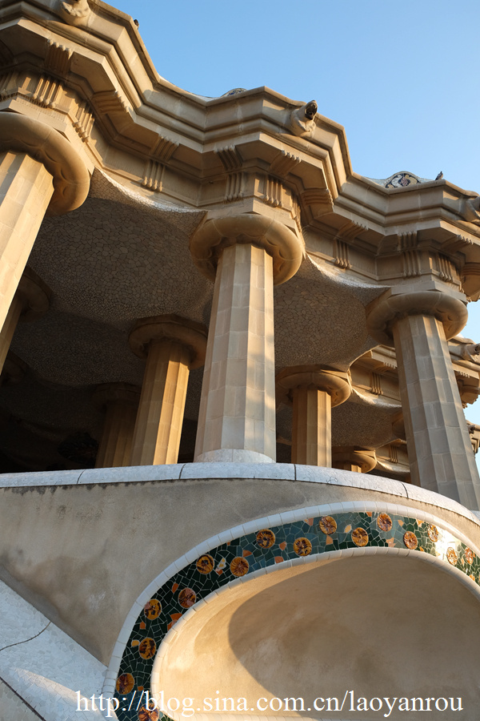  

奎尔公园百柱厅外景

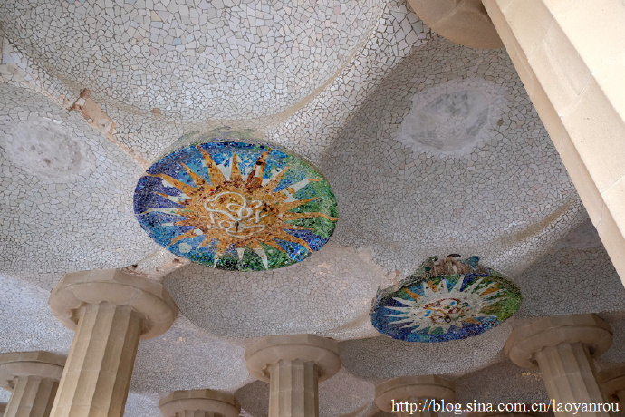  

百柱厅天花

更让人称奇的是大厅顶部的观景台，不仅可以看见园内的蓝白马赛克尖顶的糖果屋，还可以远眺一路延伸至地中海的巴塞城区及高耸入云的圣家堂，观景台边缘波浪般蜿蜒的围栏还被高大爷设计成为了贴满缤纷马赛克瓷片的超长靠椅，坐上去贴合背部非常舒服，据说是考虑了人体工程学原理而设计的，可谓独具匠心！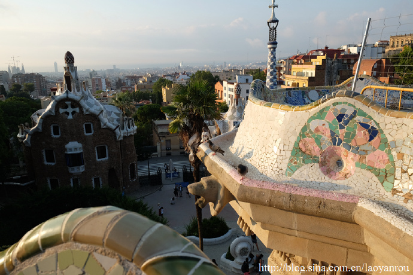  

百柱厅屋顶观景台

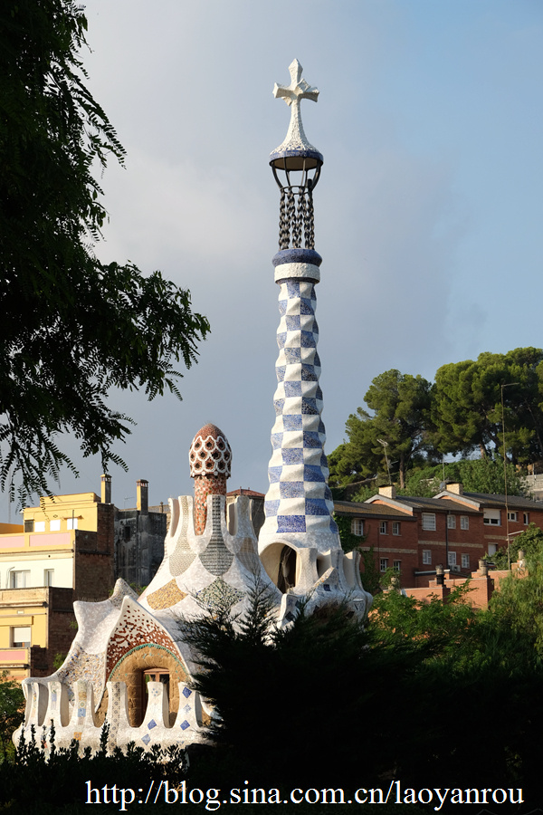  
奎尔公园糖果屋  
  

而要说最能体现高大爷“直线属于人类、曲线属于上帝”理念的则是百柱厅旁边的斜柱走廊，整个走廊分两层，支撑下层的柱子全部都像漫不经心的由自然石块和材料堆砌起来的斜柱，看似东歪西倒毫无章法地野蛮生长出来的，但实际上却是严格符合工程力学原理的，经历了上百年风雨洗礼仍旧屹立不倒。有几处斜柱还被设计成底细顶粗的螺旋上升圆柱型，感觉就像科幻大片里外星球的建筑风格，其设计理念惊为天人。

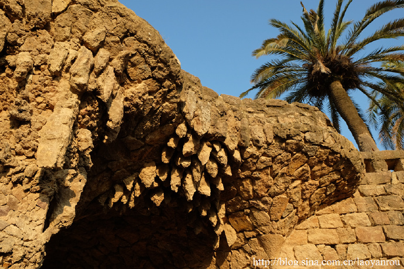  

斜柱长廊入口

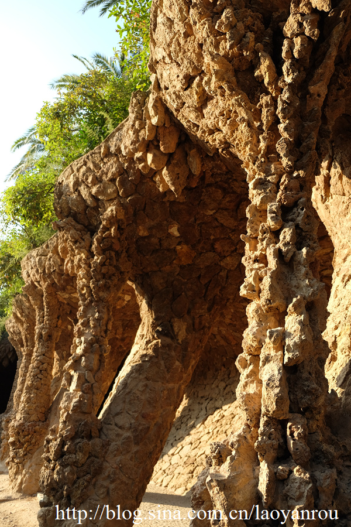  

斜柱长廊一角

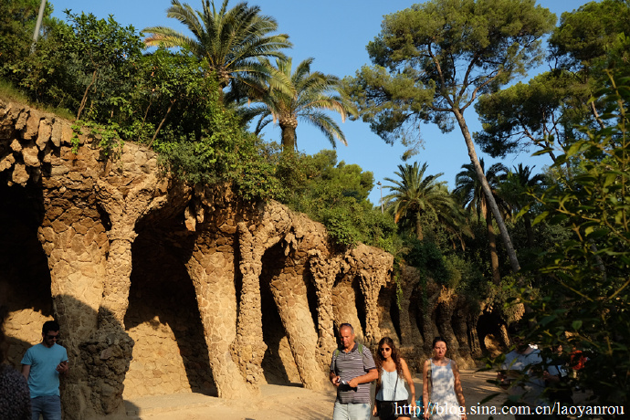  

斜柱长廊一角

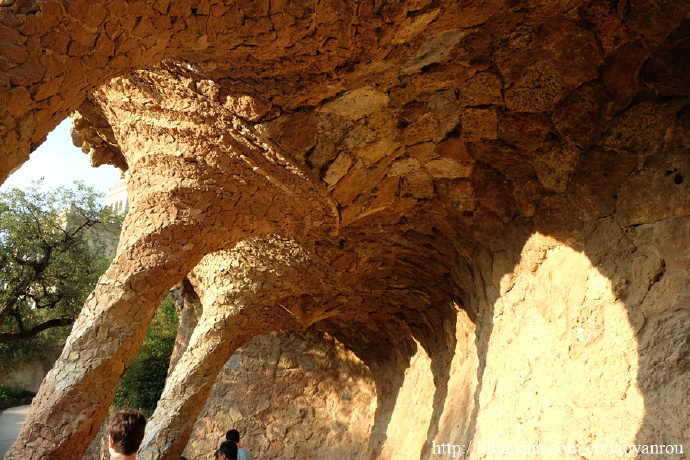  

斜柱长廊的陀螺柱

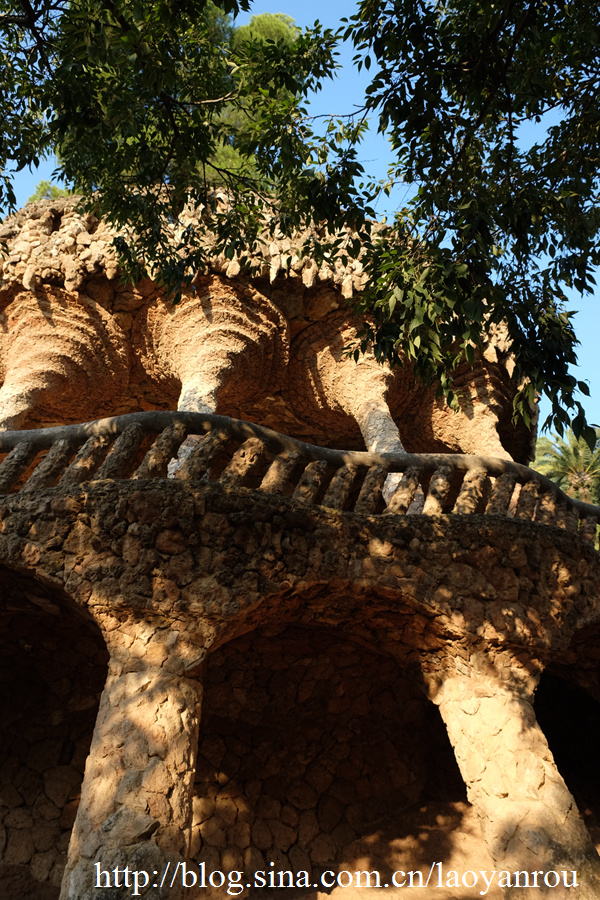  

斜柱长廊外星宫殿

初次与高大爷触电耗时不长，估摸着离午饭还有一段时间，我们便搭着公交车前往附近的圣保罗医院，原以为这只是高迪之旅的中间一段小插曲，但不曾想这家由加泰罗尼亚现代主义建筑师伊蒙塔内尔设计、建于1902-1930年的医院竟然完全颠覆了我对医院的固有印象和观感。

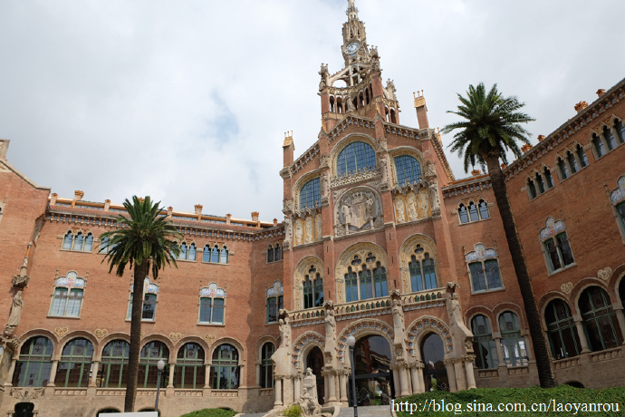  

圣保罗医院正门

首先从外部来说，不同于大多医院的单体楼或联体楼布局，圣保罗医院是由16栋极具伊斯兰风格的建筑分散组成。每栋建筑功能各异，建筑之间的空地设计成各式花园供病人休息散步所用，与其说是医院不如说是一座小型宫殿群更为恰当。
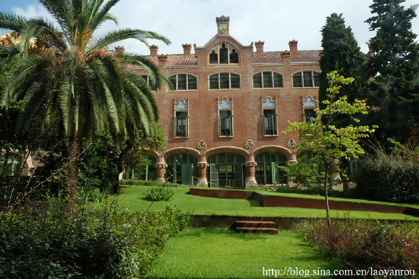  

医院花园一角

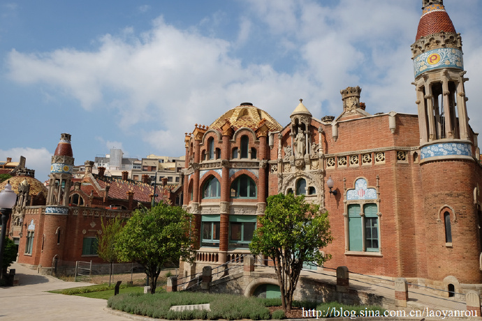  

医院建筑之一

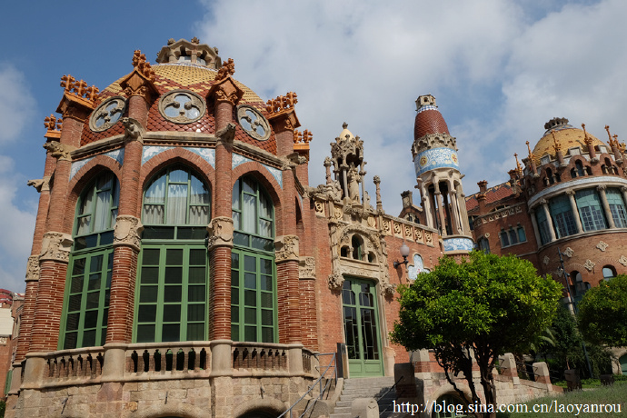  

医院建筑之二

其内部更是大有乾坤，整个医院16栋建筑的地下四通八达全都是地下通道，既便于在各种天气环境下安全转运行动不方便的病人，也不影响地面康复散心的病人心情，地下通道利用天井最大程度使用自然采光，丝毫不会给人以狭窄阴暗的地下封闭感，这种设计兼顾了院内各类病人的生理和心理需求，极具人性化理念。  
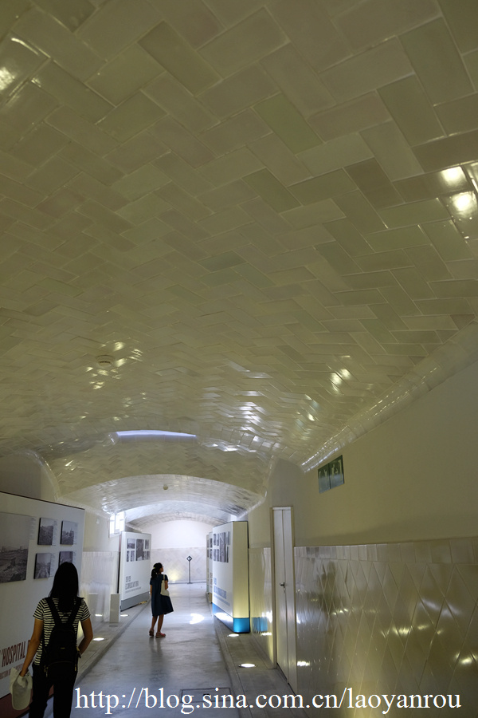  

医院地下通道

还有一点值得称道的是无论是地下通道还是住院病房，所有地板、墙壁甚至天花板都贴满了瓷砖瓷片，而且不像一般医院清一色单调的白色，所贴瓷片不单颜色丰富而且样式各异，医院大厅、走廊乃至病房天花顶上的瓷片装饰最为婀娜多姿、缤纷多彩，想必在这里住的病人如果天天被包围在童话般的瓷片王国里，即便是病入膏肓不能动弹，也不至于仰望枯燥无味的白色天花板而生无所恋，搞不好还能焕发一些生命的悸动。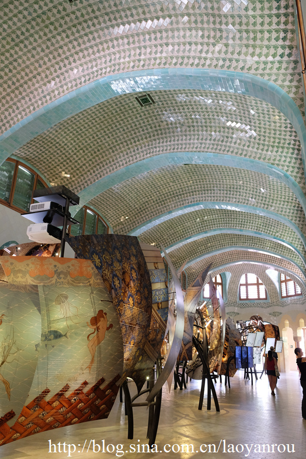  

波浪形瓷片天花

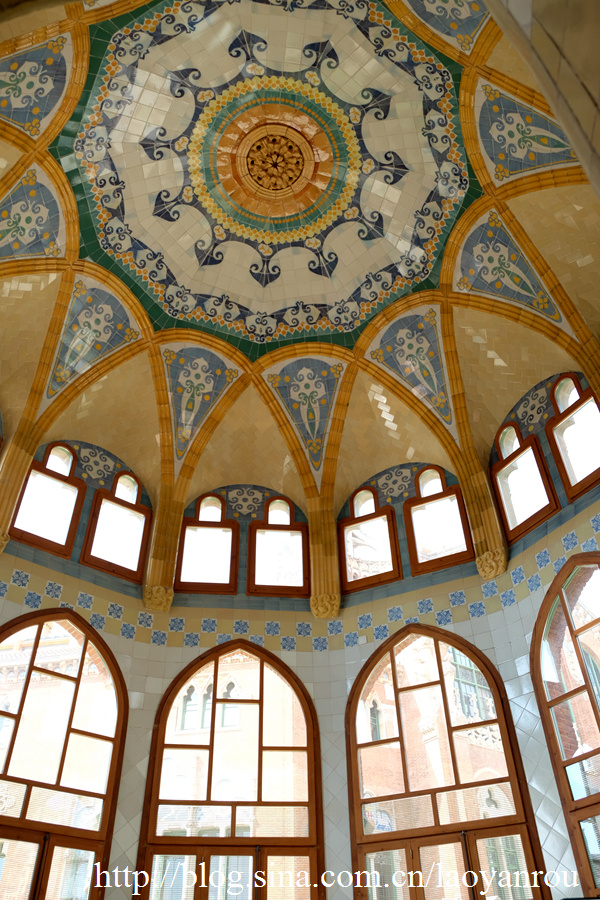  

伊斯兰风格瓷片天花

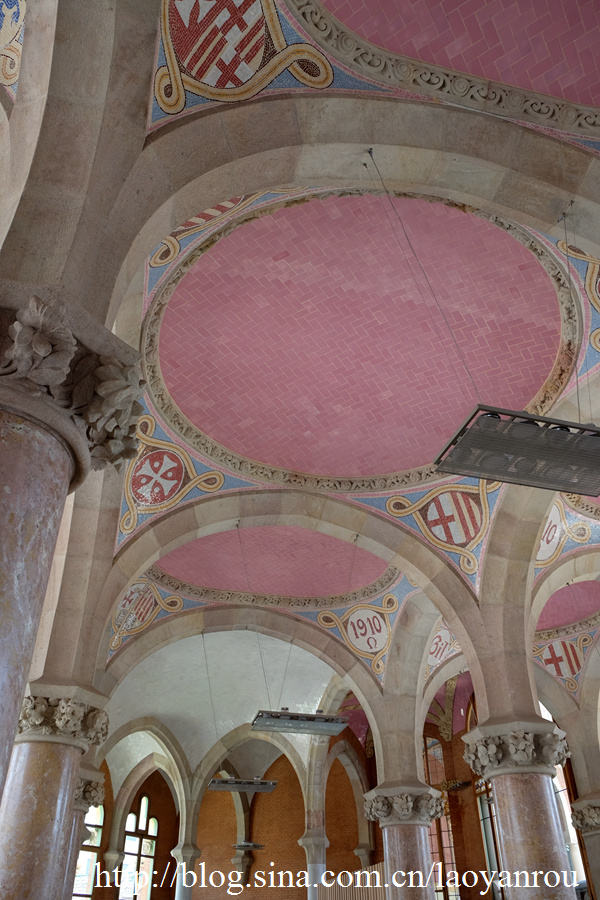  

少女粉色系瓷片天花

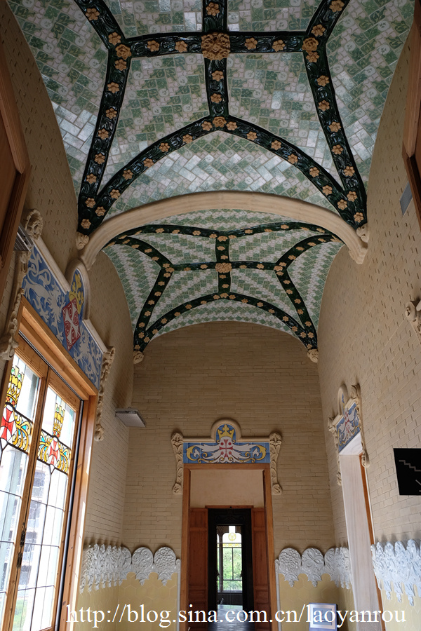  

走廊天花一

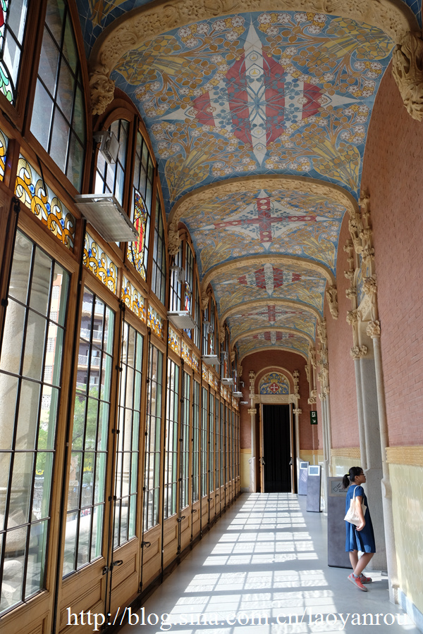  

走廊天花二

最令我印象深刻的，还有一处手术室的设计非常前卫大胆，整个手术室就建在小广场中心位置，正对着一楼花园，采用180度全景通透大玻璃与外界相隔，尽管设计师的初衷可能是为了令手术者放松心情，但我实在不敢想象在这里面一边做着手术一边被很多人围观的感觉会怎么样，只能说鱼和熊掌不可兼得，见仁见智吧！

“小插曲”奏完我们下午又回归到主旋律，从高大爷两座最经典的公寓楼“米兰之家”和“巴特略之家”挑选了后者作为参观对象，尽管如此我们还是忍不住在经过“米兰之家”是驻留了一小会，这栋公寓楼从外表来看仿佛几层灰白石头波浪此起彼伏，波浪间还溅起好几朵黑色的铁枝海带小浪花，实乃各个房间的阳台栏杆，好一幅波澜壮阔的海浪奏鸣五线谱啊！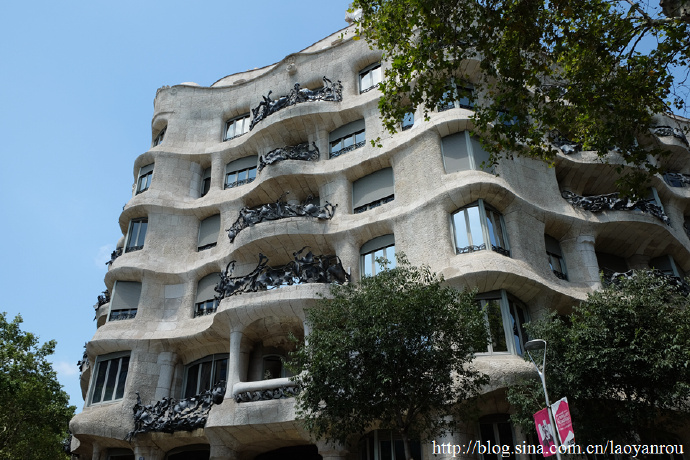  
  
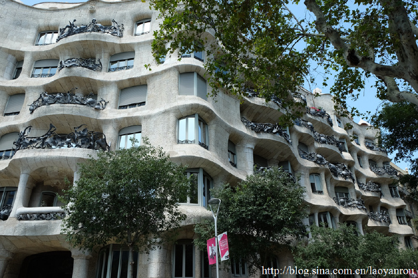

相对米兰之家，从外表来看巴特略之家的色彩元素更为丰富，一二层楼以灰黑色流淌的水泥柱为框架，蓝紫色的水晶玻璃为窗户，俨然一座水晶宫。而三楼至五楼的外墙则用蓝色、白色、绿色、褐色的各种马赛克瓷片镶嵌，点缀着很多类似海底气泡的马赛克圆盘，衬以鲨鱼头骨形状白色的阳台护栏，活生生一座生意盎然的海王龙宫。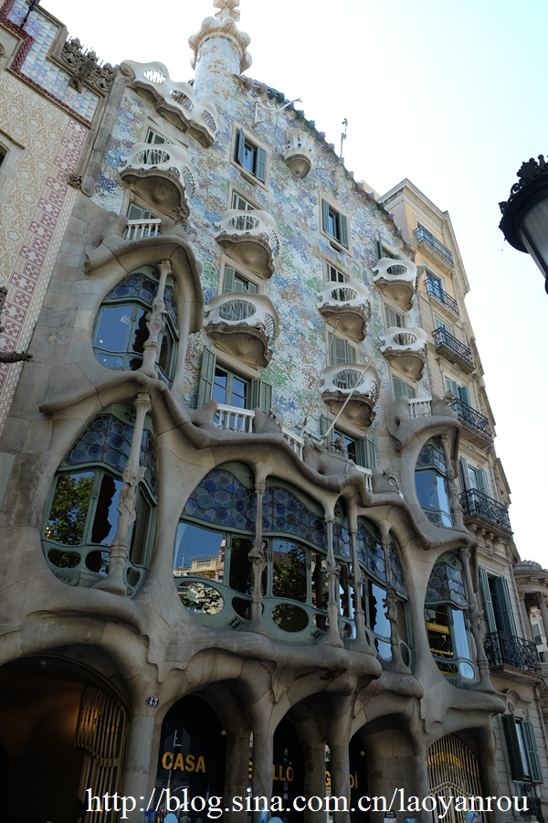

而当我们踏入长方形小块橡木拼接而成的木地板以后就难以看见方形甚至直线勾勒的物件了，楼梯底部侧面装饰着橡木做成的一条龙的脊梁骨，橡木楼梯扶手及门窗铜把手都是精心按人体工程学设计，曲线柔美，入手伏贴畅滑。所有的窗户和房门均设计为椭圆、圆形等等各种不规则形状，如此结构复杂、形状各异、毫无章法的木工活当年想必曾令不少木工师傅抓狂。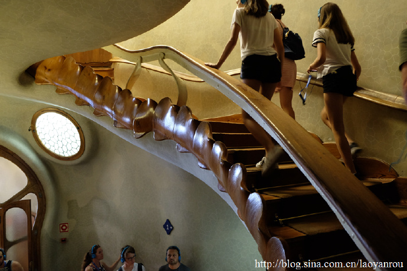

橡木龙脊骨楼梯

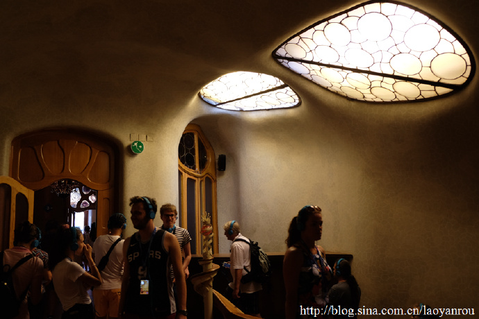  

泡泡天窗

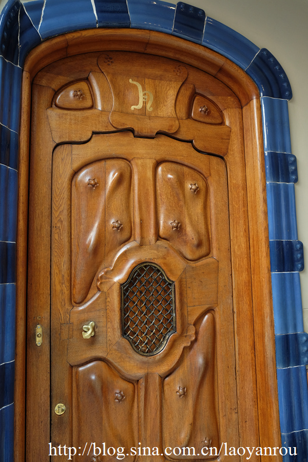  

凹凸有致橡木门

不单是门窗手艺复杂，张着大嘴的海蛇壁炉、画成鱼鳞状的墙壁、鲸鱼肋骨形状的拱柱、以及以令人窒息漩涡状汇聚于中心点缀着海葵型吊灯的巨型吊顶均令人目不暇接，远超常人想象范畴。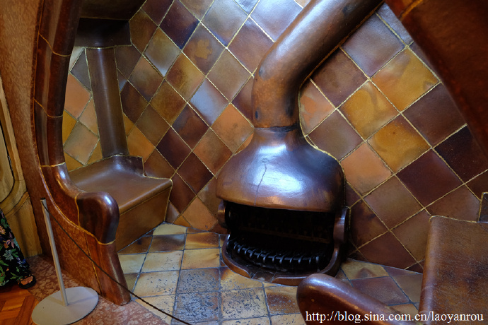  

海蛇壁炉

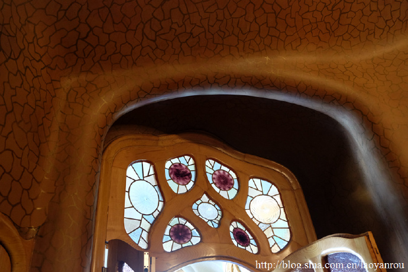  

鱼鳞墙壁

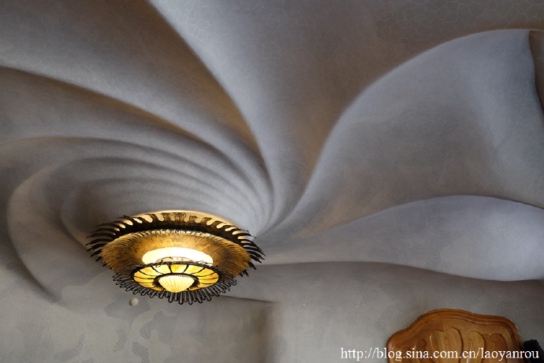  

海之漩涡天花板

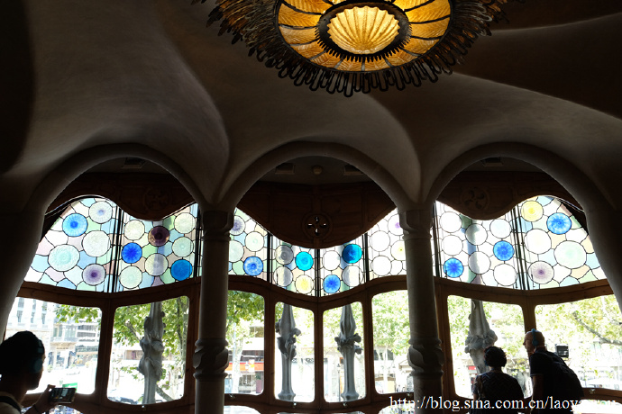  

水晶泡泡玻璃窗

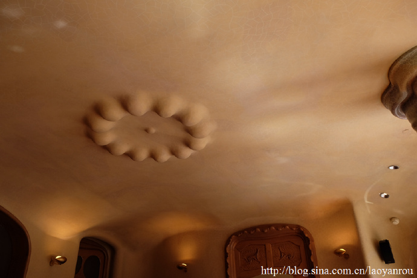  

海葵天花板

不单如此，连中央天井四周墙壁蓝白相间的瓷砖都自下而上设计成由浅而深、由疏到密，严格遵守透视学原理。高大爷的曲线强迫症还将楼顶阳台的烟囱化身为海底的火山口，屋脊变成橙色鱼脊的模样。整个公寓所有设计元素之新颖独特、巧妙大胆而又浑然天成，简直令人叹为观止。

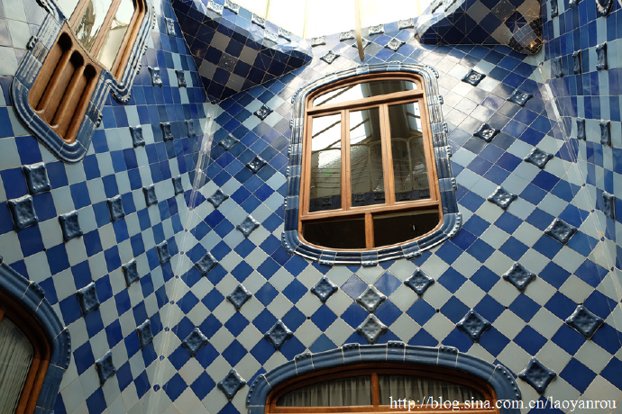  

天井渐变色瓷砖

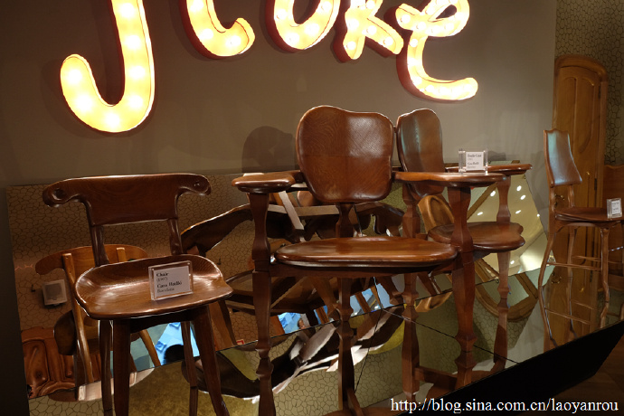  

高迪设计人体工程椅

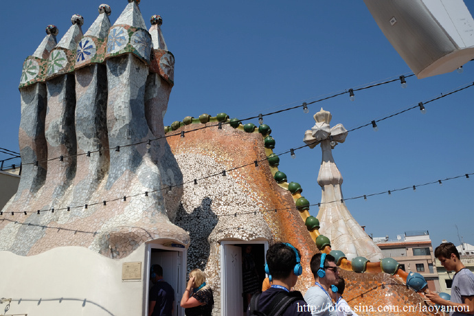  

海底火山烟囱

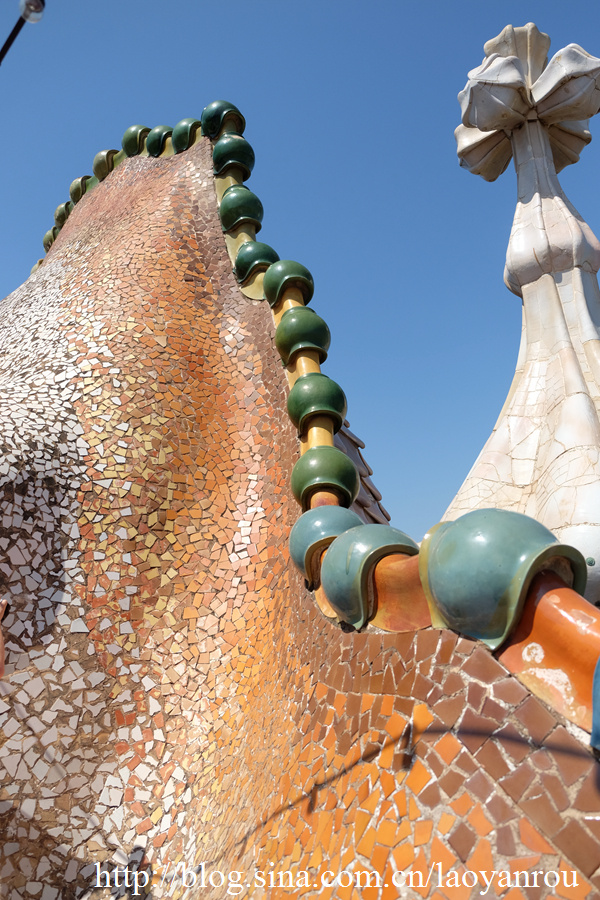  

鱼脊骨屋梁

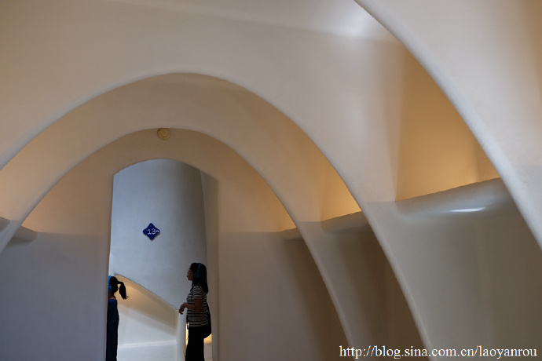  

鱼骨天花

离开巴特略之家，偶遇了加泰罗尼亚音乐厅，同样出自圣保罗医院设计师伊蒙塔内尔之手，两者都被列为了世界文化遗产。外部的浮雕及陶瓷马赛克拼贴依然秉承了圣保罗医院的风格，据说内部更加精致典雅，但因参观时间已过，只能从音乐厅迎宾大厅窥见一斑了。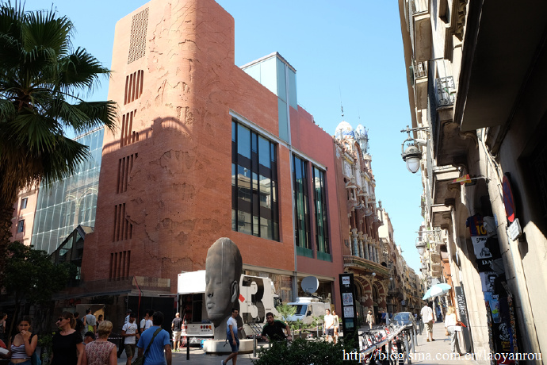  

加泰罗尼亚音乐厅街景

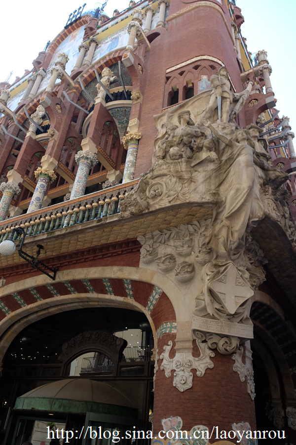  

音乐厅外立面装饰

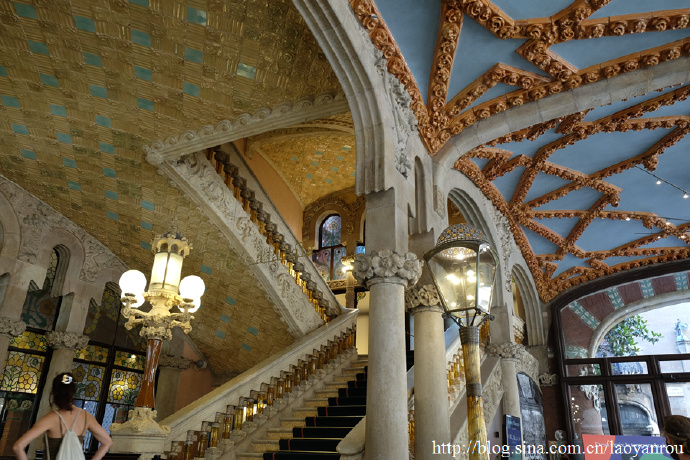  

音乐厅大堂装饰

趁着天色尚早，抱着试试看的心理，拥拥攘攘地排了一个小时队挤进了毕加索博物馆，这里主要展示了毕加索九岁到“蓝色时期”的作品，尽管笔法画工略微稚嫩，但其现代派艺术风格已初具雏形，结合晚年创作的以委拉斯凯兹的《宫娥》为原型的连载作品来看，可以清楚地看清其绘画技艺及风格日趋成熟的时间脉络。这位出生于西班牙南部马拉加的绘画天才同时也是思想进步人士，曾经和海明威、白求恩等以不同形式参加过国际纵队投入
“西班牙内战”对抗法西斯佛朗哥政权，内战失败后离开西班牙流亡法国，参加了法国共产党，却再也没有回到伤心地。所以尽管他艺术上取得了令人难以企及的成就，成为第一个活着看见自己作品被卢浮宫收藏的画家，但其政治抱负和信仰无法在祖国实现，成为其一生永远的遗憾，以至于不愿再次回到西班牙，面对曾经的失落和伤痛。
