# 欧游札记之火舞西班牙(Day4巴塞罗那—蒙特惠奇城堡—巴塞罗那历史博物馆—诺坎普球场)

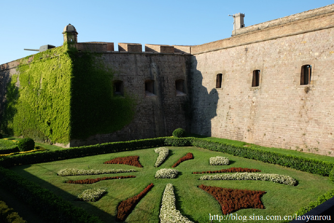  

蒙特惠奇城堡

Day4巴塞罗那—蒙特惠奇城堡—巴塞罗那历史博物馆—诺坎普球场

每到一个城市都想登高远眺，仿佛每次打仗都要占据制高点一样。位于巴塞罗那西南部的蒙特惠奇山恰好满足了我们的愿望。搭乘一部公交车穿过清晨的巴塞城区，沿着盘山公路蜿蜒而上，抵达了位于半山腰的终点站。放眼四周，郁郁葱葱的树木环伺，花草芬芳，山下的巴塞城区从树尖顶上羞答答地露出了一小块尊容。“欲穷千里目，更上一层楼”，本想偷点懒坐缆车登顶，不曾想未开始营业，唯有二话不说发动“11”路勇攀高峰了。登顶的路上我们并不孤独，还有一位亚洲女性游客也拿着手机导航一路同行，我们有时跟着她走，有时跟着自己的手机，最终大家殊途同归在山顶的蒙特惠奇城堡成功会师。

吭哧吭哧爬了半天，结果发现早起的鸟儿不一定有食吃，时间太早城堡尚未开放。不过话又说回来了即使开放我们也不一定进去参观，毕竟一个军事防御堡垒可看点并不多。但是城堡的外部倒是颇有一点特色，黄灰色石块砌成的城墙上爬满了绿色的藤蔓，浓得化不开的绿植覆盖了一大片城墙，只露出几个深藏功与名的防御枪炮口，而原先城墙外用于防御的壕沟则摇身变成了精心设计的欧式花园，如若不是城墙上架起的铁炮自我标榜一下的话，游客们还可能误以为这是巴塞哪位达官贵族建在山顶的宫殿。

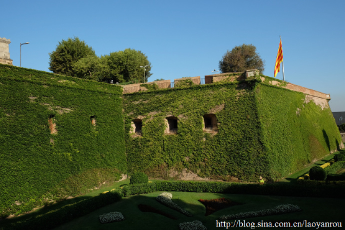  

蒙特惠奇城堡护城河

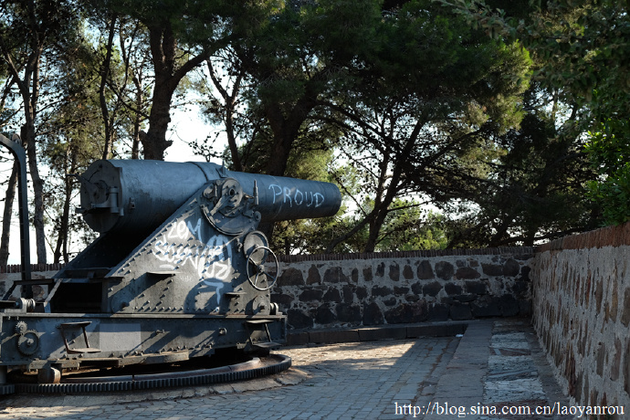  

城堡大炮

既然城堡是无缘一进了，我们便沿着城堡外围在蒙特惠奇山顶好好地绕了一大圈。移步换景地一溜下来，朝着海的那一面瞅见了巴塞作为西班牙乃至欧洲最重要的港口的标志—庞大货运吞吐量的集装箱码头港口以及配套的油气化工仓库等（虽然港口的工业味和化工味着实不咋地）。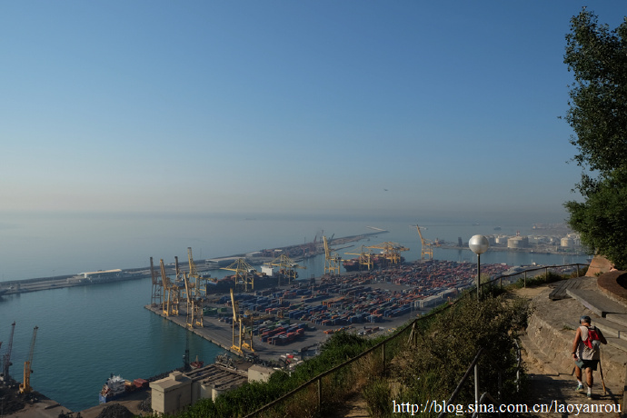  

巴塞罗那港口

背海一面即可俯瞰包括圣家堂在内的老城及其周边延伸至远方山脉的整个雄伟壮阔的大巴塞罗那地区，足见其作为加泰罗尼亚首府、西班牙第二大城市、伊比利亚半岛明珠的美誉的确名副其实。

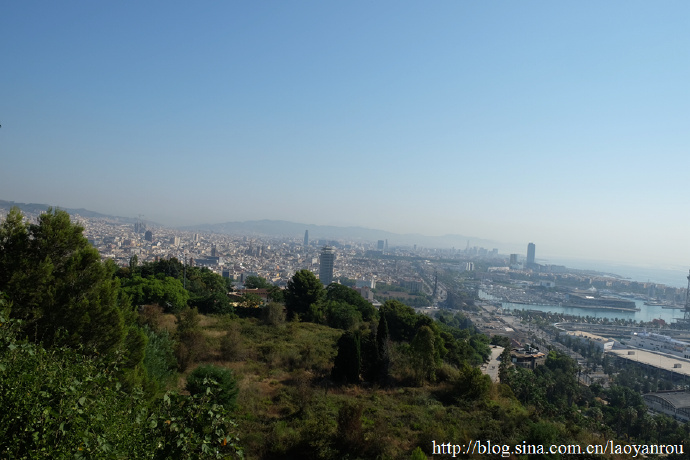  

山顶俯瞰巴塞罗那

如果还想换个角度欣赏巴塞，就可以像我们一样从山顶往下走一小段后搭乘吊篮缆车从蒙特惠奇山跨海下行到旧港对面的巴塞洛内塔海岸，随着缆车的视角逐渐从高到低地转换，巴塞城和旧港的旖旎风光如同放映风光大片般历历眼前，美不胜收，与置身其中相比，从上帝视角放眼巴塞、俯瞰众生着实别有一番风味。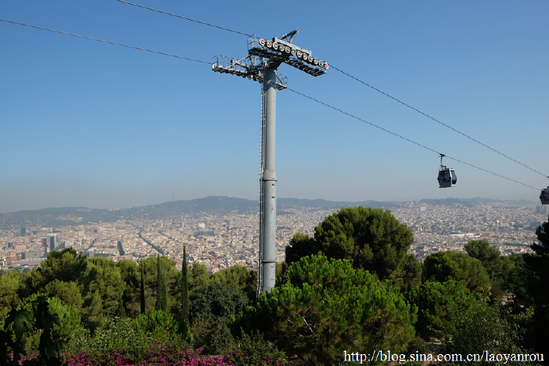  

蒙特惠奇山缆车

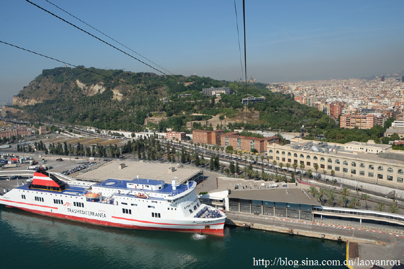  

缆车下行观景

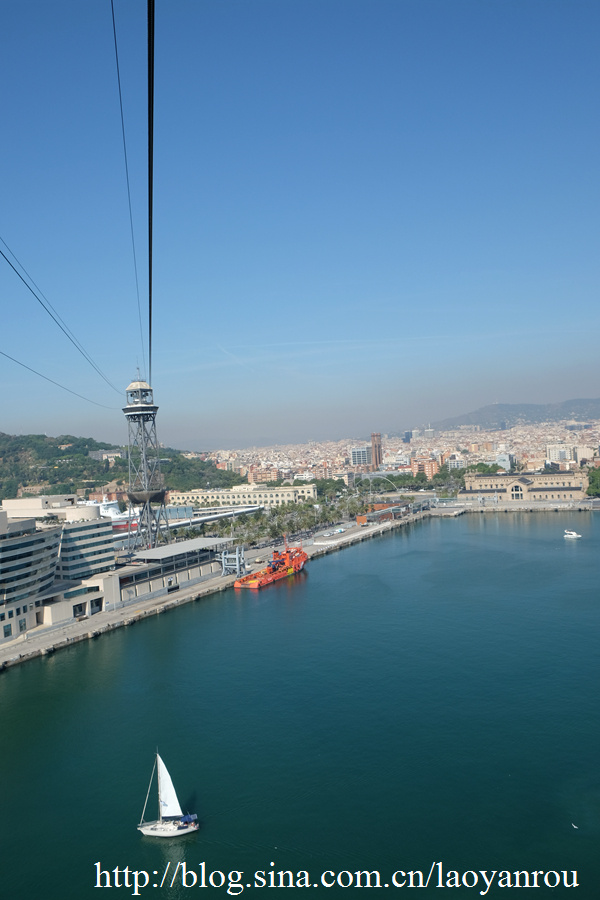  
  

乍看上去，巴塞洛内塔的海滩沙子比不上海南三亚的细腻白净，游人密集度也是难以企及项背。但好就好在对于西班牙第二大城来说，有那么一处可供市民轻松自在地休憩戏水的场所也算是难能可贵的了。令人意外惊喜的是，海滩边一家意大利冰淇淋店竟然是中国人开的，老板娘分外热情地招呼小女大快朵颐了一把，还拉住我们扯了好些家常，估计国人来此旅游帮衬生意的一定不少了。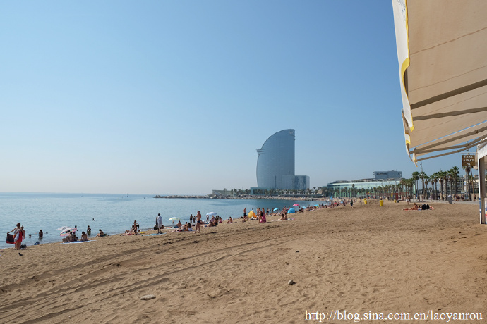

巴塞洛内塔海滩

巴塞罗那历史博物馆就夹在旧港和巴塞洛内塔之间，从外观上看仿佛只是几栋红砖结构的仓库，其实里面还算是有一些比较另类的收藏品的，比如一架黄铜制成的女神执花台灯，花心就是三个白炽灯泡。高大爷设计的几个橡木椅子，曲线玲珑婀娜，与巴特略之家设计风格及其相似。还有两套分别反映三、四十年代与七、八十年代的巴塞罗那普通家庭的厨房用品，包括锅碗盘瓢、烤炉冰箱灶台水槽桌子等等一应俱全，可以看出时代变迁对于巴塞普通家庭生活起居的巨大影响。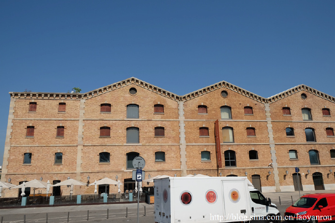

历史博物馆外景

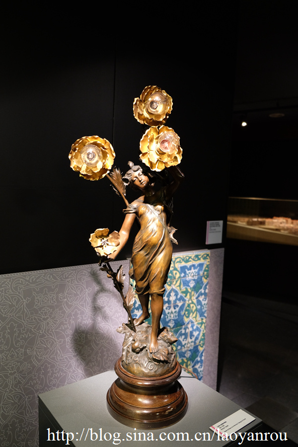  
  
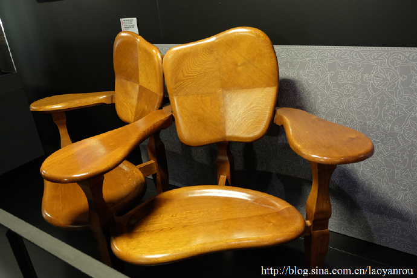  

高迪椅子

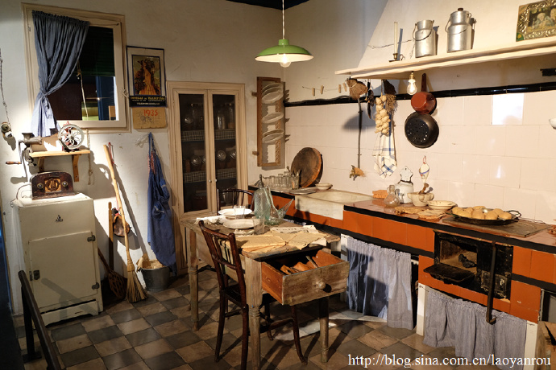  

三、四十年代巴塞民居

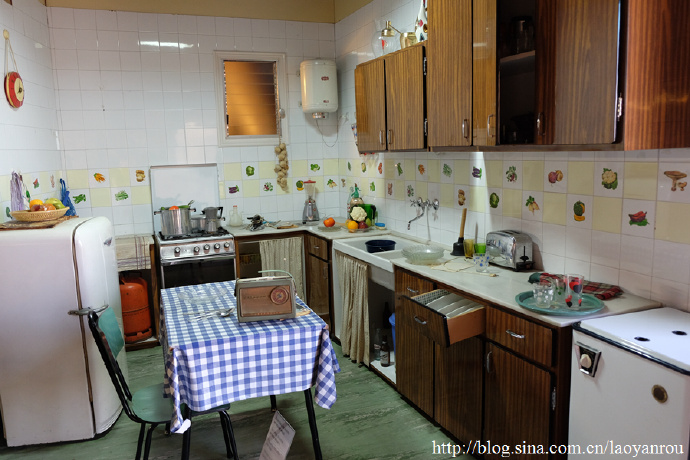  

七、八十年代巴塞民居

尽管不是巴塞罗那队的粉丝，甚至连球迷都不是，但梅西的鼎鼎大名还是把我们引到了巴塞的主场—诺坎普球场。不曾想这里俨然已经变成了一个旅游景点，人头攒动的游客和球迷、琳琅满目的纪念品商店、随处可见的梅西大幅画像，把整个诺坎普及其周边区域变成了巴塞队粉丝的朝圣之地。在AMY的一再撺掇下，我们入乡随俗地买了几件巴塞队的纪念品，围巾水杯之类的，也算是为巴塞罗那略尽绵薄之力了。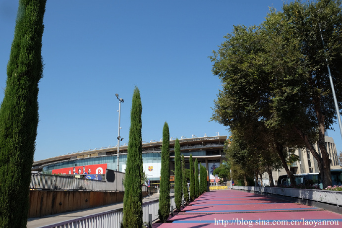  
  
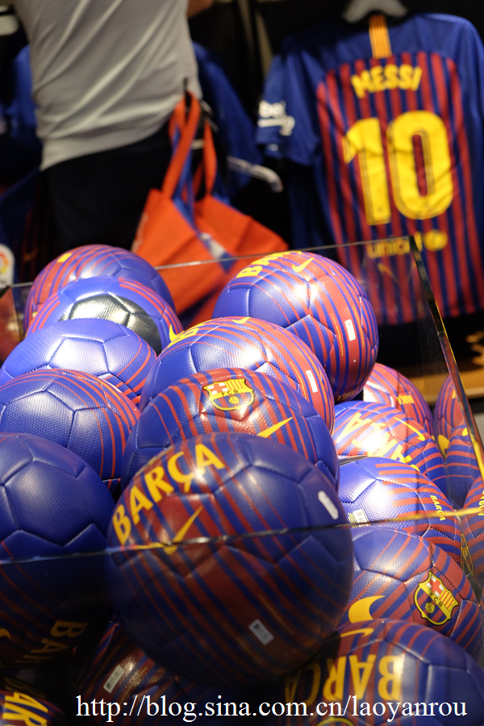  
  
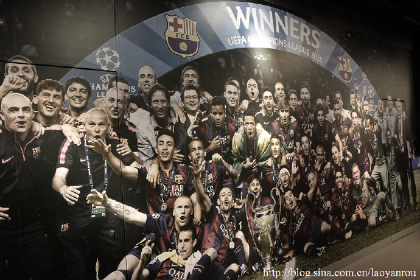
