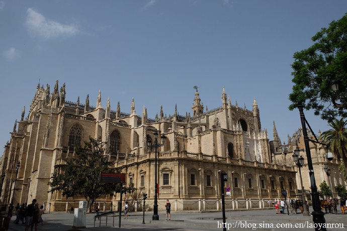
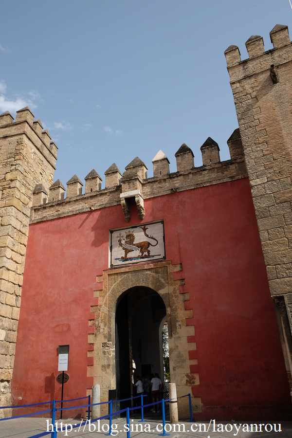
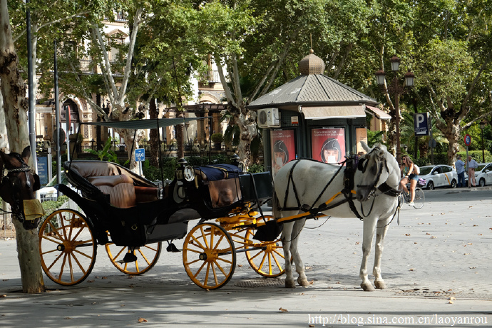
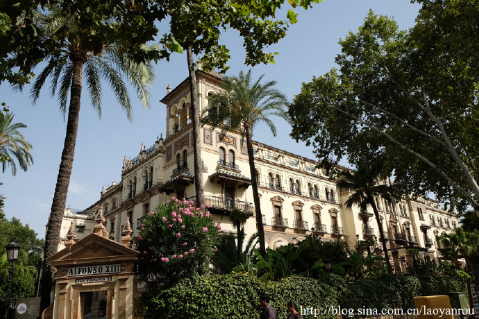
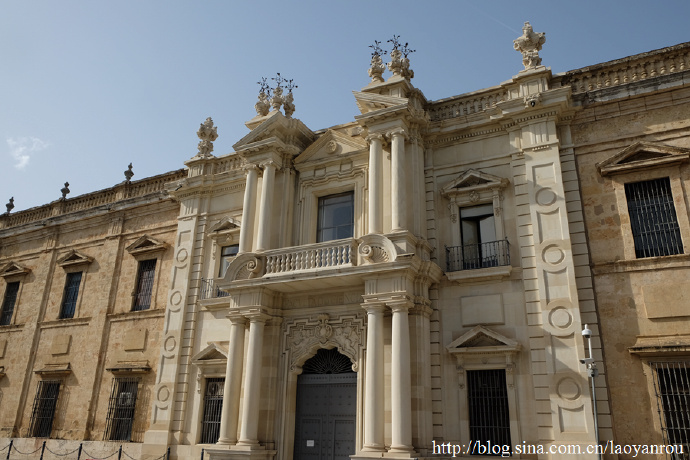
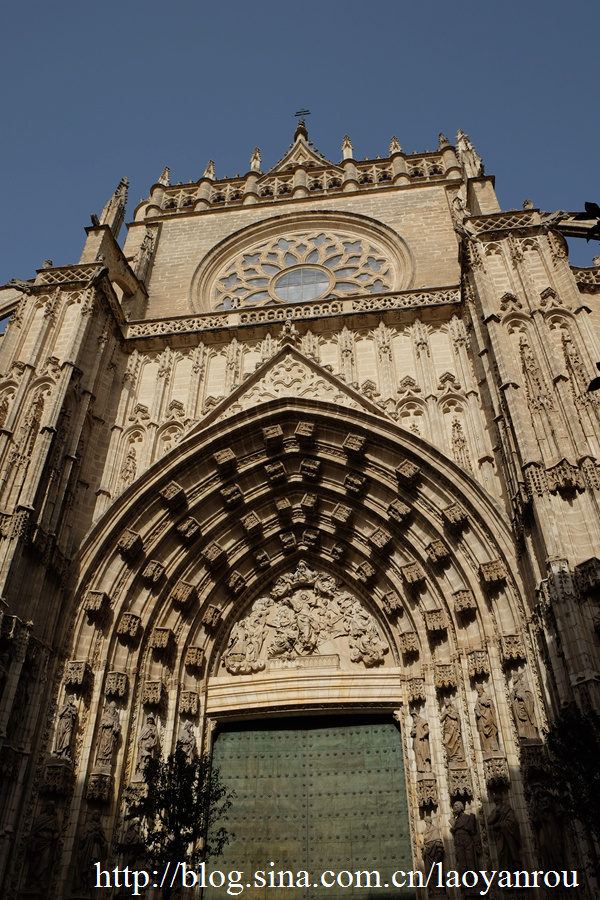
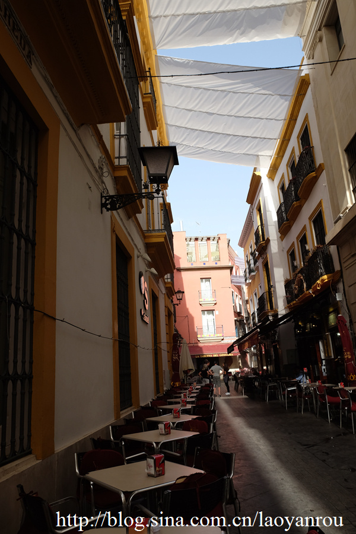

# 欧游札记之火舞西班牙(Day5塞维利亚—闲逛)

  
塞维利亚主教堂  
Day5塞维利亚—闲逛

初到塞维利亚正值晌午时分，刚下火车便深刻体验了塞维利亚的“热情似火”，简直仿佛来到了吐鲁番火焰山，阵阵高达40多度的热浪裹挟而来，令人窒息的温度差点让我们打道回府。一早听说这里热，但没想到竟然这么热，远超出我们的想象，但有一点比较令人欣慰的，就是不管再热，身上竟然一滴汗都不淌，想必是是气候干燥的缘故吧！说到气候还不得不承认这里的气候与隔海相望的北非倒是极为相似，炎热、干燥、少雨，恐怕正是当年的摩尔人也即是阿拉伯人横渡直布罗陀海峡入侵西班牙后，对塞尔维亚所在的安达卢西亚地区情有独钟的原因吧！摩尔人这一流连忘返乐不思蜀，从公元8世纪开始一直延绵不绝了近800多年，直到15世纪初西班牙收复失地运动后无可奈何花落去，却从此给西班牙留下了灿烂的伊斯兰文明印记，形成了伊斯兰文化与基督教文化前赴后继相互融合的独特人文风景。

等安顿下来，稍事休息恰好避过了炎炎烈日的炙烤，我们打算四周闲逛一下，先熟悉一下环境和主要景点的位置，为后续参观做点功课。于是顶着热浪来到了塞维利亚城区中心，映入眼帘的塞维利亚大教堂建筑与西班牙北部的哥特式教堂总感觉似曾相识但又总感觉有点不对味，具体区别一时半会还说不上来。而旁边的塞维利亚王宫朱红色的宫门上立着一头雄狮的皇室徽记，城墙上的城垛子也不像欧式风格。而王宫后的阿方索八世酒店的阿拉伯风味就更浓厚了，配上几株棕榈树绝对能让人产生时空错位感，误以为已穿越到迪拜或是多哈了。倒是酒店旁的塞维利亚大学建筑风格中规中矩，妥妥的典型欧派风格。

塞维利亚主教堂

  

塞维利亚王宫大门

  

西班牙广场外的游览马车

  

阿方索八世酒店

  

塞维利亚大学

  

主教堂大门

一大圈逛下来热是热了点，但滴汗未出，堪称神奇。估计也得归功于塞维利亚街道上空飞跨两侧房屋的遮阳布帘，白色长条形的巨布交错往复，除了缝隙中偶尔泄下的几缕阳光以外，基本将整条街道遮得严严实实，在炎热的夏季为塞维利亚的居民和游客送去了几分清凉，自身也成为了一道独特亮丽的街道风景线。

  

街道上的露天餐馆及遮阳帘
