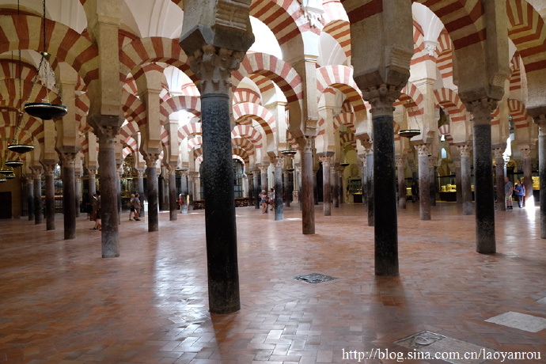
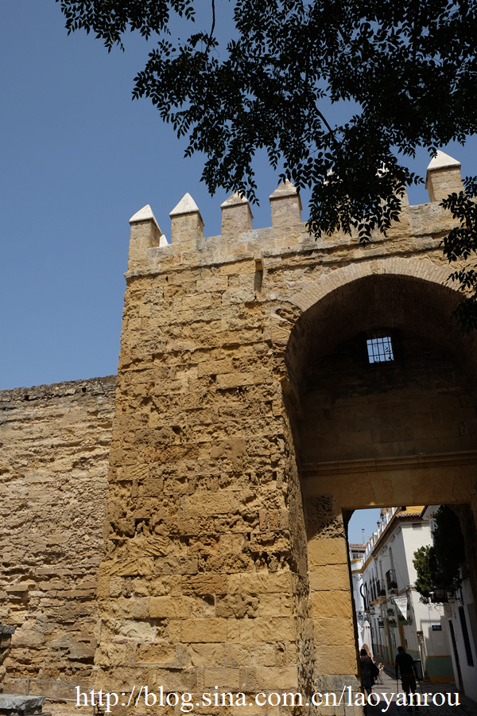
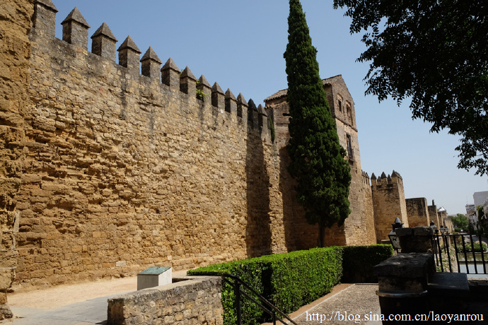

# 欧游札记之火舞西班牙（Day10科尔多瓦——大清真寺）

科尔多瓦大清真寺

Day10 科尔多瓦——大清真寺

距格拉纳达仅两个半小时车程的安达卢西亚第三大城市—科尔多瓦，也曾有过辉煌的过去。自伊斯兰人攻入伊比利亚半岛开始以此为都，到倭马亚王朝最后一个国王定都于此建立了西哈里发帝国，再到被基督徒逐出半岛，科尔多瓦在伊斯兰人统治下经历了五百多年的蓬勃发展和衰落，其繁荣程度曾堪与东罗马帝国君士坦丁堡相媲美，最鼎盛时市内共建有300多座清真寺，而其中最出名的便是科尔多瓦大清真寺。

作为我们科尔多瓦之行最重要的目的之一，即便是大清真寺坐落于瓜达尔基维尔河岸边，离我们所住的万豪酒店大概要步行半个小时左右，我们也无怨无悔地顶着安达卢西亚下午的炎炎烈日蹒跚前行，不巧的是路边除了几株松树外无遮无挡，直至抵达了老城城墙的时候终于看见了一些喷泉和绿树，这是一处典型的阿拉伯风格城墙，墙体由凿得方方正正的巨石堆砌而成，墙头不高约莫有6、7米左右，墙上面和城门的的垛口均呈金字塔尖的烟囱型，尽管不少墙体的石头已经因受外力攻击或剥蚀而凹陷不平，但仍显得非常坚实可靠，屹立不倒。

老城城门

老城城墙

等穿过城门进入老城里便发现伊斯兰文化即便是经历了几百年基督教文化的冲刷依然保留了非常多的痕迹，民居风格与阿尔拜辛区几乎如出一辙，清一水的白色墙壁被刷成蓝色、橘黄色、褚红色的门框和窗框装点得如油画一般，穆德哈尔式的遮阳草帘慵懒地耷拉在阳台上方，四周挂满了绿褐色相间的藤蔓，磨得锃亮的石头小巷中除了个别小店在炎炎夏日下正常开门营业外，大多均闭门谢客或门可罗雀。

老城街道

远处的清真寺钟塔

遮阳草帘

穿过色彩缤纷的老城街道，来到清真寺外围，满眼立刻被外墙和钟塔的土黄色所满屏了，斑驳不一、新旧相间、灰黄交错的寺墙默默地诉说着清真寺坎坷的过去，墙头是一长溜的形似十字架的花朵栏杆，大门依然是熟悉的典型半圆拱形的伊斯兰风格，但本应四门洞开、八方敞亮的寺庙却被天主教徒封死了大多门口，只留下入口的五处大门。一踏进清真寺，中庭却丝毫没有印象中应有的模样，只见成行成列的橘树密布院中，郁郁葱葱，零星金黄色的橘子挂在枝头上随风摇曳，中庭正中清冽透彻的喷泉水池边围满了避暑纳凉的游客，令人仿佛穿越到了某个阿拉伯宫殿的后花园。

清真寺大门

清真寺中庭橘园

令人震撼的还在后头，踏入大教堂举目四望，数以千计的白色、黑色、褚红色罗马式大理石柱由近及远、密密麻麻地撑起了整座庞大的教堂屋顶，被誉为“圆柱森林”确实名副其实。而石柱之间的半圆形拱门设计更是令人惊艳，全部由白色大理石和红砖楔接而成，呈现出半环型红白相间的单层或双层的拱券样式，如此别致样式设计据我所知，独此一家别无分号。层层递进的红白拱门和支撑其下的大理石柱森林组成了一件极其庞大、几何规整、极具透视感和视觉冲击力的建筑艺术巨作，想必从古至今绝对吸引了无数建设学家和游客们的眼球和菲林。

石柱森林

更为难得的是，如此伊斯兰风格的主体建筑在被天主教徒局部改建为教堂以后竟然还能完整保存下来，甚至还与哥特式和文艺复兴风格的祭坛融合在同一座建筑中，有些礼拜堂中间是白色的哥特石柱，四周则是阿拉伯石柱，下半部是伊斯兰拱门，而上半部却是哥特式或文艺复兴式的穹顶，左边是一个灰雕穹顶的伊斯兰祈祷厅，一墙之隔就是另一个天主教的礼拜堂。

天主教礼拜堂

穆德哈尔式天花

文艺复兴风格礼拜堂

天主教祭台与阿拉伯石柱

清真礼拜堂穹顶

清真祭坛

清真礼拜堂

巴洛克风格礼拜堂

阿拉伯石柱与哥特穹顶

阳光从四周巨型落地窗的阿拉伯格栅投进教堂，与金碧辉煌的天主教圣人祭坛交相辉映，丝毫感觉不到违和感，反倒是觉得这两种原本水火不相容、争斗了N多世纪的宗教文化在科尔多瓦竟然能如此和谐互补、各美其美，简直是建筑文化史上的一个奇迹！而实现如此融合要归功于历代西班牙天主教国王的极高的文化包容和艺术素养，真正践行了“艺术无国界无宗教”的理念，从清真寺修复前的历史照片可以看出当时清真寺已经十分破败不堪，地面下陷了近一米多深，根本没有今天漂亮的红色水磨石地砖，仅剩下部分大理石柱和拱门摇摇欲坠，完全可以推倒重建。但当时卡尔洛斯五世等国王并未这么做，而是尽可能原样修复了摩尔人清真寺的主体建筑，然后在中间改建了部分为天主教礼拜堂，再按此混搭风格逐年扩建，使得摩尔艺术与欧洲艺术能得以在同一座建筑中融合共存，确实是前无古人后无来者。

清真寺内部修复前照片

清真寺旧天花木板

其实和基督教、伊斯兰教同宗同源的还有犹太教，在大清真寺附近就有犹太人区，当年也是在收复失地运动后，向来不受欧洲人待见的犹太人被一纸犹太人驱逐令赶出了科尔多瓦，只留下了一栋栋类似伊斯兰风格的白色犹太式民居，据说中间有一条“花间小路”也叫“百花巷”的小有名气，我们也慕名前去蹭了点热度，说实话亮点不多，一条狭窄得仅能两人并排前行的小巷被两侧白色的犹太民居夹在其中，两侧民居白色的墙壁上一长溜过地挂满了开满鲜花的花盆，从巷头望向巷尾颇有点百花齐放夹道欢迎的气势，故此命名为“百花巷”，估计是网红打卡点的缘故，接踵摩肩的游客在巷子里面来回穿梭，我们大部分时间只顾着看路，倒也没觉着小巷有多么的靓丽，姑且只能认为是科尔多瓦为吸引游客而想出的一点小噱头罢了。

犹太区百花巷

与之相比来说，倒是瓜达尔基维尔河上的古罗马桥还值得一看，从清真寺边上的河堤望过去，夕阳下的古罗马桥横跨过缓缓流动、浅可见底的瓜河，巨大的圆柱头船形桥墩支撑着近十个桥拱向对岸延伸，尽管历经岁月洗礼，桥身和桥墩的石块大多已经斑驳变色，但依然无法掩盖其曾经强壮的身躯和历史的荣光。此时回望大清真寺方向，只见红黄色两幢重新装修过崭新的摩尔人别墅隐藏在旁边一座巨型残旧的阿拉伯建筑阴影中，广场纪念柱顶端的天主教圣人低头凝视着穆德哈尔式的寺庙大门，新旧相对，基督教与伊斯兰教相交，丝毫感觉不到任何别扭和冲突，世界大同矣！

古罗马桥

红与黄、新与旧

圣徒雕像守望清真寺

夕照下的清真寺外墙

钟塔夕阳

街边卖艺的吉他老汉

屹立不倒的清真塔
